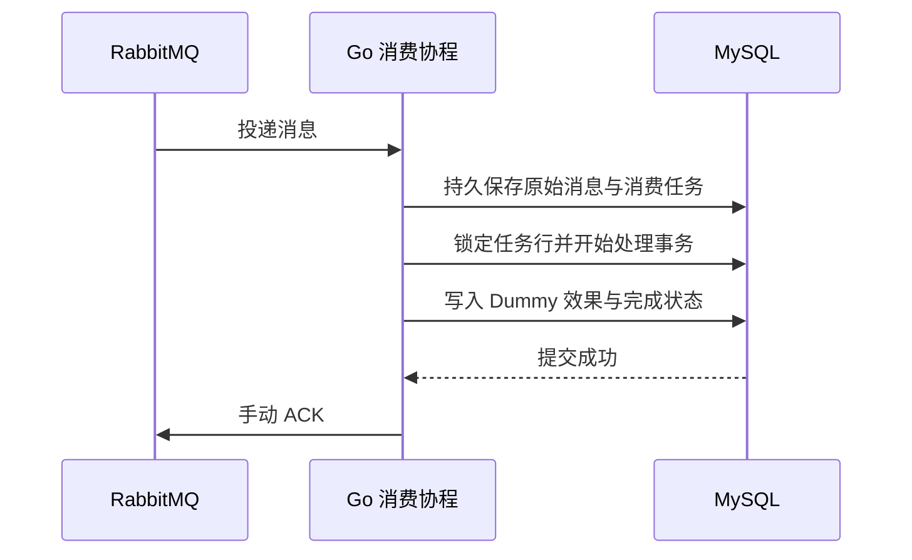

# NoteX HTTP 接口

本文描述当前的账号、会话、关注关系、帖子与 SQL Feed 接口。请求示例使用本机默认地址 `http://127.0.0.1:8080`。
项目采用纯后端交付方式，接口通过脚本验证。

该文档应随开发进程渐进式更新。

## 通用约定

- 业务接口前缀为 `/api/v1`，健康检查位于根路径。
- 注册、登录使用 JSON 请求体，并设置 `Content-Type: application/json`。
- 业务请求体上限为 4096 字节。超过限制或 JSON 解析失败时，当前实现返回 `400 invalid_input`。
- 业务请求设置 5 秒 Context 超时，数据库操作继承此超时。
- 除注册、登录及健康检查外，所有接口要求 `Authorization: Bearer <token>`。
- ID 是正整数。时间字段均为 Unix 秒。
- 成功响应直接返回对象，错误响应统一为 `{"error":"错误代码"}`。
- 登录响应及通过认证的业务响应设置 `Cache-Control: no-store`。

### 对象定义

用户对象如下。

```json
{"id":42,"username":"alice","created_on":1794618000}
```

关系列表中的对象如下。

```json
{"id":105,"user_id":8,"username":"bob","created_on":1794618100}
```

这里的 `id` 是关系 ID，`user_id` 是列表中另一位用户的 ID，`created_on` 是关系建立时间。
关注列表展示被关注者，粉丝列表展示关注者。

## 接口清单

| 方法 | 路径 | 认证 | 成功状态 |
|---|---|---|---|
| GET | `/healthz` | 公开 | 200 |
| GET | `/readyz` | 公开 | 200 |
| POST | `/api/v1/register` | 公开 | 201 |
| POST | `/api/v1/login` | 公开 | 200 |
| POST | `/api/v1/logout` | Bearer | 200 |
| GET | `/api/v1/me` | Bearer | 200 |
| GET | `/api/v1/users?username=alice` | Bearer | 200 |
| PUT | `/api/v1/users/:id/follow` | Bearer | 200 |
| DELETE | `/api/v1/users/:id/follow` | Bearer | 200 |
| GET | `/api/v1/users/:id/follow` | Bearer | 200 |
| GET | `/api/v1/users/:id/following` | Bearer | 200 |
| GET | `/api/v1/users/:id/followers` | Bearer | 200 |
| POST | `/api/v1/posts` | Bearer | 201 |
| GET | `/api/v1/posts/:id` | Bearer | 200 |
| DELETE | `/api/v1/posts/:id` | Bearer | 200 |
| GET | `/api/v1/users/:id/posts` | Bearer | 200 |
| GET | `/api/v1/feed` | Bearer | 200 |

## 健康检查

`GET /healthz` 检查 HTTP 进程存活，返回 `200 {"status":"ok"}`。

`GET /readyz` 在 1 秒期限内检查 MySQL 连接，可连接时返回 `200 {"status":"ready"}`，
失败时返回 `503 {"status":"unavailable"}`。该接口检查连接状态，业务表完整性由迁移与接口验证确认。

## 注册与登录

### POST /api/v1/register

```json
{"username":"alice","password":"local-demo-password"}
```

用户名允许 3～32 个 ASCII 字母、数字或下划线，大小写敏感。密码长度为 8～72 个 UTF-8 字节。
服务端保留输入原值。成功返回 201 和用户对象，随后可调用登录接口。

参数不合法返回 `400 invalid_input`，用户名重复返回 `409 username_taken`。
数据库保存 bcrypt 密码哈希。

### POST /api/v1/login

请求体与注册相同。成功响应如下。

```json
{
  "user":{"id":42,"username":"alice","created_on":1794618000},
  "token":"64个十六进制字符组成的随机令牌",
  "expires_on":1794704400
}
```

令牌有效期为 24 小时，数据库保存其 SHA-256 摘要及用户关联。会话持久化后可跨应用重启使用。
每次登录产生独立令牌。用户不存在、密码错误或凭据格式不符合登录要求时返回 `401 unauthorized`。
缺失必填字段或 JSON 解析失败返回 `400 invalid_input`。

### POST /api/v1/logout

携带当前 Bearer 令牌，请求体可为空。服务端删除当前会话，返回 `200 {"status":"ok"}`。
其他登录令牌继续有效。再次使用已撤销令牌请求任何受保护接口，包括退出接口，会返回 `401 unauthorized`。

### GET /api/v1/me

返回当前令牌对应的用户对象。

## 查找用户

### GET /api/v1/users?username=alice

`username` 必填，按大小写敏感的准确用户名匹配。成功返回用户对象。
输入格式不合法返回 `400 invalid_input`，符合格式但不存在的用户名返回 `404 user_not_found`。

## 关注、取关及关系判断

路径中的 `:id` 指目标用户，操作发起者由服务端认证结果确定。

### PUT /api/v1/users/:id/follow

请求体可为空。成功返回如下结果。

```json
{"is_following":true}
```

首次关注插入关系。重复关注返回 200，保留原关系 ID 和建立时间。
不合法 ID 或关注自己返回 `400 invalid_input`，目标用户不存在返回 `404 user_not_found`。
唯一约束保证同一用户对最多一条有效关系。

### DELETE /api/v1/users/:id/follow

请求体可为空。成功返回 `200 {"is_following":false}`。
取关物理删除关系，删除零行仍返回成功，因此重复取关及对不存在的正整数目标 ID 取关都返回 200。
不合法 ID 或对自己取关返回 `400 invalid_input`。重新关注产生新的关系 ID，并记录本次建立时间。

### GET /api/v1/users/:id/follow

返回 `200 {"is_following":true}` 或 `200 {"is_following":false}`。
目标用户不存在返回 `404 user_not_found`，不合法 ID 返回 `400 invalid_input`。
查询自己通常返回 `false`，写接口禁止自关注。

并发关注与取关按数据库实际执行情况收敛。旧关注请求在一次取关之后重新执行，会再次建立关系。
当前接口使用状态设置语义，操作版本与请求标识去重属于后续需求决策。
关系变更与 Outbox 事件在同一个事务中提交。重复关注或删除零行的取关沿用成功响应。
关注和取关的事务遇到 MySQL 1213 死锁错误时，最多尝试 5 次，等待间隔为 5、10、20、40 毫秒。
每次尝试都重新开启事务，重做关系变更及其事件写入。
等待响应请求取消，重试耗尽返回 `503 relationship_busy`。

## 关注列表与粉丝列表

- `GET /api/v1/users/:id/following` 查询该用户关注了谁。
- `GET /api/v1/users/:id/followers` 查询谁关注了该用户。

所有已登录用户均可查询其他用户的关系列表。

| 查询参数 | 类型 | 规则 |
|---|---|---|
| `limit` | 整数 | 默认 50，允许 1～100，省略或空字符串采用默认值 |
| `cursor` | 字符串 | 首次省略，后续原样传回上一页的 `next_cursor`，最长 512 字符 |

响应示例如下。

```json
{
  "items":[
    {"id":108,"user_id":8,"username":"bob","created_on":1005},
    {"id":105,"user_id":15,"username":"carol","created_on":1003}
  ],
  "next_cursor":"eyJvd25lciI6NDIsImRpcmVjdGlvbiI6ImZvbGxvd2luZyIsImNyZWF0ZWRfb24iOjEwMDMsImlkIjoxMDV9",
  "has_more":true
}
```

该示例属于用户 42 的关注列表，页大小为 2。结果按关系建立时间倒序，同时间按关系 ID 倒序。
查询最多读取 `limit + 1` 条，用额外一条判断 `has_more`，游标基于实际返回的末尾记录。
结束时返回空 `next_cursor` 和 `has_more=false`，空列表的 `items` 为 `[]`。

游标是 JSON 的 Base64 URL 编码，包含 `owner`、`direction`、`created_on`、`id`。
服务端检查列表归属和正数边界。游标边界记录被删除后仍可继续读取。
固定数据下分页应无重复、无遗漏。连续翻页期间新增到边界之前的关系通过刷新获取。
`has_more` 反映当前查询时的状态，多次请求之间的关系变化可能使后续页面为空。

游标格式或归属错误返回 `400 invalid_cursor`，非法页大小返回 `400 invalid_input`，
列表所属用户不存在返回 `404 user_not_found`。

## 帖子

帖子使用纯文本正文，公开范围为所有已登录用户。正文去除首尾空白后必须非空，
最多 500 个 Unicode 码点，数据库采用 `utf8mb4` 字符集。
正文和发布时间在创建时确定，删除通过 `deleted_on` 记录。

### POST /api/v1/posts

请求必须携带一个 `Idempotency-Key` 请求头，例如 `7e6f0d72-83ab-4a26-85db-0bd8679746bb`。
标识允许 1～128 个 ASCII 字母、数字、下划线或连字符，大小写敏感。
客户端为每次新的发布意图生成新标识，超时或失败后重试同一次发布时复用原标识。

```json
{"content":"今天开始实现帖子接口。"}
```

服务端根据当前会话确定作者身份。成功提交后返回 201 和帖子对象。

```json
{
  "id":101,
  "author":{"id":7,"username":"alice"},
  "content":"今天开始实现帖子接口。",
  "created_on":1794636000
}
```

正文缺失、全为空白或超过长度限制返回 `400 invalid_input`。
请求体沿用 4096 字节上限，长度按实际传输的 JSON 字节计算。
请求标识缺失、重复请求头或标识格式不合法返回 `400 invalid_input`。
同一用户、同一标识、相同规范化正文返回原始 `201` 和原帖子对象。
正文比较采用去除首尾空白后的值，同标识而正文不同返回 `409 idempotency_conflict`。
不同标识允许发布相同正文，不同用户可独立使用相同标识。

发布请求记录、帖子、首次响应数据及 `post.created` 事件通过同一个 MySQL 事务提交，联合主键 `(user_id, request_key)`
协调并发请求。Go 在唯一键冲突后回滚当前事务，通过新查询读取已提交的原始结果。
提交前失败会回滚该事务内的写入。提交结果因连接中断而不确定时，客户端使用原标识重试。

发布记录至少保留 24 小时，当前版本持续保留。应用重启后仍能识别请求。
原帖删除后重试仍返回首次发布的结果，详情接口继续返回 `404 post_not_found`。
部署本版本前执行 `migrations/0003_post_requests.sql`。已有帖子继续支持查询和删除，
历史发布请求的标识无法补建。事务事件记录还需执行 `migrations/0004_outbox_events.sql`。

### GET /api/v1/posts/:id

返回与发布响应相同结构的帖子对象。所有已登录用户都可以读取有效的公开帖子。
帖子不存在或已经删除时返回 `404 post_not_found`，不合法 ID 返回 `400 invalid_input`。

### DELETE /api/v1/posts/:id

仅作者可以删除自己的帖子。首次删除与作者重复删除均返回 `200 {"status":"ok"}`。
首次删除时间保存在数据库中，后续重复删除保留该时间。
首次删除与 `post.deleted` 事件同事务提交，依据条件更新的受影响行数判断是否发生状态变化。
其他用户删除返回 `403 forbidden`，帖子不存在返回 `404 post_not_found`，不合法 ID 返回 `400 invalid_input`。

删除成功后开始的新详情请求返回 404，新个人帖子列表会过滤该帖。
与删除并发且已开始执行的读取，按其读取到的数据库状态返回。

### GET /api/v1/users/:id/posts

查询指定作者的有效帖子，支持所有已登录用户读取。参数如下。

| 查询参数 | 类型 | 规则 |
|---|---|---|
| `limit` | 整数 | 默认 20，允许 1～100，省略或空字符串采用默认值 |
| `cursor` | 字符串 | 后续页原样传回 `next_cursor`，最长 512 字符 |

响应包含 `items`、`next_cursor`、`has_more`，`items` 中使用上述帖子对象。
按 `created_on DESC, id DESC` 排序，查询读取 `limit + 1` 条判断下一页。
游标取实际返回的最后一条帖子，采用 JSON 的 Base64 URL 编码。
解码后形态如下。

```json
{"owner":7,"kind":"user_posts","created_on":1794636000,"id":101}
```

服务端校验所属作者、列表类型和正数排序边界。游标边界帖删除后仍可继续读取，
新增到边界之前的帖子通过刷新获取。空列表返回 `{"items":[],"next_cursor":"","has_more":false}`。
结束时 `next_cursor` 为空，`has_more` 为 false。

作者不存在返回 `404 user_not_found`，不合法页大小或作者 ID 返回 `400 invalid_input`，
游标无法解析、归属或类型不匹配返回 `400 invalid_cursor`。

## 关注 Feed

### GET /api/v1/feed

使用当前 Bearer 会话对应的用户身份，读取自己和当前关注作者的有效帖子。
默认 `limit=20`，允许 1～100，省略或空字符串采用默认值。
首次省略 `cursor`，后续原样传回上一页的 `next_cursor`，最长 512 字符。

```bash
curl 'http://127.0.0.1:8080/api/v1/feed?limit=20' \
  -H "Authorization: Bearer $TOKEN"
```

响应沿用个人帖子列表的 `items`、`next_cursor`、`has_more` 结构，帖子对象包含作者、正文及发布时间。
结果按 `created_on DESC, id DESC` 全局排序，每条帖子出现一次。
服务端在同一条 SQL 中过滤当前关注关系和删除状态，随后读取 `limit + 1` 条，
使用实际返回的末尾帖子生成游标。游标解码后的形态如下。

```json
{"owner":7,"kind":"feed","created_on":1794636000,"id":101}
```

`owner` 是当前阅读者 ID，`kind` 固定为 `feed`。服务端校验阅读者、列表类型和正数边界。
格式、归属或类型错误返回 `400 invalid_cursor`，非法页大小返回 `400 invalid_input`，
会话无效返回 `401 unauthorized`。数据库查询失败按通用错误规则返回。

新关注允许读取作者的有效历史帖子。取关或删帖成功后开始的新 Feed 请求按最新状态筛选。
翻页期间新增到游标之前的帖子通过刷新获取，游标边界帖删除后仍可继续读取。
多次翻页分别读取当前状态，关注关系变化会影响后续页面。
空结果为 `{"items":[],"next_cursor":"","has_more":false}`，末页的游标为空。

当前 SQL 基线与个人帖子列表共用帖子对象及分页实现。
`0002_posts.sql` 在建表时创建 `(deleted_on, created_on DESC, id DESC)` 索引，
为有效帖的全局时间访问提供路径。关注筛选使用关系表的用户对唯一索引。
实际查询计划和处理量由数据分布影响，容量与性能结论以正式实验为准。

## 事务 Outbox

升级后的四种业务状态变化通过同一个 `sql.Tx` 修改业务数据并插入 `outbox_events`。
Go 负责执行顺序、判断实际变化和提交／回滚，MySQL 负责约束检查及事务原子性。
事件写入失败会使对应业务修改回滚，并按既有错误规则返回。

| 事件类型 | payload 字段 | 后续工作 |
|---|---|---|
| `post.created` | `actor_id` 为作者，`post_id` 为帖子 | Feed 分发及搜索新增 |
| `post.deleted` | `actor_id` 为作者，`post_id` 为帖子 | 搜索删除及派生状态清理 |
| `follow.created` | `actor_id` 为关注者，`target_user_id` 为被关注者 | 历史补入及可读取性更新 |
| `follow.deleted` | `actor_id` 为关注者，`target_user_id` 为被关注者 | 取关后的派生状态维护 |

事件内容由 `id`、`event_type`、`payload`、`created_on` 组成。事件主键 `id` 是稳定身份，
`created_on` 为 Unix 秒。Go 使用 `PostPayload` 和 `FollowPayload` 构造对应的 JSON 内容。
帖子事件包含 `actor_id`、`post_id`，关系事件包含 `actor_id`、`target_user_id`。
MySQL 的 JSON 类型检查语法，业务身份由 Service 的校验和同事务业务操作保证。
取关事件在 payload 中保留双方用户 ID，关系删除后仍可以查询待办。

重复发布返回首次结果，重复删除、关注或取关仅在状态实际变化时生成新事件。
重新关注产生新的关系和新的事件。注册、登录等纯账号操作沿用自身事务语义。
事件时间和自增 ID 不能作为事务提交顺序。后续消费者需要核对权威状态，处理重复、迟到及部分执行。

当前事件持久保存在 MySQL，由后台任务投递到 RabbitMQ。消费任务与失败处置已通过下述显式 Dummy 入口接入。
本次迁移创建事件表，事件覆盖升级后经业务接口实际发生的变更。
升级前已有数据的派生状态初始化需要在 Feed／搜索接入时安排，原发布请求重试继续返回已保存结果。
维护者可直接检查事件身份与关联对象。

```sql
SELECT id, event_type, payload, created_on
FROM outbox_events
ORDER BY id
LIMIT 20;
```

### 后台投递与恢复

运行前执行 `0004_outbox_events.sql`。`RABBITMQ_URL` 非空时启用投递，
`RABBITMQ_QUEUE_PREFIX` 默认 `notex`，允许 1～64 个 ASCII 字母、数字、下划线或连字符。

业务事务提交成功后向容量为 1 的 `chan struct{}` 发送非阻塞通知。
多个通知合并后，后台任务按批次扫描 MySQL，每批最多 32 条。启动和每 5 秒轮询会找回遗漏通知及到期重试。
扫描依据未投递、未永久失败和重试时间，持续覆盖较晚提交的小 ID。
所有查询在网络投递前结束，等待 Broker 时数据库事务和行锁已释放。

| 投递字段 | 含义 |
|---|---|
| `published_on` | 所有目标队列均获得发布确认的 Unix 秒，待投递时为空 |
| `attempts` | 投递尝试次数，在网络操作前递增 |
| `next_attempt_on` | 下一次允许尝试的 Unix 秒，初始为 0 |
| `last_error` | 最近一次失败原因，成功后清空 |
| `failed_on` | 无效内容或未知类型被隔离的时间，正常事件为空 |

帖子事件分别发送到 `<prefix>.feed`、`<prefix>.search`，关系事件发送到 `<prefix>.feed`。
通过 RabbitMQ 默认交换机按队列名路由，每个目标单独使用 `mandatory` 并等待 Publisher Confirm。
客户端先处理 `basic.return`，确保不可路由的消息被记录为失败。队列为 durable classic，消息使用 persistent。
每个进程的投递任务串行等待确认，消息携带稳定的 `event_id` 和相同的 AMQP `MessageId`。

所有目标都确认后才写入 `published_on`。部分目标成功、确认丢失、确认后数据库更新失败，均可能产生重复投递。
多实例同时扫描也可能重复发送同一事件，后续消费者需要通过事件身份与业务幂等处理。
`published_on` 表示 Broker 交接成功，Feed 和搜索效果的完成时间由后续消费链路核对。

连接失败、不可路由、确认超时或 NACK 会保留待办，重试等待为 1、2、4、8、16、32 秒，
之后封顶 32 秒，实际执行还受 5 秒扫描间隔影响。失败扫描等待恢复定时器，新请求通知会合并。
下一次连接会重新建立 Channel、队列和确认监听。单次数据库／MQ 操作期限为 5 秒，退出信号可取消操作。
当前 Go 客户端的发布方法不响应 Context 取消阻塞写入，因此期限到达时关闭网络连接，保留不确定结果供重试。
后台任务退出后再关闭 MySQL 连接池。无效事件保留 `failed_on` 与原因，可通过下述命令行入口查询和显式重放。

维护者可查询待投递与失败记录。

```sql
SELECT id, event_type, published_on, attempts, next_attempt_on, failed_on, last_error
FROM outbox_events
WHERE published_on IS NULL
ORDER BY next_attempt_on, id;
```

### 消费任务、确认与恢复

执行 `0005_event_consumption.sql` 后可启动显式测试消费者。每条消费路径拥有独立 AMQP 连接，
通过 `Qos(1)` 限制未确认消息数，并逐条处理。连接异常后关闭旧连接，按 5 秒恢复节奏重连。
Feed、Search 各自的恢复任务也在连接前扫描，因此已持久化的任务可在 MQ 不可用期间继续处理。



`consumption_jobs` 的 `consumer` 保存完整队列名。合法消息以该消费路径与 `event_id` 为唯一身份，
Feed 和 Search 分别完成自己的任务。重复消息保留原任务状态和重试时间。
同一身份出现不同原始消息字节时，新增隔离记录保存冲突输入，原任务保持自身处理进度。
JSON 无效、空消息、ID 不匹配、未知类型、错误目标等输入，以消息 ID 和原始字节的 SHA-256 指纹去重并隔离。

| 消费字段 | 含义 |
|---|---|
| `status` | `pending` 等待执行、`completed` 已完成、`failed` 等待人工处置 |
| `attempts` | 已提交的处理尝试累计次数，事务整体回滚时本次计数也回滚 |
| `cycle_attempts` | 当前自动重试周期的尝试次数，显式重放时归零 |
| `next_attempt_on` | 最早允许重试的 Unix 秒 |
| `last_error` | 最近失败原因，完成后清空；重放前错误同时保存到重放记录 |
| `body`、`message_id` | 原始消息与 AMQP MessageId，用于核对和恢复 |
| `completed_on`、`failed_on` | 完成或停止自动处理的时间 |

`SQLHandler` 接收当前 MySQL 事务。任务行通过 `FOR UPDATE` 串行化重复处理，
Dummy 效果与完成状态在同一事务提交。处理前建立保存点，处理函数返回错误时回滚到保存点，
撤销本次 SQL 效果，再保存错误和重试状态。事务死锁、数据库断连等导致整体回滚时，现有待办仍可恢复。

普通处理错误最多自动尝试 5 次，失败后等待 1、2、4、8 秒，第 5 次失败进入 `failed`。
实际执行时间还受扫描节奏影响。处理函数返回包含 `ErrPermanent` 的错误时立即进入 `failed`。
这些次数适用于已保存的处理结果，数据库基础设施故障通过关闭消费连接和延迟恢复保留工作。

成功结果、后续重试任务或隔离记录持久化后才 ACK。保存失败时关闭连接，保留 Broker 重投机会。
因此 ACK 表示交付责任已经由持久结果或 MySQL 待办接管。最终效果需查询 `completed` 和实际目标数据。
任务提交后 ACK 丢失会导致重复投递，已完成任务跳过处理并再次确认。

### 查询与显式重放命令

命令复用 `MYSQL_DSN`、`RABBITMQ_URL` 和 `RABBITMQ_QUEUE_PREFIX`。
查询和重放通过 `go run ./src/cmd/events` 执行。

```bash
go run ./src/cmd/events list --scope consumer --status failed --limit 20
go run ./src/cmd/events list --scope consumer --id 123
go run ./src/cmd/events list --scope consumer --after 123 --limit 20
go run ./src/cmd/events replay --scope consumer --id 123 --reason '故障修复后恢复'
go run ./src/cmd/events list --scope outbox --status pending
go run ./src/cmd/events replay --scope outbox --id 456 --reason '已修复待投递事件'
```

`--id` 为对应表的记录 ID。列表返回 JSON，包含状态、尝试次数、错误、下一次执行时间，
`body_base64` 使用 Base64 无损表示消息原始字节；Outbox 查询的该字段为事件 payload。
消费查询中的 `consumer` 为完整队列名，`event_id` 为原始事件身份。
单条查询附带最近 100 次重放记录，记录中包含操作者提供的原因、此前错误与时间。

消费侧仅允许重放 `failed` 的合法原任务。重放事务同时插入 `event_replays`、恢复 `pending`、
清空失败时间并重置本周期次数，保留原事件 ID 和累计尝试次数。多个并发重放请求通过行锁串行化，
第一个请求调度成功后，后续请求会收到状态不满足错误。已完成任务保持完成状态。

Outbox 允许重放尚未完成投递且已有错误记录的事件。重放前重新校验事件类型和 payload，
修复后恢复自动投递，正常扫描负责执行。未知或错误内容需先修复源事件。
消费侧的无效字节和身份冲突保留在隔离记录中，修复来源后提交合法消息，便于保留原始证据。

### Dummy 范围与部分执行恢复

`go run ./src/cmd/events dummy` 启动 Feed、Search 两个测试消费协程。
命令要求 `RABBITMQ_URL` 非空，队列前缀以 `notex_dummy_` 开头。API 与 Dummy 使用相同测试数据库及前缀，
业务写入即可产生测试消息。测试效果写入 `dummy_effects`，每个消费路径和事件只产生一份效果。

当前部分执行验证采用 SQL 写入后返回错误，并检查保存点回滚和重试后的完整效果。
提交后未确认窗口采用关闭 AMQP 连接并重新消费验证。真实 Redis Timeline、Meilisearch 写入跨越 MySQL 事务，
需要在 Sprint 3、4 分别落实幂等写入、进度跟踪与恢复。第五步继续补充确定位置的进程强制退出与多轮核对。

## 错误响应

| HTTP 状态 | `error` | 含义 |
|---|---|---|
| 400 | `invalid_input` | 参数、JSON 请求体或业务输入不合法 |
| 400 | `invalid_cursor` | 游标无法解析，归属不匹配或边界值不合法 |
| 401 | `unauthorized` | 凭据错误，Bearer 缺失，令牌无效、过期或已撤销 |
| 403 | `forbidden` | 当前用户无权删除该帖 |
| 404 | `user_not_found` | 查找或操作要求存在的用户不存在 |
| 404 | `post_not_found` | 帖子不存在，或读取已删除帖子 |
| 409 | `username_taken` | 用户名唯一约束冲突 |
| 409 | `idempotency_conflict` | 当前用户已用该发布标识提交不同正文 |
| 500 | `internal_error` | 未知数据库或内部错误，详细错误记入服务端日志 |
| 503 | `request_unavailable` | 业务请求的 Context 已超时或取消 |
| 503 | `relationship_busy` | 关系写入死锁重试已耗尽，可稍后重试 |

这些响应适用于上述业务处理函数。未注册的路径使用 Gin 默认 404 响应。

## 脚本验证

先构建 API，然后运行验证脚本。脚本使用现有 MySQL 服务，创建独占的随机数据库和受限账号，
执行迁移、启动 API、验证接口，结束后关闭进程并删除该测试数据库与账号。

```bash
GOMAXPROCS=2 GOMEMLIMIT=768MiB go build -p 2 -o /tmp/notex-api-verify ./src
python3 scripts/verify_api.py --binary /tmp/notex-api-verify
```

管理连接通过 `TEST_MYSQL_HOST`、`TEST_MYSQL_PORT`、`TEST_MYSQL_USER`、`TEST_MYSQL_PASSWORD` 配置，
默认分别为 `127.0.0.1`、`3306`、`root` 和空密码。管理账号需要创建及删除测试数据库和账号的权限。
API 本身使用测试账号，其权限限定为测试库中的 SELECT、INSERT、UPDATE、DELETE。

报告默认输出到 `/tmp/notex-api-verification.json`，可通过 `--report` 指定。
报告记录 MySQL 版本、各验证组结果、采样 RSS、表空间估计和资源清理结果。
密码和登录令牌保留在进程内存中，报告记录验证结果。

本轮约定 Go 编译并行度最多 2，客户端请求并发最多 8，新增进程内存预算 2 GiB，新增磁盘预算 1 GiB。
脚本采样新增进程 RSS，超过内存预算会停止测试 API。`GOMEMLIMIT` 控制 Go 运行时的软内存目标。
已运行的 MySQL 单独记录 RSS，保留其现有全局设置。
该脚本覆盖小规模功能及并发正确性，C/Q 集和正式性能场景仍按 Sprint 文档执行。

### 账号与关系接口执行记录

2026-11-14 在本机 MySQL 9.6.0、REPEATABLE-READ 隔离级别下执行。
Go 编译及现有 Go 测试通过，修复后连续三轮接口验证均通过全部 11 组检查。
每轮使用 7 个测试用户，请求最大并发为 8，覆盖以下行为。

- 注册校验、用户名唯一性、bcrypt 存储、登录认证及准确用户名查询。
- 重复关注保留关系 ID 和建立时间，重复取关成功，重新关注产生新 ID。
- 非对称关注图的双向列表、同秒记录的分页排序、空列表及游标归属校验。
- 游标边界记录删除后的续页、翻页期间新增关系后的刷新查询。
- 混合关注／取关并发后的唯一性，以及数据库、关系判断和双向列表的一致性。
- 应用正常关闭、重启后的会话恢复、单会话退出及过期认证。
- 测试库关系表临时不可用时返回 `500 internal_error`。

初次验证复现了混合关注／取关引起的 MySQL 1213 死锁，并导致 HTTP 500。
关系写入加入上述有界重试后，三轮均通过。日志中的 1146 表不存在错误来自最后一组主动故障注入。

三轮脚本及子进程的采样 RSS 峰值最高约 60.3 MiB，既有 MySQL 进程采样峰值最高约 139.2 MiB。
每轮测试表数据与索引空间估计为 144 KiB，验证二进制占用约 12.3 MiB。
运行后 Go 构建缓存总量约 757.2 MiB，包含此前已有缓存。RSS 采样范围为接口脚本及其子进程，编译期采用前述并行度与 Go 软内存目标。
三轮临时数据库、账号及 API 进程均已清理。
MySQL 8.0 的实际运行兼容性、C/Q 集和性能指标仍待验证。

### 帖子与 SQL Feed 执行记录

2026-11-14 在本机 MySQL 9.6.0、REPEATABLE-READ 隔离级别下执行。
Go 编译与现有 Go 测试通过。修复空 `limit` 的默认值处理后，完整接口脚本连续两轮通过全部 19 组检查。
首次执行时 `?limit=` 被错误地送入整数解析，导致 400，现已统一为各列表的默认页大小。

脚本在独立数据库中创建表与索引。帖子用例覆盖作者身份、中文与 Emoji、500 码点边界、
删除权限、重复删除、个人帖子分页、游标归属、重启持久性及查询故障。
Feed 使用独立的四用户夹具，创建 34 条有效候选帖，并在时间靠前的位置加入 22 条无关作者帖子和
22 条已删除帖子，以检查过滤与 LIMIT 的顺序。期望结果通过夹具中的作者集合、时间和 ID 独立生成。

Feed 检查覆盖自身帖子、关注方向、超过 20 条的作者历史、跨作者同秒排序、完整分页、
默认与最大页大小、游标类型与所属用户、删除边界帖后的续页、新帖刷新、取关、重新关注、
重启读取及关系表／帖子表查询失败。

两轮通过记录的新增进程 RSS 采样峰值最高约 98.7 MiB，既有 MySQL 最高约 138.1 MiB。
每轮测试表和索引空间估计为 192 KiB，验证二进制约 12.3 MiB。
本轮前后 Go 构建缓存增长约 4.7 MiB，模块缓存增长约 4 KiB。
运行最大请求并发为 8，Go 编译并行度为 2。临时数据库、测试账号与 API 进程已清理。
报告中的 1146 错误来自主动故障注入。C/Q 数据集、查询执行计划与正式性能指标仍待后续实验。
Feed 索引合入 `0002_posts.sql` 后，脚本使用两份迁移重新初始化测试库，全部 19 组检查再次通过，测试资源已清理。

### 发布幂等执行记录

2026-11-15 在本机 MySQL 9.6.0、REPEATABLE-READ 隔离级别下执行。
Go 编译与现有 Go 测试通过，完整接口脚本通过全部 23 组检查。
本轮新增验证覆盖请求标识校验、同标识并发请求、正文冲突、规范化正文、大小写敏感和用户隔离。
16 次同标识请求以最多 8 路并发执行，返回相同结果，数据库只生成一篇帖子和一条请求记录。

测试库通过临时触发器在保存发布结果时注入错误，确认已插入的帖子与请求记录一起回滚，
移除故障后原标识可重试成功。删除后重试、正常重启和强制结束 Go 进程后重启均能找回原结果。
保留期检查通过将请求记录时间回拨 25 小时完成。精确提交响应丢失及提交结果不确定窗口待后续故障实验验证。

新增进程采样 RSS 峰值约 100.1 MiB，既有 MySQL 采样峰值约 109.8 MiB，测试表与索引空间估计为 208 KiB。
构建缓存约从 762 MiB 增至 764 MiB，验证二进制约 12 MiB。测试数据库、账号及 API 进程均已清理。
报告中的 1644 和 1146 错误来自主动故障注入。

### 事务 Outbox 执行记录

2026-11-15 在本机 MySQL 9.6.0、REPEATABLE-READ 隔离级别下执行。
Go 编译与现有测试通过，完整接口脚本通过全部 27 组检查。

- 四种业务写入在 Outbox 插入失败后，业务表、请求记录和事件表均与操作前快照一致。
- 通过触发器在事件插入处注入 1213 错误，验证关系事务重试耗尽返回 503，全部写入回滚。
  该检查验证错误处理路径，真实并发锁竞争另由既有混合关注／取关检查覆盖。
- 发布、删除、关注和取关的重复请求最多 8 路并发、每组 16 次，仅实际变化产生对应事件。
  重新关注会生成新事件，账号操作保持事件数量一致。
- 按帖子身份核对创建和删除事件，按关注双方核对事件净效果与当前关系，包含混合并发操作。
- 正常退出及强制结束 Go 进程后重启，事件完整内容与重启前快照一致，发布重试保留原事件身份。

新增进程采样 RSS 峰值约 100.7 MiB，既有 MySQL 采样峰值约 123.7 MiB，
测试表与索引空间估计为 272 KiB。测试数据库、账号与 API 进程已清理。
MQ 投递、真实 Feed／搜索副作用和规定轮数的精确故障窗口仍按后续步骤验收。

同日将事件内容调整为 JSON `payload` 后，Go 编译、现有测试及全部 27 组接口检查再次通过。
脚本同时检查两种 payload 的准确字段集合与正整数 ID，隔离测试资源已清理。

### RabbitMQ 投递执行记录

2026-11-15 在本机 MySQL 9.6.0、RabbitMQ 4.2.9 和 amqp091-go v1.10.0 下执行。
Go 编译、现有测试、27 组 API 回归均通过。独立投递实验约 115 秒完成以下检查。

- 启动时恢复已提交但已失去 Channel 通知的事件，关系事件仅进入 Feed 队列。
- 较小事件 ID 在较大 ID 已投递后才提交，由定时扫描恢复。
- 删除搜索队列后，Feed 投递成功、搜索返回不可路由，事件保留失败原因。
  重连恢复队列后重投，Feed 收到同一身份两次，搜索收到一次。
- 20 轮通过触发器阻止确认后的 `published_on` 更新，重启投递 goroutine 后同一事件重新送达两个队列。
  每轮逐项验证事件身份和内容，每个队列收到同一事件两次。
- 未知事件类型与不合法 payload 共两条记录持久隔离，保留失败原因。
- Broker 停止至少 60 秒，期间通过帖子 Service 提交 1 万次发布事务。
  恢复后两个队列各核对 10001 个事件身份与完整内容，包含停机前已确认且保留在队列中的一条事件。
- 独立真实 HTTP 验证通过注册、登录、发布、双队列投递和 SIGTERM 正常退出。
  单次请求到确认约 27 毫秒，记录用于连通性检查。

Broker 采样内存约 126～138 MiB，受容器 768 MiB 硬限制约束。镜像约 111 MiB，
投递过程中数据卷采样约 5.2 MiB，测试清理后约 308 KiB。
隔离数据库与队列已清理，RabbitMQ 容器及命名数据卷保留。
确认窗口实验使用数据库故障与 goroutine 重启。确定位置强杀 Go 进程、消费者实际副作用与完整 S4 验收继续在后续步骤执行。

### 第四步消费执行记录

2026-11-15，消费集成测试的 11 组检查通过，并通过 Go race detector。
覆盖并发重复处理、Feed／Search 独立身份、SQL 部分效果回滚、退避与五次尝试上限、
永久失败、并发显式重放、无效字节及身份冲突隔离、提交后 ACK 丢失、接收记录写入失败、
消费进程重启、MQ 不可连接时的持久任务恢复，以及真实 CLI 查询／重放／Dummy 正常启停。

同轮执行全量 Go 测试、原发布集成实验和 27 组 HTTP 回归，均通过。
发布实验再次完成 20 轮确认后回写失败恢复，以及 MQ 停机至少 60 秒期间保留 1 万条事件并恢复投递。
完整 Go 测试约 150 秒，`time -l` 报告最大 RSS 约 233 MiB，使用 2 个 Go 执行线程和 512 MiB Go 内存目标。
RabbitMQ 沿用 2 CPU／768 MiB 容器限制，API／脚本沿用 2 GiB 预算。
隔离数据库和队列清理完成，RabbitMQ 恢复运行并保留数据卷。

本轮消费效果限于 Dummy 的 MySQL 写入。消费窗口通过受控 SQL 错误、AMQP 连接关闭和 worker 重启验证，
确定位置的消费进程强杀和正式多轮故障台账继续在第五步完成。
