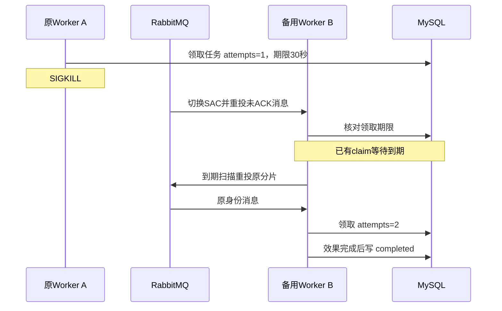
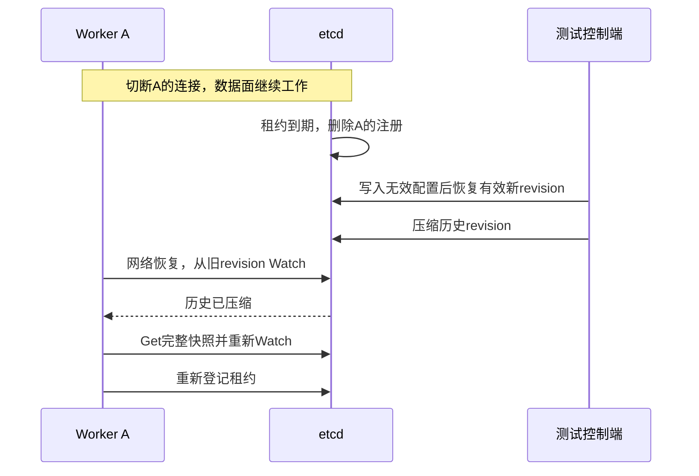

# Sprint 5 多实例资源回归

测试日期为 2026-11-17。本轮复用一个测试库、一套基础关系数据及现有 Redis、RabbitMQ，新增一个 etcd 容器。关键分布式故障各执行五轮，资源对照每组采用三轮结果。

## 环境与预算

| 项目 | 本轮配置 |
|---|---|
| 机器 | MacBook M4 Pro，24 GiB 物理内存 |
| Go / MySQL | Go 1.26.1 darwin/arm64，MySQL 9.6.0，本机 MySQL buffer pool 128 MiB |
| Redis | 7.4.12，容器上限 1 CPU / 256 MiB，maxmemory 128 MiB，AOF everysec |
| RabbitMQ | 4.2.9，容器上限 2 CPU / 768 MiB，单节点 quorum / SAC |
| etcd | 3.6.5，容器上限 1 CPU / 256 MiB，单节点 |
| 总资源守卫 | 测试相关内存 4 GiB，新增磁盘 2 GiB，最多三个 Feed Worker |
| 共享基础数据 | 1003 个用户，1000 位读者，3000 条关系。作者 1、3 走推，作者 2 走拉 |
| 固定分片 | P=4，`reader_id % 4`，所有 Worker 订阅全部四条分片队列 |
| 正式突发负载 | 每轮 96 篇帖子，四路并发发布，每帖覆盖 1000 位活跃读者 |
| 正确性依据 | MySQL 原始权威行排序与完整 Feed 分页对照，1000 位读者的 Redis 保留区间摘要核对 |

监控汇总本轮原生进程及 MySQL 的 RSS，加上三个容器的 Docker working set。GOMEMLIMIT 是 Go 运行时软限制，GOMAXPROCS 是 Go 调度并行度。容器 CPU / 内存限制由 Compose 执行。内存数值采用上述进程与容器口径。

磁盘监控累计测试库所在 MySQL 数据目录、Redis / RabbitMQ 数据卷、日志及构建缓存的增长，另为 etcd backend、WAL、镜像和日志预留 448 MiB，并计入两个二进制。后续阶段进一步把整个复用 Go 构建缓存计入保守上界，覆盖建库前的编译开销。原始报告保留各次运行的口径，汇总采用完整口径。

## 资源对照配置

Core、Query、Rebuilder、Relay 全程使用各自固定配置。Core SQL 上限为 10，Relay 为 2。表内 SQL 包含每个 Worker 的一条槽位锁连接。

| 组别 | Worker 数 | 每 Worker SQL | 每 Worker 执行并发 / GOMAXPROCS | 每 Worker GOMEMLIMIT | Worker SQL 合计 | Worker 并发合计 |
|---|---:|---:|---:|---:|---:|---:|
| 固定总资源 | 1 | 12 | 6 | 384 MiB | 12 | 6 |
| 固定总资源 | 2 | 6 | 3 | 192 MiB | 12 | 6 |
| 固定总资源 | 3 | 4 | 2 | 128 MiB | 12 | 6 |
| 增加总资源 | 1 | 4 | 2 | 128 MiB | 4 | 2 |
| 增加总资源 | 2 | 4 | 2 | 128 MiB | 8 | 4 |
| 增加总资源 | 3 | 4 | 2 | 128 MiB | 12 | 6 |

测试 namespace 预留三个 Worker 槽位，每槽位 SQL 上限 12，总预约上限 36。加上 Core、Relay，稳定配置的池上限为 16～24，配置过渡的保守上限为 48。扩容实验把每实例并发从 3 降至 2、SQL 从 6 降至 4，观察旧消费组 drain、revision 应用及 SAC 归属。

## 固定总资源与扩资源结果

下表取每组各轮指标的中位数。吞吐计时覆盖发布开始到全部持久任务完成，包含 Relay 的五秒轮询等待。读者更新吞吐按每帖 1000 位活跃读者换算。任务中还包含作者自身这一接收者，其缓存是否活跃会影响实际 Redis 写入，因此原始 `recipients=96096` 与表中的 96000 位读者更新分别记录。

| 组别 | Worker 数 | 帖子 / 秒 | 读者更新 / 秒 | 发布 P99 / ms | Feed P99 / ms | 读者 4 可见 P99 / 秒 |
|---|---:|---:|---:|---:|---:|---:|
| 固定总资源 | 1 | 2.063 | 2063 | 22.1 | 91.2 | 7.01 |
| 固定总资源 | 2 | 2.220 | 2220 | 21.7 | 105.6 | 4.83 |
| 固定总资源 | 3 | 2.578 | 2578 | 17.4 | 384.9 | 7.46 |
| 增加总资源 | 1 | 1.983 | 1983 | 18.3 | 62.3 | 7.71 |
| 增加总资源 | 2 | 2.625 | 2625 | 45.5 | 118.3 | 8.50 |
| 增加总资源 | 3 | 2.826 | 2826 | 20.4 | 151.4 | 6.93 |

固定总资源从一实例到二、三实例，吞吐中位数分别增加约 7.6%、24.9%。扩资源组对应增加约 32.4%、42.5%，第三个 Worker 相对两个 Worker 的增益约 7.7%。按相对单 Worker 加速比除以实例数计算，扩资源组二、三实例的并行效率约为 66.2%、47.5%。

```mermaid
xychart-beta
    title "固定总资源的吞吐中位数"
    x-axis [1个Worker, 2个Worker, 3个Worker]
    y-axis "帖子每秒" 0 --> 3.2
    bar [2.063, 2.220, 2.578]
```

```mermaid
xychart-beta
    title "增加总资源的吞吐中位数"
    x-axis [1个Worker, 2个Worker, 3个Worker]
    y-axis "帖子每秒" 0 --> 3.2
    bar [1.983, 2.625, 2.826]
```

每轮四个分片分别有 384 个 Chunk，接收者数为 24000、24096、24000、24000。三个 Worker 的首选分配为 A、B、C、A，A 承担两个分片，B、C 各承担一个。该工作量分配使三实例之间存在约 2∶1∶1 的负载差异。四条分片队列始终各有一个活跃消费者，备用订阅数随 Worker 数增长。

前六轮经过缓存从空增长到 500 条的过程，已单独保留。正式表格用补跑的固定总资源一、二 Worker 结果替换它们，其他四组在缓存达到 500 条之后执行。总共保留 24 轮突发负载记录，采用其中 18 轮。

各组共享基础关系数据，帖子和持久任务历史随轮次追加，Redis 缓存有界保留 500 条。执行顺序及历史增长会影响本机短测结果。每轮发布样本只有 96 个，Feed 延迟采样持续至本轮新帖对指定读者可见，样本数见原始记录。P99 接近短样本最大值。初版 `worker_drain_s` 包含了后续分页校验时间，正式表格采用 `elapsed_s_batch` 及对应吞吐字段。

## 负载递增检查

三 Worker 保持每实例并发 2、SQL 4，按 1、2、4 帖／秒分别运行三个约十五秒输入窗口。每窗结束后等待全部持久任务完成，保留排空时间及队列采样。

| 输入率 | 每轮帖子数 | 输入停止后排空中位数 / 秒 | 最慢排空 / 秒 | Feed P99 中位数 / ms | 最坏轮次 Feed P99 / ms | 停止时 MQ 积压中位数 |
|---|---:|---:|---:|---:|---:|---:|
| 1 帖／秒 | 15 | 6.55 | 6.65 | 148.8 | 1967.4 | 57 |
| 2 帖／秒 | 30 | 10.94 | 11.28 | 275.9 | 581.5 | 101 |
| 4 帖／秒 | 60 | 16.79 | 27.80 | 201.6 | 528.3 | 340 |

九轮全部请求成功并最终排空。4 帖／秒下，停止输入后的排空时间和积压明显增加，已经表现出排队压力。输入较低时仍有 Relay 轮询形成的批次等待。MQ 积压包含根事件、Planner、Chunk，管理接口存在统计刷新延迟。十五秒窗口只能给出这次短负载现象，持续输入的精确饱和点还需要更长时间窗口。延迟尖峰在低输入率也出现，本轮尚未完成其逐调用归因。

## 资源峰值与收尾

| 指标 | 实测峰值或结束状态 |
|---|---|
| 汇总内存 | 833.52 MiB，约 0.814 GiB |
| 新增磁盘保守上界 | 1.562 GiB，已包含整个约 524 MiB 的复用 Go 构建缓存 |
| 测试账号 SQL 连接 | 15，收尾时为 0 |
| 测试库 | `notex_s5_0c3a88fb`，1003 用户、3000 关系、2880 帖子 |
| outbox | 2895 条，全部已发布 |
| Feed 子任务 | 51894 条 |
| 消费记录 | 54804 条，全部 completed，最大 attempts=2，其中 15 条属于确定性时序测试 |
| Feed MQ 队列 | 根、Planner、历史 Chunk、四条分片全部 ready=0 / unacked=0 |
| etcd 服务注册 | 收尾时 0 个，runtime 配置保留 |
| 测试进程 | 本轮 Go 服务和负载脚本已退出 |
| 容器 | Redis、RabbitMQ 复用原容器，etcd 创建一次。暂停注入结束后均已恢复运行 |

数据库、基础数据和中间件容器全程持续复用，结束后保留供 diff 审查与复现。测试 namespace 的搜索队列保留 2885 条消息，属于既定延期的搜索接入范围。内存和磁盘守卫全程未触发。

## 五轮关键故障

| 场景 | 结果与核对方法 |
|---|---|
| SIGKILL 活跃 Worker | 五轮通过，每轮捕获两个已领取 Chunk，接管后均为 `completed / attempts=2` |
| etcd 单客户端网络隔离 | 五轮通过，A 的租约 key 消失期间继续处理数据面任务 |
| 同名 Worker 重启 | 五轮均被 MySQL 槽位锁拒绝，测试时旧实例的 etcd 注册已过期 |
| 无效 runtime 配置 | 五轮保留旧有效 revision，记录控制面错误 |
| Watch 历史压缩 | 五轮主动压缩到新 revision，A 日志出现五次压缩错误，重新获取快照后应用正确 revision |
| etcd 容器暂停 | 五轮约 17 秒，期间发布、消费、读取成功，恢复后目录与 revision 正确 |
| Core 慢响应 | 五轮暂停 Core，请求在 5.007～5.018 秒返回 503，恢复后分页核对通过 |
| Redis 暂停 | 五轮 Feed 在 2.006～2.019 秒通过 SQL 回退，恢复后持久任务及 1000 位读者索引收敛 |
| 扩缩容与降预算 | 五轮从两个 Worker 扩至三个并降低每实例额度，之后把首选分配交回 A、B 并停止 C |
| 真实 RPC 业务路径 | 五轮核对发布幂等、热正文删除、越权删除、取关、重新关注、完整分页 |
| 并发重建 | 五轮，每轮定点过期八位测试读者缓存，再发起十六个读取请求，核对权威分页与索引摘要 |

SIGKILL 实验先短暂停住 Core，把 Chunk 固定在真实 RPC 调用和 MySQL 领取状态中，再终止 A、恢复 Core。该注入步骤确保每轮覆盖已提交的执行领取。故障恢复耗时同时包含 MQ 接管与 SQL 领取恢复。

| 轮次 | 观测到 SAC 接管 / 秒 | 全部持久任务恢复 / 秒 | Watch 重取与重新注册核对 / 秒 |
|---|---:|---:|---:|
| 1 | 5.065 | 28.056 | 11.518 |
| 2 | 4.896 | 23.410 | 11.056 |
| 3 | 5.115 | 27.233 | 12.450 |
| 4 | 4.835 | 30.802 | 12.437 |
| 5 | 5.045 | 29.120 | 11.460 |

接管时间通过 RabbitMQ 管理接口观测，包含管理统计刷新延迟。SQL 的三十秒领取期限从原始 claim 开始计时，重试发布还受五秒扫描间隔影响。





## 确定性时序窗口

四个额外 Go 测试共享现有中间件和测试库，各覆盖五个身份或窗口。测试记录保留为已完成状态，Redis 专用验证 key 自动过期。

| 测试入口 | 实际控制流与断言 |
|---|---|
| `TestDistributedLateCacheWrites` | 并发效果使旧 snapshot revision 失效。删除标记、关系阻断和更换 generation 分别拒绝迟到写入 |
| `TestDistributedLateCompletion` | 暂停旧 handler，定点使领取期限到期，新 handler 完成，随后旧 handler 返回永久失败，最终保留新领取的 `completed / attempts=2` |
| `TestDistributedConfirmAfterReceipt` | 截住真实 RabbitMQ confirm，等待 SAC receipt 清空 token 并完成，再放行 confirm，五次均保持 `retry_publish_after=0`、空 token |
| `TestDistributedShardRetry` | 两个重试发布者、两个 SAC 订阅竞争同一分片，五个任务各失败一次、成功一次，观测到的 handler 最大并发为一 |


## 复现入口与原始证据

```bash
GOMAXPROCS=2 GOMEMLIMIT=512MiB GOCACHE=/tmp/notex-grpc-build-cache go build -o /tmp/notex-s5 ./src
GOMAXPROCS=2 GOMEMLIMIT=512MiB GOCACHE=/tmp/notex-grpc-build-cache go build -o /tmp/notex-s5-control ./src/cmd/control
docker compose --profile governance up -d --no-recreate etcd
python3 scripts/distributed_regression.py --binary /tmp/notex-s5 --control /tmp/notex-s5-control --output notes/fanout/runs/sprint5 --phase all
```

同一个 `--output` 会复用 `fixture.json` 指定的测试库。可选择 `smoke`、`performance`、`faults`、`guards`、`capacity`，性能补跑使用 `--cases fixed-1 fixed-2`。测试进程结束后保留数据库、队列、容器、配置和原始证据。

| 脚本入口 | 工作过程 |
|---|---|
| `setup` | 首次建库迁移并建立基础关系，后续复用 fixture 和有效会话 |
| `launch`、`configure`、`ownership` | 启动进程，等待登记 revision，通过 CAS 调整额度，检查每条分片的活跃消费者和优先级 |
| `batch`、`settled`、`drain` | HTTP 发布，检查 outbox、根消费、持久子任务和执行状态，等待完整收尾 |
| `verify`、`verify_indexes` | 原始 SQL 行与完整 HTTP 分页比较，按缓存 floor 核对全部读者的保留区间摘要 |
| `performance`、`capacity` | 固定突发负载对照与递增输入率检查 |
| `faults`、`business_checks` | 故障注入、身份追踪、恢复与业务核对 |
| `EtcdProxy` | 仅控制 worker-a 到 etcd 的 TCP 连接，其他客户端可以继续推进 revision |
| `monitor`、`disk_usage` | 采样原生与容器资源、SQL 连接、队列积压，预算异常时停止本轮服务负载 |
| `run`、`stop_process` | 管理阶段及结果，恢复暂停容器、收尾本轮进程并保留证据 |

原始证据目录为 `notes/fanout/runs/sprint5`，沿用项目已有的测试运行目录忽略规则。

- `20261117-224943-report.json` 保存初次双 Worker 联通验证。
- `20261117-225058-results.jsonl` 保存初始十八轮资源对照。
- `20261117-231907-results.jsonl` 保存固定总资源一、二 Worker 的六轮稳态补跑。
- `20261117-230504-results.jsonl` 保存三十五条五轮故障与业务核对记录。
- `*-guards.log` 保存四个确定性时序测试的 Go 输出。
- `20261117-232459-results.jsonl` 保存九轮负载递增记录。
- `final-audit.json` 保存退出后的队列、服务注册和代码基线核对。
- `*-resources.jsonl` 保存进程 RSS、CPU、容器资源、SQL 连接及后续增加的队列采样。
- `*-core.log`、`*-worker-*.log` 等保存应用日志及重投递、drain、Watch 错误证据。

所有进程实验使用同一业务二进制，其 SHA-256 为 `c1bc28196049054eaa3782d67de00c41688205000bcac7d02a1f4deb23fd733c`。

`go test -p 1 ./src/...`、`go vet ./src/...`、Python AST 语法检查及 `git diff --check` 均通过。四个 `TestDistributed*` 在 `guards` 阶段通过环境变量连接复用中间件并实际执行。历史集成测试的独立建库／删库入口继续由各自环境开关控制。

## 本轮范围

本轮采用单节点 RabbitMQ 与 etcd，覆盖进程退出、连接隔离、容器暂停、配置恢复和共享资源回归。多数派失效属于多节点部署实验。搜索接入按既有决定延期，测试 namespace 的搜索队列保留发布消息，其消费和搜索隔离指标继续列为待验收项。长期持续到达率、长时间 P99 和集群多数派行为仍需对应环境与时间窗口验证。
