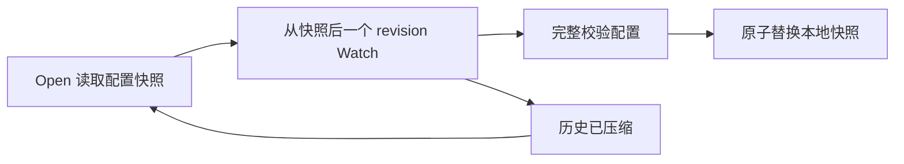

# 固定分片、接管与 etcd

本批提供 Stage 2、Stage 3 的代码入口。验证范围为编译、Go 静态检查和 diff 检查。真实 MQ 接管、etcd 故障恢复与多实例运行留待 diff 审查后的联调。

## 启用治理模式

设置 `ETCD_ENDPOINTS` 后，拆分进程使用 etcd 配置和服务目录。每个进程还需要唯一的 `INSTANCE_ID`，可用 `SERVICE_VERSION` 标记程序版本。公共数据库、Redis、MQ、推拉策略和 RPC token 沿用 README 的环境配置。

1. 执行 `migrations/0007_feed_topology.sql`。它记录队列前缀对应的固定分片数和推拉策略，并给消费记录增加重试投递的协调字段。
2. 按本机约定预算准备 etcd。Compose 的 `governance` profile 提供单节点 etcd 3.6.5，限制为 1 CPU、256 MiB，监听本机 23790。该配置用于后续联调。
3. 初始化运行配置，再按 Core、Rebuilder、Query、Worker、Relay 的依赖顺序启动服务。

```bash
docker compose --profile governance up -d etcd
go build -o /tmp/notex ./src
go build -o /tmp/notex-control ./src/cmd/control
export ETCD_ENDPOINTS=http://127.0.0.1:23790
export RABBITMQ_QUEUE_PREFIX=notex
export FEED_MODE=hybrid
export FEED_PULL_AUTHORS=42,108

/tmp/notex-control init -workers worker-a,worker-b,worker-c \
  -active worker-a,worker-b -shards 4 -sql 4 -concurrency 2
```

`init` 通过 CAS 创建配置。示例预留三个实例槽位，每个最多四条任务数据库连接，Worker 总连接预算为十二。每个 Worker 的槽位锁占用其中一条连接。Core、Relay 的池需要计入整机预算，按当前默认值合计受管实例池上限为二十四。初始化和重复启动的连接握手开销需要在联调总预算中预留。新增进程的 CPU、内存和容器总预算在联调前统一约定。

以下命令分别在继承公共环境变量的终端执行。

```bash
NOTEX_ROLE=core INSTANCE_ID=core-a HTTP_ADDR= /tmp/notex
NOTEX_ROLE=feed-rebuilder INSTANCE_ID=rebuilder-a HTTP_ADDR= /tmp/notex
NOTEX_ROLE=feed-query INSTANCE_ID=query-a HTTP_ADDR= /tmp/notex
NOTEX_ROLE=feed-worker INSTANCE_ID=worker-a HTTP_ADDR=127.0.0.1:8082 /tmp/notex
NOTEX_ROLE=feed-worker INSTANCE_ID=worker-b HTTP_ADDR=127.0.0.1:8085 /tmp/notex
NOTEX_ROLE=relay INSTANCE_ID=relay-a HTTP_ADDR= /tmp/notex
```

Core 和 Rebuilder 使用各自配置的 RPC 地址监听，并把地址注册到 etcd。客户端从目录建立 round-robin gRPC 连接。多个 RPC 服务实例需要各自独立的监听地址。所有参与同一部署的进程使用相同的 etcd namespace、Feed 策略和 Redis 目标。

## 队列与持久任务

新 Chunk 使用 `reader_id % P` 归组。每组继续按最多一百位接收者分块，页内任务身份和后继页身份由同一 MySQL 事务冻结。Chunk 的任务 body 与 MQ envelope 都保存 `shard_count` 和 `shard`，接收端核对二者及每位读者的归属。

示例队列为 `notex.feed.chunk.s000` 到 `notex.feed.chunk.s003`。声明类型为 quorum，启用 `x-single-active-consumer`，每个消费者 prefetch 为一，分片内串行执行。应用层维护持久重试次数，因此分片队列设置 `x-delivery-limit=-1`，消息失败状态归入 `consumption_jobs`。

根事件、Planner 和历史 Chunk 分别沿用 `feed`、`feed.plan`、`feed.chunk`。历史任务原始身份和消息字节参与原有去重。它们的竞争消费与新分片消费共享本实例执行并发上限。分片内串行范围是新的同分片 Chunk，关系重建、作者索引和历史混合 Chunk 继续依靠已有的条件写入协议协调。


MySQL 到期重试通过 `RunShardRetries` 重新投递到原分片。多个实例可以扫描恢复工作，SQL 条件更新和随机 token 协调本次投递。领取后的不确定投递在三十秒后重新具备资格。已确认投递等待 MQ receipt，receipt 清除投递 token，再调用已有的任务领取协议。迟到的 publisher confirm 只能更新自身 token 对应的记录。


业务执行继续使用三十秒领取期限、单调增加的 `attempts` 和五秒外部处理预算。Redis generation、关系身份和删除标记保护迟到写入。接管期间允许重投递，MQ 的 SAC 管理投递归属，存储协议负责结果收敛。

## 手动扩容与分工调整

先启动预留的 C 实例。

```bash
NOTEX_ROLE=feed-worker INSTANCE_ID=worker-c HTTP_ADDR=127.0.0.1:8086 /tmp/notex
/tmp/notex-control status
```

`status` 展示 runtime 的实际 revision 和注册记录。C 在本地完成所有分片订阅后更新 `applied_revision`，注册信息最多再经过两秒上报。取得 runtime revision 后，发布首选实例分配。

```bash
/tmp/notex-control assign -active worker-a,worker-b,worker-c -expect 120
```

把示例 `120` 替换为刚查询到的 runtime revision。该命令检查新首选实例已经注册并应用当前 revision，随后通过 CAS 发布新的配置。输出表示配置已发布，各实例的应用进度可通过 `status` 或 `/controlz` 查询。

`assign` 按输入实例顺序轮流分配首选位置。四个分片的分配结果为 A、B、C、A。需要自定义分配时，用 `apply` 提交完整 runtime JSON，例如 `preferred` 为 A、B、C、B。

每个预留 Worker 订阅全部新分片。首选实例使用优先级一百，其余实例使用十。RabbitMQ 4.2 的 quorum SAC 支持等待原活跃消费者确认在途消息后转交给更高优先级消费者。配置更新同时会触发本实例旧消费组的有界收尾和重新订阅。实际活跃归属可在 RabbitMQ 管理页面查看，`applied_revision` 表示本地配置与订阅初始化完成。[RabbitMQ 4.2 SAC 文档](https://www.rabbitmq.com/docs/4.2/consumers#single-active-consumer)


SIGTERM 或订阅调整给分片内当前执行五秒收尾窗口，之后取消请求并关闭连接。进程意外退出时，RabbitMQ 根据连接失效处理未 ACK 消息，MySQL 重试路径处理已经持久化的未完成任务。旧进程的晚完成仍须通过任务和 Redis 条件保护。日志记录分片订阅优先级、收尾开始及期限、首次投递时间和重投递身份，队列等待量与未 ACK 数可通过 RabbitMQ 管理接口采集。

缩容时，先把首选分配交给保留实例，检查配置应用情况，再停止退出实例。预留槽位可用于后续再次启动。当前扩容入口由人工执行启动命令和配置命令。

## 运行配置与资源约束

配置 key 为 `/notex/<queue_prefix>/runtime`。`control init` 输出完整 JSON，可保存作为配置编辑和恢复依据。

| 字段 | 含义 |
|---|---|
| `queue_prefix`、`policy_id`、`shards` | 部署拓扑身份 |
| `workers`、`max_workers` | 预留实例槽位和最大实例数 |
| `max_worker_sql`、`total_worker_sql` | 每槽位连接上限与汇总预算 |
| `max_concurrency` | 每实例执行并发预算上限 |
| `preferred` | 每个分片的首选实例 |
| `worker_sql`、`concurrency` | 当前每实例使用的连接和执行并发额度 |

拓扑、槽位和预算上限在初始化时固定。动态更新支持 `preferred`、`worker_sql`、`concurrency`，完整校验后原子替换本地快照。预算满足 `max_workers * max_worker_sql <= total_worker_sql`，新旧配置并存期间各实例也受相同上限约束。扩大预留槽位或调整总体上限需要单独安排部署迁移。

```bash
/tmp/notex-control apply -file /tmp/notex-runtime.json -expect 120
curl http://127.0.0.1:8082/controlz
```

Worker 的 `RunManaged` 等待旧消费组退出后再降低连接和执行并发额度。独占槽位由 MySQL 连接级 `GET_LOCK` 保护，etcd 暂时不可用期间也能阻止同名 Worker 同时占用同一槽位。槽位连接检查失败会停止该 Worker，MySQL 释放连接锁后，重启实例可以再次取得槽位。

## 注册、Watch 与故障恢复

`control.Open` 必须取得有效初始配置，初始化失败会使启动返回错误。服务监听与依赖初始化完成后，`Register` 将地址、角色、版本、实例 session 和应用 revision 写入 `/notex/<prefix>/services/<role>/<instance>`，注册 key 绑定十五秒租约。`LeaseKeepAlive` 维持续租，失去租约后尝试重新注册，同一身份的不同有效 session 由 CAS 检查冲突。

`Resolver` 在每条业务 gRPC 连接内持有服务地址快照，通过 Watch 更新地址；只接收 loopback 地址和匹配部署身份的记录。目录租约表示续租状态，业务 readiness 继续由各角色检查依赖。



断线时保留已验证的配置和地址，连接失败由 gRPC 处理。Watch 从已处理的 revision 恢复，收到压缩错误后重新读取完整快照，再衔接后续 Watch。无效配置或配置删除会留下 `last_control_error` 并保留最近有效快照。可将已保存的有效 JSON 恢复到 runtime key，观察各实例应用进度。服务退出先结束 HTTP、RPC 和消费工作，再撤销注册租约。[etcd API 文档](https://etcd.io/docs/v3.6/learning/api/)

## 代码阅读入口

| 文件与函数 | 数据流或控制流 |
|---|---|
| `control.Parse`、`Runtime.Validate`、`Compatible` | JSON → 范围检查 → 拓扑及预算兼容检查 |
| `control.Connect`、`Endpoints`、`Root` | 启动参数 → 本机 etcd 连接与命名空间 |
| `control.Open`、`Current` | 初始快照 → Watch → 不可变快照与变化广播 |
| `Node.Register`、`Applied`、`Status`、`Close` | 登记 → 续租及上报 → 查询 → 收尾后撤销 |
| `Node.Resolver`、`rpc.DialDiscovered` | etcd 目录 → 本地地址集 → round-robin gRPC |
| `core.NewClient`、`feed.NewRebuildClient` | 应用持有的 gRPC 连接 → 既有类型化 RPC 方法 |
| `Runtime.Includes`、`Priority` | 实例槽位和首选列表 → 订阅资格及优先级 |
| `feed.RunManaged`、`runGeneration` | 配置变化 → 收尾 → 应用额度 → 并行订阅 |
| `partitionRecipients`、`publishTasks` | 接收者 → 稳定分组 → 持久化身份对应的 MQ envelope |
| `outbox.ShardName`、`NewShardedPublisher` | 分片编号 → 固定队列名 → 声明和可靠发布 |
| `RunShard`、`shardSession` | 订阅 → 串行 receipt、任务领取、外部执行、ACK → 重连 |
| `RunShardRetries`、`republishDue` | 到期记录 → 投递领取 → confirm → MQ receipt 接续恢复 |
| `workerSlot` | 获取独占连接锁 → 核对持久拓扑 → 监测连接 → 收尾释放 |

## 后续运行验收

diff 审查后，需要约定总资源预算，再验证两个和三个 Worker 的实际活跃归属、SIGKILL 接管、旧写入晚到、重试投递确认窗口、降并发、同槽位重复启动、etcd 断开重连与 revision 压缩。故障注入轮数与性能对照沿用 Sprint 5 验收矩阵。

本机单节点 etcd 和单节点 RabbitMQ quorum 队列用于进程与连接故障实验。集群多数派故障实验需要另行安排多节点部署及资源。
