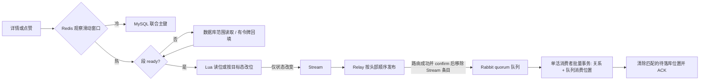

# 点赞的运行和恢复

先对业务库执行 `migrations/0008_post_likes.sql`。默认 `LIKE_MODE=sql`：纯 MySQL，不依赖异步服务。启用冷热分流时，所有实例统一设置 `LIKE_MODE=adaptive`、同一个 `REDIS_URL`、`RABBITMQ_QUEUE_PREFIX` 和数据库。Relay 和消费进程另需 `RABBITMQ_URL`。单进程 `NOTEX_ROLE=all` 自带两者；分布式部署保留现有 `relay`，增开 `NOTEX_ROLE=like-worker`（默认 HTTP 8086）。不要在同一数据库混用 SQL-only 和 adaptive 写入实例；切换模式前停写并排空。

8 秒内 **>256** 次点赞类请求（含取消和同态重试）或 **>2048** 次详情读取晋级；192 秒内点赞 **<16 且**读取 **<128** 才退火。只统计有效帖子请求，不把点赞内部的正文读取再算一次。Redis 服务器时间、每类只保留判断所需的最近 N 个时间戳。193 秒过期的是计数样本，不是热点或位图。Relay 定时检查到期帖子，积压期间不退火；冷写与晋级使用同一帖子行锁。正文用原详情缓存；启用 Feed 投影时晋级也调用已有作者索引构建器。点赞只按需加载访问者所在的 4096 字节段。为避免稀疏用户 ID 拉出超大字符串，单帖总位图上限 1 MiB，超出可表示范围的用户始终走 SQL。

无需客户端 operation_id：Redis Stream 原生位置有序；Relay 只发送仍在 Stream 头部的连续批次（最多 64 条），不确认不移除。消费者最多收集 8 个批次或等待 20ms，用一个 SQL 事务按位置跳过旧消息、按关系折叠最终状态、批量删除和插入，并推进消费位置。只能使用同一条有序队列，不能随意分流或手工跳过队头。每帖 pending 记最后一个未落库位置：只有匹配位置的消费者才能清它，旧消息不会放行退火。进程重启正常重发，不需要清空缓存。

Redis Stream 和 pending **不是可丢弃缓存**：要求 noeviction、AOF、独立命名空间。不要手工 DEL/XTRIM、回滚快照或绕开队列写库。Compose 的 everysec 仅覆盖进程退出，不保证主机掉电后最后一秒零丢失；要求更强的本机持久性须设置 appendfsync always 并重新测吞吐。Redis 丢失/回滚时停写、先排空仍在 MQ 的消息，核对 SQL 和消费位置，使用新前缀重建；未持久化且未到 MQ 的意图不能从 MySQL 推导。积压时监控 XLEN、Rabbit ready/unacked、磁盘和 Redis 可用内存。首版没有横向扩展消费队列或吞吐 SLO。
