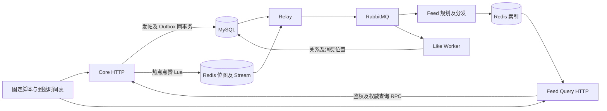
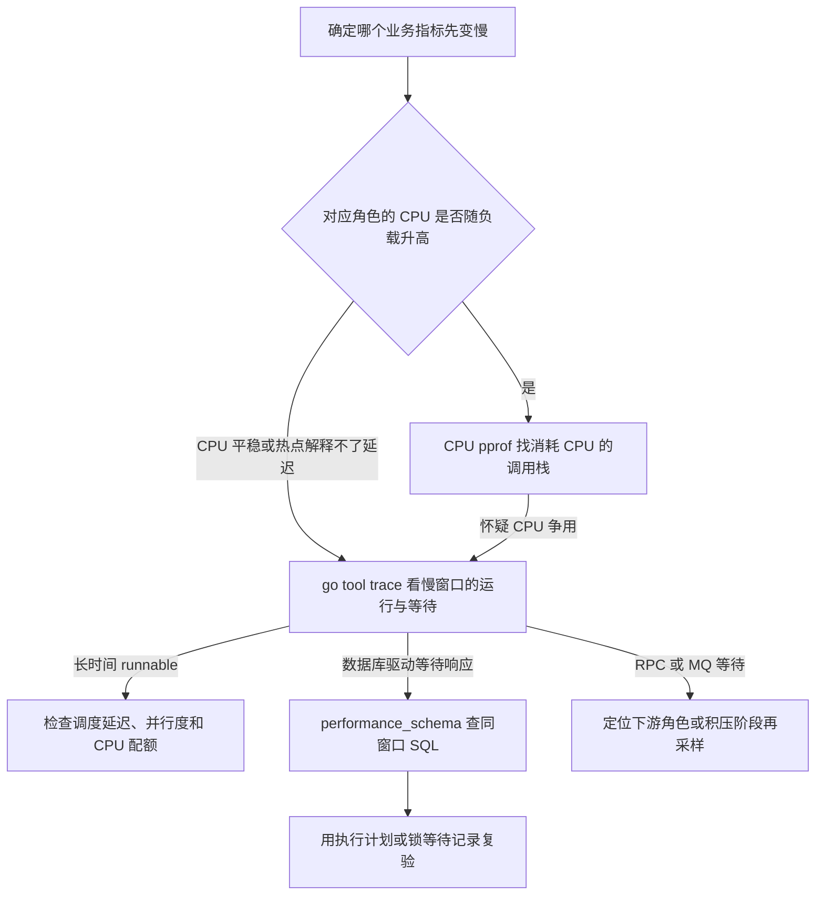

# NoteX 综合压测方案 v1（待摸底冻结）

业务基线为提交 `f2fd045a60e33de15505406ab3a5222588840e50`。本方案是实验设计。文中的新负载、阈值和时长是建议值，当前提交尚无这套实验的实测成绩。目标是在同一台 M4 Pro 上回答三个问题：给定流量能否持续服务、异步效果多久兑现、每单位业务消耗多少资源。

## 1. 实验边界

主对照统一走真实 HTTP，按接口路由到 Core 和 Feed Query，固定一套 MySQL、Redis、RabbitMQ、etcd，固定 Rebuilder、Relay、一个 Feed Worker 和一个 Like Worker。主配置采用 hybrid Feed、adaptive 点赞、四个 Feed 分片。所有对照记录实际启动角色、版本、池大小、队列类型、日志级别、AOF、MySQL 刷盘与 binlog 配置。启动后检查 readiness、实际订阅和分片归属。SQL-only 点赞单独建库运行，各轮预置相同状态。



保留原回归的独立入口和测试规格。历史 Q 集为 12 万用户、100 万关注、20 万帖子，采用单请求闭环读。F 集为 1000／1 万／10 万活跃粉丝，以 Service 事务为起点。两套数据继续回答原来的问题。多实例的四路并发、96 帖 × 1000 活跃读者继续作为扩缩容对照。新混合场景单列结果。[Feed 验收](../../notes/fanout/07-acceptance.md) · [多实例回归](distributed-regression.md)

## 2. 四条可独立重放的业务流量

建议新建小型共享数据集：1 万账号、2 万篇历史帖、10 万条去重关注，固定 seed 20261118。预留 1 个有 1000 名活跃粉丝的推作者、1 个同规模拉作者、100 个各有 20 名活跃粉丝的普通推作者，生成器优先满足这些约束，再填齐总关系数。读者组包含同时关注大小作者的哨兵。热帖使用位图表示范围内的账号，另设边界 ID 做功能回归。快照记录真实活跃人数、拉作者清单、每作者粉丝数、种子帖及关系摘要。每轮预建会话并预热指定读者索引，测量期覆盖 TTL 由清单核实。

| 场景 | 固定请求轨迹 | 主要判据 |
|---|---|---|
| F 多作者发布与刷 Feed | 每 100 个请求含 10 次普通发帖、90 次 Feed 读取。普通作者轮转；稳定期每 30 秒额外各发一篇大推作者帖和大拉作者帖，同时发一篇普通哨兵帖。读流量中 80% 首页、20% 使用前页真实游标，页大小 50 | 按作者类型分开发帖响应、首页／翻页 P95/P99、哨兵可见时间；按分片记录待执行工作、最老任务年龄、已完成接收人数，以及大作者发布后普通作者最长无进展时间 |
| L 热帖争赞 | 使用同一请求表分别跑长尾均匀分布及单帖承接 80% 写请求两组；每 100 个请求含 60 PUT、20 DELETE、20 详情。预生成每个用户与帖子的有序目标态，其中显式包含同态重试；不同用户并行。SQL 与 adaptive 分别重放两组 | 对照冷写、升温、位图已就绪三个区间的成功写/s、实际状态改变/s、详情的 liked_by_me、SQL 事务数和最终落库时间。记录单帖实际 8 秒窗口计数，确认晋级时刻；未触发则该轮仅能说明冷路径 |
| A 会话鉴权 | 全部请求使用预发 token 访问 GET /me。均匀轮转 1 万会话和 1% 会话承接 80% 请求各一组。相同 RPS，保持连接复用；另在混合流量中观察 Feed 经 RPC 鉴权的路径 | 每次鉴权的 session 查询数及耗时、RPC 等待、P99。缓存方案加报命中、回源、失效；注销成功后用旧 token 在 Core 和 Feed 均应返回 401，过期会话同样核对 |
| M 综合业务 | 每 100 个请求含 40 次 Feed、25 次详情、15 次点赞、5 次取消、8 次发帖、3 次关注、2 次取关、2 次 /me。按种子打散到达顺序。复用 F 的作者分组、L 的热帖分布和 A 的热会话分布。关注与取关使用独立关系对；固定正文长度分布与 Feed 页大小 | 各接口有效吞吐和 P99、普通作者可见性、点赞最终态、两条异步链路的债务以及整机成本。分别报每类样本数，小流量接口保留原始延迟和最大值 |

L 在热阶段至少让单帖每秒实际收到约 40 个点赞／取消请求，有余量跨过现有 8 秒内超过 256 次的晋级条件。取一个连续 192 秒以上的低热度窗口，单独观察退火及 pending 清除。A 的登录在计时前完成；若要研究密码校验 CPU，另开登录场景。M 的用户从预存帖子池与已确认的新帖池按冻结权重选帖，确保同一逻辑动作在各版本引用同一逻辑对象。持续写入会改变首页，分页的精确比对留到静止的校验窗口。

## 3. 从摸底到正式 A/B

1. **封存工作负载。** 保存业务 SHA、脚本 SHA、二进制哈希、配置、硬件和中间件版本、种子快照哈希。轨迹含逻辑用户、目标、期望状态、计划时刻和依赖。实际 token 单独保存在临时测试环境。发帖按逻辑操作生成 Idempotency-Key，重试复用该键。
2. **开环摸底。** 从每秒 40、80、120、160... 个请求逐级试，每档 60 秒，记录每档队列斜率。调度器按预定时刻发起，有界在途数，达到上限记未发出。初次沿用并发上限 4；如它先限制到达率，标注客户端受限，在新的并发预算约定后再测。记录计划数、实发数、完成数、语义成功数、超时、丢弃、调度迟到及发压机 CPU。预热、探针和重试流量单列。
3. **冻结正式档。** 各场景选基线可持续档及相邻压力档，在正式测量前写入 manifest。建议可持续档初始目标为至少 99% 计划请求按时发出（迟到阈值 20ms）、语义成功数／计划数 ≥99%、单接口 P99 ≤250ms、普通哨兵可见 P95 ≤2s、停写后 60s 内两链路排空。稳定期后半段积压持续增长的档位单列为过载。以上属实验目标，摸底后若调整，先记录理由和冻结值。压力档失败也保留。
4. **同条件正式复跑。** 每个场景、档位、版本至少三轮，每轮预热 60 秒、稳定采样 300 秒，再停写排空和核对。每轮使用独立库、队列和 Redis 前缀，在相同基础快照上执行同一预热轨迹。固定后台任务、池、Go 并行度和持久化参数；协议升级后同时重跑旧版本。基线与候选交替运行，用同轮次的种子配对。容量探索另表报告满足冻结目标的最高实测档。
5. **留下可复算结果。** 每轮输出 manifest、请求 JSONL、探针 JSONL、5 秒资源时间序列、逐轮核对和清理结果。报告每轮 P50/P95/P99、样本数、三轮中位数及范围，以及配对变化率。分别计算发出至响应、计划到达至完成的延迟。超时和未完成独立列数，分母写清。观察差值接近轮间波动时补跑配对轮次。结果以正确性、服务目标和资源代价三项独立判定。

## 4. 如何用 Go CPU pprof、go tool trace 和 MySQL performance_schema 判断瓶颈

先在压测曲线上圈出异常发生的阶段，记下到达率、受影响的业务指标和服务实例。例如，“热帖晋级后，HTTP 点赞 P99 平稳，但落库越来越晚”应先观察 Relay 和 Like Worker；“Feed 首页 P99 上升”则从接收请求的 Feed Query 开始，沿 RPC 查到 Core。将异常窗口与相同轨迹、相同负载阶段的基线窗口配对。



### 4.1 Go CPU pprof：哪个函数消耗了 CPU？

对可疑角色抓 30 秒 CPU profile，用 `go tool pprof -top` 看 `flat`（函数自身消耗），用 `go tool pprof -top -cum` 看 `cum`（含被调用函数的消耗）。例如 Feed Query 的读取入口 `cum` 很高，沿调用栈展开后，才能看出时间集中在候选合并、排序还是响应编码。比较两轮相同请求量下的 CPU 样本时间，并保留实际完成数；某个函数占比升高，也可能是其他工作减少。若 P99 翻倍而 CPU 样本很少，转查这段时间 goroutine 在等什么。

### 4.2 go tool trace：慢请求在运行、等调度，还是等下游？

在同一负载阶段另抓 5 秒 trace，用 `go tool trace trace.out` 展开时间线。优先选处理该业务的 goroutine，结合状态切换时的调用栈阅读。常驻 worker 空闲时也会长时间等待，判断瓶颈要看有待处理请求或任务的那段时间。

| 时间线上的证据 | 在 NoteX 中怎样复验 |
|---|---|
| 大量 goroutine 已经 runnable，却迟迟没有开始执行 | 对齐调度延迟、该角色 CPU 与 GOMAXPROCS；再用 CPU profile 找出当时占用执行时间的调用栈 |
| 请求停在 database/sql 获取连接的路径 | 若已采集池指标，检查对应角色的 WaitCount、WaitDuration 窗口增量；继续查事务持有连接的时间。这段等待发生在提交 SQL 给 MySQL 之前 |
| 数据库驱动已发出请求，goroutine 在等网络响应 | 进入 4.3 查数据库端耗时。若栈指向 Core RPC，则到处理该 RPC 的 Core 实例取样 |
| 慢窗口与 GC 或同步阻塞重叠 | 检查受影响的请求是否经历停顿、GC assist 或相同调用点的锁等待，并在下一轮相同阶段复现 |

### 4.3 MySQL performance_schema：数据库的时间花在哪类 SQL 上？

在目标窗口运行 `scripts/mysql_digest_window.py`。它按业务连接的默认库对归一化 SQL（digest）做前后快照。先按 `total_ms` 找累计占时最大的语句，再结合 `calls`、`mean_ms`、`rows_examined` 和 `rows_sent` 判断原因。并发语句的耗时可以重叠，不能用 `total_ms` 除以窗口时长推算单请求延迟。

| 数据库证据 | 对应假设与复验 |
|---|---|
| 会话查询 mean_ms 平稳，但 calls 和 total_ms 很高 | 在 A 场景比较每次成功鉴权对应的查询次数。引入会话缓存后，以同一热会话轨迹复测查询次数、Core CPU 和接口 P99 |
| Feed 查询 mean_ms 上升，每次执行扫描的行数增加，返回行数基本稳定 | 取相同读者、游标和页大小，在测试快照上对该 SELECT 执行 EXPLAIN ANALYZE，定位扫描或排序耗时 |
| 冷赞写入变慢，扫描量稳定，流量集中到同一帖子 | 在等待发生时查 performance_schema.data_lock_waits 确认阻塞事务，再用同 RPS 的均匀写入复验。采样脚本只汇总 digest，锁等待需现场另查 |

**异步链路需要按阶段归因。** 例如热赞落库变晚，先看同一窗口里积压首先出现在 Redis Stream 还是点赞消费队列。若消费队列持续增长，Like Worker 的 trace 显示正在等数据库响应，且写入 digest 的耗时同步上升，再查 MySQL 锁等待或提交成本。若积压首先出现在 Stream，先采 Relay。单进程 trace 和按库汇总的 SQL 都无法直接给出某条消息的排队时间，逐帖分析需关联事件身份与阶段时间戳。

基线和候选使用相同的采样配置，CPU profile 与 trace 分开采集，记录角色、实例、业务版本及起止时刻；正式成绩同时保留常规采样轮，以便判断诊断开销。命令和观察账号权限见[已接入的采样入口](#已接入的采样入口)。

## 5. 证明业务效果

- **Feed。** 选固定哨兵读者，发布期间持续轮询。记录 HTTP 发起、确认和首次观察到的时间，分开报告端到端与确认后可见延迟。建议探针 200ms 间隔，记录真实间隔与探针吞吐；增加探针前做成本摸底。每批冻结哨兵集合及期望帖子，确保观察页可覆盖该窗口，超窗记未观察；同时检查推作者分发任务和预期活跃成员。Feed 接口可能经 SQL 回退提前可见，缓存投影完成时间独立计量。停写后按 MySQL 权威关系及帖子排序逐页核对选定读者、重复、缺失和删除过滤。
- **点赞。** 客户端保存每个用户与帖子的已确认目标态，同一对的相反操作按响应串行；超时结果单独通过读回、必要时同目标重试消歧。稳定期抽样读详情，停写后等 Stream、MQ、pending 和在途事务排空，再按主键集合逐对比对 post_likes 与预期，同时核对消费位置。只数总行数会漏掉“数量相等但点错人”的错误。
- **发布与恢复。** 按幂等键核对已接纳逻辑发帖、帖子、根事件与下游效果，记录重投和重复效果。每轮进入排空时保存待追踪身份，超期逐项列出。既有 MQ／Redis 停机、worker 接管、CDC 位点恢复等专项故障按各自阶段要求另批执行，不混入稳定期分位数。

## 6. 让优化假设接受同一组检验

| 候选 | 主对照 | 何时有理由保留 |
|---|---|---|
| Outbox CDC | F、M 及空载窗口；同一事件契约和 MQ，比较现有 Relay 与读取 Outbox 插入的 CDC。附加“轮询 + 同配置 binlog”组，辨别打开日志与改变事件源各自的成本 | 发帖提交至分发延迟或总成本可复现地改善，算入 connector 内存、binlog 写入与保留空间，停机续读无缺失。点赞的 Redis Stream 单独计量 |
| 热会话缓存 | A 的均匀／偏斜组及 M；保持 token、过期策略和鉴权语义 | 会话 SQL／请求下降，同时受益接口尾延迟或系统容量改善，注销与过期核对通过；记录缓存故障回源峰值 |
| 减少或合并事务 | 按 digest 先定位 Core 发帖、冷赞或异步批落库中的具体事务，再跑对应 F／L 和 M | 成功业务的事务数、锁等待和总耗时发生预期变化，失败注入后业务与事件仍原子、检查点与点赞状态一致 |
| 基于 etcd 的弹性调节 | F 增加低→高→低流量轨迹；先跑静态 1／2／3 Worker，再对比相同轨迹的动态策略。沿用固定总资源与增加总资源两张表；其余角色固定 | 报触发、启动、注册、实际接管、积压消退、缩容收尾时间及 Worker·秒。记录最大副本数、阈值和冷却时间；观察抖动。etcd 提供配置和发现，进程启停需要执行器，Feed 分片及点赞单活队列分别解释 |
| 其他 | 若 F 的慢 SQL 扫描占主导，优先验证索引或分页；若 L 的提交占主导，再试批大小与等待窗口 | 先给出指标预测，只变一项，并复跑 M 检查对其他接口和可见性的影响 |

保留初始基线 B0。连续优化时，每轮同时给出“候选相对直接上版”和“候选相对 B0”的结果。四个场景始终复用同一已冻结轨迹；候选特有的故障与边界单独追加。

## 7. 本机执行与实施顺序

建议综合实验采用现有多实例回归的较紧预算：测试相关进程（含发压、采集和 MySQL）RSS 加容器 working set 合计上限 4 GiB，每批新增磁盘 ≤2 GiB，项目源文件、原始证据、镜像和卷等累计按用户的 100 GB 上限执行。Redis 1 CPU／256 MiB（maxmemory 128 MiB、noeviction）、RabbitMQ 2 CPU／768 MiB、etcd 1 CPU／256 MiB，最多三个 Feed Worker；按原回归表分配总连接数与并行度。每批最多 30 分钟，轮次分批串行。起跑前盘点镜像、卷、缓存和可用空间，给采样间隔内的增长留余量；接近上限即停发、收尾并记为资源受限。CDC 新组件计入总账，先核算可用空间。超出预算或无法完成既定规模时，记录首先撞到的限制，提出调整供用户决定。

实施先复用 scripts/fanout_baseline.py、scripts/fanout_acceptance.py 的数据隔离和 SQL 采样，以及 scripts/distributed_regression.py 的资源守卫与角色启动。先打通一次小流量的发压、采样、排空、核对和清理，再做四场景摸底并冻结 manifest。首次完整基线结果决定先优化哪条链路。所有清理限定本轮专属库、账号、Redis 前缀、队列与 etcd namespace；启动、校验和清理本身的流量单独记账。

### 已接入的采样入口

给需要采样的服务进程设置 `NOTEX_PPROF_ADDR=127.0.0.1:6060` 后按原配置启动。各实例使用独立的回环端口，未设置时关闭。CPU 与 trace 两次采样分开执行，在同一负载阶段记录实例、采样起止和业务版本。CPU 分析使用该轮的原始可执行文件解析符号。

```sh
curl -fsS 'http://127.0.0.1:6060/debug/pprof/profile?seconds=30' -o cpu.pb.gz
go tool pprof -top ./notex cpu.pb.gz

curl -fsS 'http://127.0.0.1:6060/debug/pprof/trace?seconds=5' -o trace.out
go tool trace trace.out
```

CPU profile 按函数调用栈累计正在执行的 CPU 时间。trace 展示本进程的 goroutine 调度、网络等待和 GC。二者都在收到采样请求时启动。追踪特定帖子跨越 MQ 的等待时间还需关联事件身份和业务时间戳。

MySQL 已有按库和按账号的采样。独立窗口脚本使用只读观察连接，两次读取指定业务连接默认库的 statement digest 累计计数，按差值总耗时降序输出 JSON。压测保持运行，在目标阶段执行以下命令，将 notex 替换为该轮实际的测试库名。

```sh
python3 scripts/mysql_digest_window.py notex --seconds 30 > sql-window.json
```

连接参数沿用 TEST_MYSQL_HOST、TEST_MYSQL_PORT、TEST_MYSQL_USER、TEST_MYSQL_PASSWORD。观察账号需要读取 performance_schema 的 setup_consumers 和 events_statements_summary_by_digest。服务端须开启 performance_schema、statement 采集与计时及 digest consumer。脚本检查三项 consumer 开关。窗口内保持实例、计数器和采集配置稳定。空数组表示未观测到匹配的 digest 增量；若业务有流量，请核对默认库、statement instruments 和 Performance_schema_digest_lost，以及原有账号维度的 Execute 计数。total_ms 是并发语句累计耗时，可能超过窗口的实际时长。
