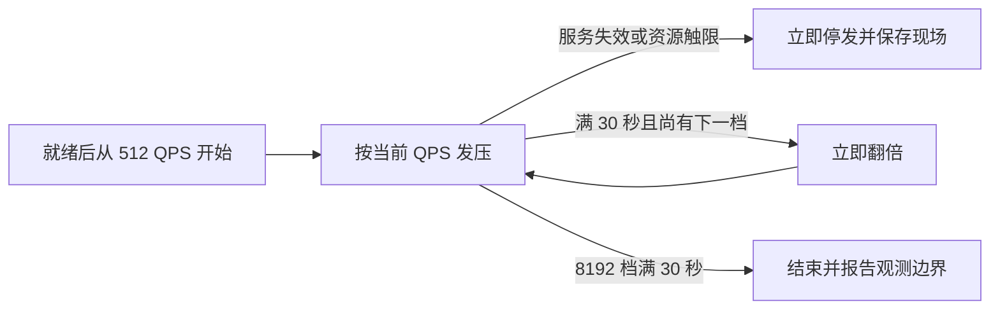
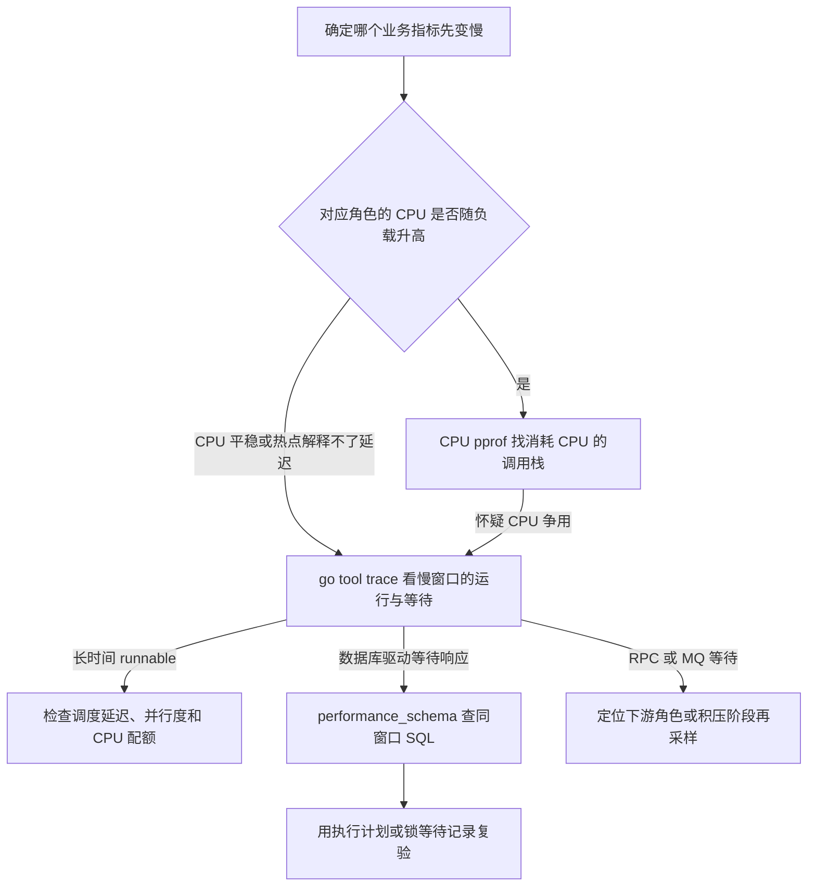

# NoteX 综合压测方案 v2：30 秒阶梯可用性测试

目标是找到本机部署在连续加压中首次出现 HTTP 业务不可用的档位。一次选择一个场景，默认 M 综合业务，只跑一趟。目标依次为 **512 → 1024 → 2048 → 4096 → 8192 QPS**，每档恒定到达率 30 秒。五档全过的发压时间为 **150 秒**。服务已就绪即开始，准备环境或清理资源的耗时另计。

## 1. 开跑条件

复用已准备好的隔离测试数据、已登录会话和服务拓扑。检查 Core 与 Feed Query 就绪，并各发一个有效业务请求。启动失败、鉴权数据错误或缺少目标帖子时，直接报告准备失败。保持同一组服务、连接及数据连续升档，缓存和队列自然演进。

沿用实验资源预算：测试相关进程（含发压、采集及 MySQL）RSS 加容器 working set 合计上限 4 GiB，每批新增磁盘 ≤2 GiB，项目总磁盘 ≤100 GB。记录提交、配置、数据种子和实际角色数。历史基线提交为 `f2fd045`，各版本均用本协议重新比较。

## 2. 选择业务流量

QPS 指**整个场景合计**每秒计划发出的 HTTP 业务请求数。使用固定种子，发帖使用唯一的幂等键，目标账号、帖子和关注关系取自该轮测试数据。

| 场景 | 每 100 个请求的构成 |
|---|---|
| M 综合业务（默认） | 40 次 Feed、25 次详情、15 次点赞、5 次取消点赞、8 次发帖、3 次关注、2 次取关、2 次 /me |
| F 发帖与 Feed | 10 次多作者发帖、90 次 Feed 读取；普通作者和大作者发帖均计入这 10 次 |
| L 热帖点赞 | 60 次点赞、20 次取消、20 次详情；单帖承接 80% 的写请求 |
| A 会话鉴权 | 100 次 /me；1% 的会话承接 80% 的请求 |

F、L、A 用于按需定位某个模块的边界。选定场景后直接执行阶梯。旧版的退火、过期、缓存撤除、最终落库、排空、恢复和逐项对账属于独立专项，均不进入本轮流程。

## 3. 发压、晋级与停止

| 从开始发压计时 | 目标 QPS | 满档计划请求数 |
|---|---:|---:|
| 0～30 秒 | 512 | 15,360 |
| 30～60 秒 | 1,024 | 30,720 |
| 60～90 秒 | 2,048 | 61,440 |
| 90～120 秒 | 4,096 | 122,880 |
| 120～150 秒 | 8,192 | 245,760 |

1. **连续开环发压。** 按单调时钟均匀调度并复用连接。响应变慢时仍按计划发出请求，客户端设置有限在途数与 2 秒请求超时。记录未发出、实际发出、成功、服务错误、超时和在途数。取消旧版固定四并发、预热、三轮重复及正式档摸底流程。
2. **30 秒到点立即切档。** 已发请求按发出时的档位归账，跨档响应后台记账。下一档按时间表立即开始；积压、缓存状态和 P99 只作观测。结束时仍在途的请求单列并取消，不延长末档。
3. **在线判定不可用。** 默认将关键服务异常退出视为立即失效。对仍存活的服务，按实际发出时间划分连续、互不重叠的 1 秒桶；请求在 2 秒内返回该操作约定的成功响应算成功。连续 3 个已到截止时间且有实际请求的桶中，若每桶成功数／实发数均低于 50%，立即停止发出，记录首个异常桶的时间和档位。桶跨档分别归账，同时报告触发停发时的档位。限流拒绝、5xx、连接失败及超时分别列出；异常 401 或无效输入优先查测试数据。50% 是本轮对严重不可用的默认量化口径，可用原始计数复算。
4. **区分服务失效和测试上限。** 若实际到达率不足目标的 95%，且证据指向发压器调度、连接配额或在途上限，报告该档实际达到的 QPS 和客户端限制；若已观测到服务失败，同时保留相应证据。本机资源守卫触发立即停发，记录限制项。五档跑完仍可用则报告“8192 QPS 档内未观察到失效”，并列出实际发出量及末尾未决请求。



## 4. 如何用 Go CPU pprof、go tool trace 和 MySQL performance_schema 判断瓶颈

先在压测曲线上圈出异常发生的阶段，记下到达率、受影响的业务指标和服务实例。例如，“热帖晋级后，HTTP 点赞 P99 平稳，但落库越来越晚”应先观察 Relay 和 Like Worker；“Feed 首页 P99 上升”则从接收请求的 Feed Query 开始，沿 RPC 查到 Core。将异常窗口与相同轨迹、相同负载阶段的基线窗口配对。



### 4.1 Go CPU pprof：哪个函数消耗了 CPU？

对可疑角色抓 30 秒 CPU profile，用 `go tool pprof -top` 看 `flat`（函数自身消耗），用 `go tool pprof -top -cum` 看 `cum`（含被调用函数的消耗）。例如 Feed Query 的读取入口 `cum` 很高，沿调用栈展开后，才能看出时间集中在候选合并、排序还是响应编码。比较两轮相同请求量下的 CPU 样本时间，并保留实际完成数；某个函数占比升高，也可能是其他工作减少。若 P99 翻倍而 CPU 样本很少，转查这段时间 goroutine 在等什么。

### 4.2 go tool trace：慢请求在运行、等调度，还是等下游？

在同一负载阶段另抓 5 秒 trace，用 `go tool trace trace.out` 展开时间线。优先选处理该业务的 goroutine，结合状态切换时的调用栈阅读。常驻 worker 空闲时也会长时间等待，判断瓶颈要看有待处理请求或任务的那段时间。

| 时间线上的证据 | 在 NoteX 中怎样复验 |
|---|---|
| 大量 goroutine 已经 runnable，却迟迟没有开始执行 | 对齐调度延迟、该角色 CPU 与 GOMAXPROCS；再用 CPU profile 找出当时占用执行时间的调用栈 |
| 请求停在 database/sql 获取连接的路径 | 若已采集池指标，检查对应角色的 WaitCount、WaitDuration 窗口增量；继续查事务持有连接的时间。这段等待发生在提交 SQL 给 MySQL 之前 |
| 数据库驱动已发出请求，goroutine 在等网络响应 | 进入 4.3 查数据库端耗时。若栈指向 Core RPC，则到处理该 RPC 的 Core 实例取样 |
| 慢窗口与 GC 或同步阻塞重叠 | 检查受影响的请求是否经历停顿、GC assist 或相同调用点的锁等待，并在下一轮相同阶段复现 |

### 4.3 MySQL performance_schema：数据库的时间花在哪类 SQL 上？

在目标窗口运行 `scripts/mysql_digest_window.py`。它按业务连接的默认库对归一化 SQL（digest）做前后快照。先按 `total_ms` 找累计占时最大的语句，再结合 `calls`、`mean_ms`、`rows_examined` 和 `rows_sent` 判断原因。并发语句的耗时可以重叠，不能用 `total_ms` 除以窗口时长推算单请求延迟。

| 数据库证据 | 对应假设与复验 |
|---|---|
| 会话查询 mean_ms 平稳，但 calls 和 total_ms 很高 | 在 A 场景比较每次成功鉴权对应的查询次数。引入会话缓存后，以同一热会话轨迹复测查询次数、Core CPU 和接口 P99 |
| Feed 查询 mean_ms 上升，每次执行扫描的行数增加，返回行数基本稳定 | 取相同读者、游标和页大小，在测试快照上对该 SELECT 执行 EXPLAIN ANALYZE，定位扫描或排序耗时 |
| 冷赞写入变慢，扫描量稳定，流量集中到同一帖子 | 在等待发生时查 performance_schema.data_lock_waits 确认阻塞事务，再用同 RPS 的均匀写入复验。采样脚本只汇总 digest，锁等待需现场另查 |

**异步链路需要按阶段归因。** 例如热赞落库变晚，先看同一窗口里积压首先出现在 Redis Stream 还是点赞消费队列。若消费队列持续增长，Like Worker 的 trace 显示正在等数据库响应，且写入 digest 的耗时同步上升，再查 MySQL 锁等待或提交成本。若积压首先出现在 Stream，先采 Relay。单进程 trace 和按库汇总的 SQL 都无法直接给出某条消息的排队时间，逐帖分析需关联事件身份与阶段时间戳。

采样在档位内并行进行，记录角色、实例、业务版本及起止时刻。到点照常晋级或停发。需要深入诊断时再单独复现相应档位。命令和观察账号权限见[已接入的采样入口](#已接入的采样入口)。

## 5. 本轮交付

每档输出一行：目标与实发 QPS、成功 QPS、错误分类及次数、在途和未发数、成功请求 P95/P99、资源峰值。汇总报告最后完成的可用档、首次失效的目标与实际 QPS、距开始发压的秒数、最先失败的接口或进程。第一档即失败时写清“在 512 QPS 档已观察到失效”；五个离散档位只能给出观测区间。

停发时保存最近的进程状态、队列深度和已有采样，随后直接清理本轮专属测试资源。旧批次 `notes/performance-tests/batch01/matrix.py` 和历史 Feed、分布式回归脚本执行各自的长时验收协议，不作为本阶梯的运行入口。

### 已接入的采样入口

给需要采样的服务进程设置 `NOTEX_PPROF_ADDR=127.0.0.1:6060` 后按原配置启动。各实例使用独立的回环端口，未设置时关闭。CPU 与 trace 两次采样分开执行，在同一负载阶段记录实例、采样起止和业务版本。CPU 分析使用该轮的原始可执行文件解析符号。

```sh
curl -fsS 'http://127.0.0.1:6060/debug/pprof/profile?seconds=30' -o cpu.pb.gz
go tool pprof -top ./notex cpu.pb.gz

curl -fsS 'http://127.0.0.1:6060/debug/pprof/trace?seconds=5' -o trace.out
go tool trace trace.out
```

CPU profile 按函数调用栈累计正在执行的 CPU 时间。trace 展示本进程的 goroutine 调度、网络等待和 GC。二者都在收到采样请求时启动。追踪特定帖子跨越 MQ 的等待时间还需关联事件身份和业务时间戳。

MySQL 已有按库和按账号的采样。独立窗口脚本使用只读观察连接，两次读取指定业务连接默认库的 statement digest 累计计数，按差值总耗时降序输出 JSON。压测保持运行，在目标阶段执行以下命令，将 notex 替换为该轮实际的测试库名。

```sh
python3 scripts/mysql_digest_window.py notex --seconds 30 > sql-window.json
```

连接参数沿用 TEST_MYSQL_HOST、TEST_MYSQL_PORT、TEST_MYSQL_USER、TEST_MYSQL_PASSWORD。观察账号需要读取 performance_schema 的 setup_consumers 和 events_statements_summary_by_digest。服务端须开启 performance_schema、statement 采集与计时及 digest consumer。脚本检查三项 consumer 开关。窗口内保持实例、计数器和采集配置稳定。空数组表示未观测到匹配的 digest 增量；若业务有流量，请核对默认库、statement instruments 和 Performance_schema_digest_lost，以及原有账号维度的 Execute 计数。total_ms 是并发语句累计耗时，可能超过窗口的实际时长。
