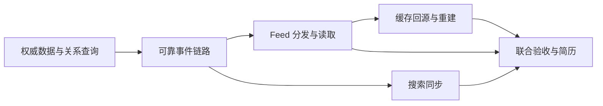

# Sprint 1：基础闭环和权威数据查询

> 2026-11-16 规划更新。Sprint 1、2 已由用户确认完成；后续执行以 [v2 规划总览](./README.md) 为准。用户已取消原 11 月 20 日截止，文内旧日期、五 Slot 编排及前端安排作为历史记录。

> 状态：**已完成**，用户于 2026-11-14 确认收口。  
> 主线：S2 关注关系建模与查询优化。  
> 建议时间：2026-11-13 下午至 11-14；日期是工作安排，不是完成承诺。  
> 依据：[PRD](../PRD.md)、[首版实现方针](../实现方针-v1.md)。

## 交付与收口记录

本次按用户确认的纯后端流程完成基础闭环，以接口脚本验证交付。
Paopao CE 作为源码参照，实际交付为 NoteX 的 Go HTTP 服务和 MySQL 权威数据查询。

- [x] 注册、登录、持久化会话、退出及准确用户名查询。
- [x] 关注、取关、关系判断、关注列表与粉丝列表，包含唯一约束和双向游标分页。
- [x] 纯文本发布、帖子详情、作者软删除和个人帖子列表。
- [x] SQL Feed 基线，按当前关注作者与自己的有效帖子进行确定性游标分页。
- [x] 接口文档、可重复执行的验证脚本及执行记录。
- [x] Go 编译与现有 Go 测试通过，完整脚本连续两轮通过全部 19 组检查。
- [x] Feed 索引合入帖子建表语句后，使用两份迁移重新验证，全部 19 组检查通过。

验证环境为本机 MySQL 9.6.0，隔离级别为 REPEATABLE-READ。
测试覆盖身份与权限、并发幂等、双向关系、帖子删除、分页边界、Feed 状态变化、重启及查询故障。
执行记录见 [接口文档](../interfaces.md)，复现入口为 [验证脚本](../../scripts/verify_api.py)。

### 后续验收待办

- [ ] 完整 C/Q 数据集及相应结果核对。
- [ ] 双向关系查询与 Feed 的 `EXPLAIN ANALYZE`、实际处理量和查询延迟。
- [ ] OFFSET 与游标在约 0／1000／1 万／10 万位置的对照实验。
- [ ] 新增索引的空间与写入代价，以及正式负载下的性能指标。
- [ ] MySQL 8.0 实际运行兼容性。

上述项目继续作为后续验收待办，当前已有证据支持基础功能和小规模并发正确性结论。
下一阶段进入 Sprint 2，完成发布意图去重、事务 Outbox 与可靠事件处理。

## 1. 六个 Sprint 的共同约定

**P0：形成自己的技术 insight，取得可信证据，最迟在 2026-11-20 结束前完成可投递的优质简历，并能应对项目追问。P1：六天内完成五个 Slot 及其完整验收。** 六天未完成不等于失败；没有理解、没有证据却写成已完成，才偏离目标。

Sprint 是学习与交付单元，不是到午夜必须结束的硬性日历。按依赖推进，必要时延长当前主题，但不得因此顺延简历截止时间。11 月 19 日进入简历收口，11 月 20 日优先保证可投递版本；未完成的能力留在后续迭代中。

| Sprint | 主要内容 | 建议窗口 |
|---|---|---|
| [1](./1-基础闭环和权威数据查询.md) | 基础闭环与 S2 | 11 月 13 日下午—14 日 |
| [2](./2-可靠发布和异步事件处理.md) | S4 可靠事件 | 11 月 15 日 |
| [3](./3-Feed推拉策略和分发控制.md) | S1 Feed | 11 月 16 日 |
| [4](./4-缓存一致性恢复和搜索投影.md) | S3 搜索 | 11 月 17 日 |
| [5](./5-分布式执行和服务治理.md) | S5 缓存 | 11 月 18 日 |
| [6](./6-CDC对照和联合验收.md) | 联合验收、简历与面试 | 11 月 19—20 日，固定保留 |

每个 Sprint 都留下三份轻量产物：实现与取舍说明、可复现证据、自己的面试讲解。沿用一套测试工具，不建设额外测试平台。简历素材从本 Sprint 开始积累，不等最后一天才回忆。

### 验收与资源规则

- 本组文档安排执行顺序，不替代 PRD 和首版实现方针，不降低既有测试要求。
- 正确性、服务目标、优化效果分别判断；未执行的实验写“未验证”，失败写“失败”。部分交付可以用于简历，但不等于首版完整验收通过。
- 正式性能实验之前，先摸底并冻结负载、延迟、可见性、恢复和资源预算；不能看到优化结果之后反向制定目标。
- 保留 C/Q/F/E 数据要求、正式性能场景至少三轮，以及 S4 核心故障窗口至少二十轮等既有要求。探索性测试可以较小，但不能替代正式验收。
- 每次运行测试前约定内存、CPU、并发及磁盘额度。整机 24G 内存不等于可全部分配给实验；源码、镜像、数据卷和证据总磁盘预算不超过 100G。
- 如实测受本机资源限制，先明确报告问题，再协商规格调整；不能因时间紧而静默缩小实验后宣称完整通过。

## 2. 本 Sprint 要解决的问题

**一条关注关系如何正确保存？为什么“我关注了谁”和“谁关注了我”都能高效查询？翻到深处时，成本由什么决定？**

先建立权威数据和最简单的正确读取路径，后面的缓存、异步和分发都需要以它为参照。

## 3. 学习目标

| 知识 | 学到什么程度 | 随后如何验证 |
|---|---|---|
| 主键与唯一约束 | 区分记录身份与“同一对用户最多一个有效关系” | 重复、并发关注不产生重复有效关系 |
| 联合索引 | 能从过滤、排序条件解释两个方向的访问路径 | 查看真实执行计划与处理量 |
| 游标分页 | 能手算时间相同的记录如何继续翻页 | 固定数据下无重复、无遗漏 |
| 事务与并发更新 | 能解释最终状态依据，不把点击顺序当作提交顺序 | 并发关注／取关及事务失败测试 |
| 权威数据与派生数据 | 知道关系和帖子状态最终由哪里裁决 | 后续所有策略使用相同参考结果 |

不扩展到图数据库、分库分表或完整数据库教材。索引方案在检查底座实际结构后决定，不能先假设上游没有合理索引。

## 4. 实现顺序与范围

1. **启动摸底。** 采用 2026-11-13 确认的官方 `main` 最新提交 `0b35d12b74c0379e4a1e6a769bd085342c5712b7` 作为 Paopao CE 基线，并固定用于本轮开发与实验。确认本地源码来源、运行方式、依赖和可复用入口；默认 Compose 使用预构建后端镜像，需改为运行选定源码的本地构建产物，才能验证自己的修改。约两小时设置一次检查点。无法启动或裁剪成本明显超出预期时，记录阻碍并重排，不吞掉全部学习时间。
2. **最小基础闭环。** 复用账号与身份校验，接通纯文本发布、详情、个人主页和删除；统一公开范围、排序、正文限制与错误状态。可靠发布相关要求在 Sprint 2 完成，当前不能提前宣称 P-01～P-06 全部通过。
3. **关系模型。** 接通准确用户名查找、关注／取关、关系判断、关注列表和粉丝列表；选择满足双向读取与确定性分页的结构。
4. **SQL Feed 基线。** 按“当前关注作者＋自己”的有效帖子读取，固定发布时间与 ID 排序；保留合理索引，不故意构造差基线。
5. **共用验证入口。** 建立固定种子数据、参考结果和运行记录，先覆盖 C 集，再准备 Q 集；期望结果不复用被测聚合算法。

基础页面只做必要接通，不重做视觉，不合并两套参照工程的所有业务。记录哪些能力来自上游，哪些是本人修改。

## 5. 验收与证据

对应首版方针 **S2-A～D**：

- C 集核对关系方向与完整分页；并发重复变更不产生重复有效关系或永久双向不一致。
- Q 集两个方向分别观察浅页、深页的 `EXPLAIN ANALYZE`，保留实际处理量与正常接口延迟。
- 页大小 50，比较约 0／1000／1 万／10 万位置的 OFFSET 与已有游标下一页；记录游标来源，不宣称任意页跳转免费。
- 报告新增索引的空间与写入代价。已有路径足够高效时，可以结论为容量验证，不强行写优化百分比。
- 页面确认账号、帖子和关系的基本流程，以及必要身份检查；SQL Feed 的结果作为后续策略参照。

正式实验资源和目标尚未冻结时，只能交付正确性与探索性测量。

## 6. 技术 insight 与面试产物

至少自行回答：

1. 为什么选择当前关系模型？与维护两份方向数据相比，收益和代价是什么？
2. 索引列顺序为什么这样安排？为什么正向好查不代表反向也好查？
3. 游标减少了什么工作，又放弃了什么产品能力？
4. 唯一约束能解决哪些并发问题，不能单独解决哪些状态变更问题？

形成一页素材：问题、原查询、最终查询与索引、执行证据、代价和边界。简历初稿先留事实槽位；没有数字就不填数字。

## 7. 完成门槛与超时处理

进入下一 Sprint 前，应至少有可运行主存储、身份与基本帖子路径、正确的关系操作，以及可解释的 SQL 读取基线。S2 完整完成仍以全部相关验收记录为准。

若基础适配超时，优先停止页面美化和非必要结构重构。未完成性能实验保留为待办，不能冒充通过。若到简历收口仍只做深了关系查询，就围绕真实完成的查询设计和证据写简历，不拿未接通的中间件填技术栈。

## 8. 参考代码与阅读顺序

以下根据 2026-11-13 工作区实际源码定位。两个目录被 Git 忽略，不代表内容不可参考；当前 Paopao 目录没有独立 Git 元数据，本地源码与选定上游提交的完整一致性待启动摸底确认，不能将 NoteX 的 HEAD 当作 Paopao 版本。正式实验仍需记录实际使用的源码版本及本人修改。Paopao 是主要业务基线；WeBook 本轮重点用于 Feed，不要求先通读整套教学项目。路径和函数只表示阅读入口，不表示已经构建或验收通过。

| 顺序 | 代码入口 | 重点阅读与用途 |
|---|---|---|
| 1 | [Paopao README_ZH.md](paopao-ce/README_ZH.md)、[docker-compose.yaml](paopao-ce/docker-compose.yaml) | 理解启动、依赖和配置；按自己的资源预算裁剪启动服务，不默认启动所有可选组件 |
| 2 | [servants/web/pub.go](paopao-ce/internal/servants/web/pub.go) 的 `Register`、`Login`；[priv.go](paopao-ce/internal/servants/web/priv.go) 的 `CreateTweet`、`DeleteTweet`；[loose.go](paopao-ce/internal/servants/web/loose.go) 的 `GetUserTweets`、`TweetDetail` | 追踪注册登录、发删帖与读取的业务入口，识别哪些上游功能需要裁剪 |
| 3 | [servants/web/followship.go](paopao-ce/internal/servants/web/followship.go) → [dao/jinzhu/following.go](paopao-ce/internal/dao/jinzhu/following.go) → [dbr/following.go](paopao-ce/internal/dao/jinzhu/dbr/following.go) | 从接口追到 `FollowUser`、`UnfollowUser`、`GetFollowing`、两个方向列表及实际 SQL；按字段理解方向，不仅凭 Follows／Followings 命名判断 |
| 4 | [0010_user_following.up.sql](paopao-ce/scripts/migration/mysql/0010_user_following.up.sql) | 查看原始关系表和 `(user_id, follow_id)` 普通索引；该迁移不是唯一约束，后续需要核实完整迁移及实际运行表结构 |
| 5 | [dao/jinzhu/tweets.go](paopao-ce/internal/dao/jinzhu/tweets.go) 的 `ListFollowingTweets`、`ListUserTweets`、`CreatePost`、`DeletePost` | 建立帖子权威数据及 SQL Feed 基线，识别旧排序、可见范围与新 PRD 的差异 |
| 6 | [auth.vue](paopao-ce/web/src/components/auth.vue)、[compose.vue](paopao-ce/web/src/components/compose.vue)、[Following.vue](paopao-ce/web/src/views/Following.vue)、[User.vue](paopao-ce/web/src/views/User.vue)、[Post.vue](paopao-ce/web/src/views/Post.vue) | 复用账号、发帖、关注流、作者与详情页面入口，接通真实后端 |

**不能直接照搬：** 原关系查询使用 COUNT 和 OFFSET/LIMIT，其中一个列表按用户昵称排序，不满足本 PRD 的关系建立时间＋稳定 ID 游标。先查再创建的业务写法也不能单独证明并发唯一性。

**需要自行完成：** 符合本 PRD 的唯一有效关系、双向游标与索引选择、并发状态验证，以及 C/Q 数据与执行计划证据。本 Sprint 不安排 WeBook 非 Feed 模块为必读材料，避免同时学习两套账号与关系架构。
