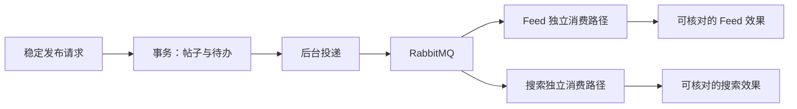

# Sprint 2：可靠发布和异步事件处理

> 主线：S4；建议窗口：2026-11-15。  
> 前置：[Sprint 1](./1-基础闭环和权威数据查询.md) 的基本业务与权威数据可运行。  
> 共同优先级、资源与验收规则沿用 Sprint 1；P0 是理解、证据和 11 月 20 日前的可投递简历。

## 1. 核心问题

**数据库已经提交，但应用在响应或消息发送前退出，为什么用户的帖子和必要后续工作仍能找回来？**

本 Sprint 建立可靠事件骨架。真实 Feed 和搜索消费者的完整故障验证分别在 Sprint 3、4 补齐，不能仅凭测试消费者成功就宣布 S4 全部完成。

## 2. 学习目标

| 知识 | 必须能够解释 |
|---|---|
| 本地事务 | 业务与待办为什么应一起提交；事务为什么不能直接包住其他系统 |
| Outbox | 它填补哪个故障窗口，又引入轮询、积压和重复投递等哪些成本 |
| 发布确认与消费确认 | Broker 接收、业务处理、用户可见是三个不同阶段 |
| 幂等与重试 | 请求重试不重复建帖，与重复消息不产生错误效果，是两个问题 |
| Go 后台任务 | `context`、超时、退出、有界并发与错误处理在真实任务中的用途 |
| 失败处置 | 临时故障、永久失败、无效消息为什么不能采用同一重试方式 |

先推演“先写数据库再发消息”“先发消息再写数据库”的失败窗口，再讨论 Outbox；不为了技术栈数量增加其他 MQ。

## 3. 实现顺序

1. **发布意图与安全重试。** 同用户、同请求标识、同内容返回原结果；同标识不同内容拒绝。识别至少保留 24 小时并跨重启有效，原帖删除后也不重新创建。
2. **业务事务与待办。** 发布、删除、关注历史补入等必要副作用有持久化工作记录；纯账号操作不强行进入消息系统。
3. **投递链路。** 实现 Outbox 扫描、确认与恢复；覆盖不可路由等失败，不能把仅有 Broker 确认当作下游完成。
4. **消费与失败链路。** 受控重试、失败记录、查询和显式重放；明确部分执行后的重做或续做方式。
5. **确定位置的故障注入。** 在事务提交后、MQ 确认后、消费部分完成后设置可控制的注入点，保留正常退出与强制退出记录。

最小测试副作用可以帮助验证链路，但真实消费者仍需覆盖自己的外部写入窗口。不能先永久记为完成，再执行尚不可恢复的 Redis 或搜索写入。

## 4. 验收分工与证据

| 验收项 | 本 Sprint 的任务 | 后续补齐 |
|---|---|---|
| S4-A | 主事务提交前失败不错误承诺成功 | 业务扩展后必要回归 |
| S4-B | 提交后响应丢失／未投递退出，安全重试找回帖子和待办 | 真实派生效果最终核对 |
| S4-C | Broker 确认后、Outbox 更新前退出，允许重投 | Feed／搜索重复效果核对 |
| S4-D | 建立部分处理故障注入与记录方式 | Sprint 3 分发中断；Sprint 4 索引中断 |
| S4-E | MQ 停止 60 秒，预算内工作保留并恢复推进 | 最终业务积压追平 |
| S4-F／G | 无效、迟到、不可路由、永久失败与显式重放可处置 | 真实消费者场景回归 |
| S4-H | 主存储短时不可用及保留数据卷重启 | 不确定提交结果安全重试 |

E 集保留 1 万条可追踪有效事件及可识别无效输入。B／C／D 核心执行窗口各至少 20 轮，可每轮选择受控子集；记录每轮已提交业务、待办、实际效果和显式失败。具体消费者未实现的窗口标为待完成。

核对稳定身份与目标效果，不仅比较总数，不以队列为空替代业务完成。保留 MySQL／MQ 数据卷；本项目不据此宣称跨地域或磁盘损毁容灾。

## 5. 技术 insight 与面试产物

交付一张自己能讲解的故障窗口图和一份实验台账，回答：

- 为什么采用 Outbox？相比请求中同步完成全部副作用，延迟和复杂度如何变化？
- Publisher Confirm 和 Consumer ACK 各自覆盖到哪里？
- “至少一次投递”如何与正确业务效果共存？为什么不宣称端到端 exactly-once？
- 业务成功但响应丢失时，客户端凭什么能安全重试？
- 为什么进入死信不代表业务完成？人工重放与自动恢复如何区分？

简历只记录实际执行的事件量、故障轮次、遗漏和重复效果结果；可靠性证据本身可以成立，不强求性能提升数字。

## 6. 完成门槛与超时处理

进入 Feed 实现前，需要可恢复的真实业务待办、可靠投递与消费骨架、安全发布重试，以及至少一条可演示的故障恢复链路。S4 的最终完成门槛是所有要求的真实副作用窗口验收通过。

时间不足时，停止开发通用消息框架或维护后台 UI，保留命令行处置即可。优先把一条真实业务的故障恢复做实，再扩大覆盖面；未完成场景列明，不能把骨架说成整个系统已可靠。

## 7. 参考代码与阅读顺序

**参考程度：有现有业务挂接点和消费示例，没有在本次检查的 Paopao 业务／事件路径与 WeBook Feed 路径中找到可直接复用的完整 Outbox＋RabbitMQ 可靠链路。** 本结论限定于相关路径，不声称整个教学仓库绝无其他示例。

| 顺序 | 代码入口 | 重点阅读与用途 |
|---|---|---|
| 1 | [Paopao priv.go](paopao-ce/internal/servants/web/priv.go)、[followship.go](paopao-ce/internal/servants/web/followship.go)、[jinzhu/tweets.go](paopao-ce/internal/dao/jinzhu/tweets.go) | 找到发帖、删除、关系修改与数据库事务的边界，决定必要待办应在哪里一起落库 |
| 2 | [Paopao servants/base/base.go](paopao-ce/internal/servants/base/base.go) 的 `PushPostToSearch`、`DeleteSearchPost`；[servants/web/events.go](paopao-ce/internal/servants/web/events.go) | 列出现有搜索与缓存副作用，区分必要工作和可丢预热 |
| 3 | [Paopao infra/events/events.go](paopao-ce/internal/infra/events/events.go)、[events_tryst.go](paopao-ce/internal/infra/events/events_tryst.go) | 阅读 `OnEvent` 和 worker pool 包装，理解原来的进程内异步入口；不能把它当作已经持久化的 Outbox |
| 4 | [WeBook feed/events/base.go](geektime-basic-go/webook/feed/events/base.go) 的 `Start`、`Consume` | 学习事件结构、消费入口、超时上下文与 Feed service 的衔接 |
| 5 | [WeBook pkg/saramax/consumer_handler_func.go](geektime-basic-go/webook/pkg/saramax/consumer_handler_func.go) 的 `ConsumeClaim` | 沿 Feed 消费入口追到错误处理和 `MarkMessage`，分析失败之后到底发生什么 |

**不能直接照搬：** WeBook 此处使用 Kafka／Sarama，消费组与 offset 不是 RabbitMQ ACK。所读通用 handler 在业务回调报错后仍执行 `MarkMessage`，格式错误分支也标记消息；这不是本项目要求的持久失败记录与可重放保证。它适合作为故障推演的学习材料，而不是可靠性完成证明。

**需要自行实现：** 稳定发布意图与跨重启重试、事务 Outbox、RabbitMQ 发布确认与不可路由处置、消费确认、安全重试、失败查询／重放、积压预算、确定位置故障注入和业务效果核对。Feed／搜索真实副作用的幂等与恢复仍需后续 Sprint 补齐。
