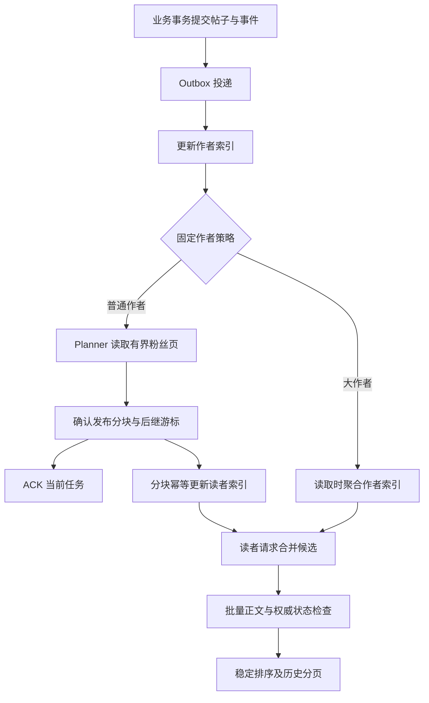

# Sprint 3：外部投影协议与混合 Feed

> 状态为待实施。依据 v2 的 P0～P2，前置为已完成的 Sprint 1、2。
> 共同业务契约、资源及完整验收规模见 [规划总览](./README.md)。本 Sprint 形成时间线主线主体，并建立可靠派生数据的真实基线。

## 1. 工程问题与学习目标

作者发帖后，哪些工作在发布时完成，哪些工作留到读者读取时完成？任务展开、Redis 写入和 ACK 之间发生退出时，怎样找回必要工作？

需要能够解释请求幂等、消息身份、目标效果幂等的不同职责，稳定游标与可变粉丝集合的交错，以及分批、并发上限和公平推进之间的关系。

## 2. 实施批次

### 3.1 冻结基线与测量入口

记录现有 API、SQL Feed、Outbox 发布器、SQL Dummy 与失败重放的运行命令和版本。整理发布路径的四条修改语句、作者查询、提交与发布器状态更新，分别统计 SQL 次数、逻辑写入、事务提交和存储开销。

承接 Sprint 1 的 C/Q 全量核对、双向关系执行计划、深分页和索引空间／写入成本待办。保留合理索引，建立独立参考结果生成器。补齐发布至实际 Feed 可见、积压年龄、每帖逻辑索引写入、普通任务推进的测量。

### 3.2 事件版本与外部处理器

扩展事件契约，明确 `schema_version`、`event_id`、`aggregate_key`、对象版本或 `relation_generation`、必要 payload 和可选 `source_position`。关系当前采用物理删除和重新生成 ID，实施时确定生命周期身份如何在取关事务中被可靠捕获，并写入同事务事件。关系 ID 可用于身份区分，事务提交顺序需要另行论证。

旧格式事件通过明确分支解码，缺少版本时回读当前权威状态并重建或进入可处置失败状态。保留原始消息、旧失败记录和显式重放能力，迁移顺序采用先兼容读取、再启用新写入。

新增外部投影处理接口，结果覆盖已完成、等待外部任务、可重试、永久失败。SQLHandler 继续承担 SQL Dummy 基线。外部调用结束后，根据可核实效果决定 ACK；需要继续处理时，可靠保存后继、重试或失败意图后再 ACK。

首个处理器为 Redis 作者索引，固定帖子身份，以有界条件更新处理重复和迟到。SQL 进度按必要根任务或分块记录，避免逐粉丝通用成功记账。固定重试次数、退避、失败审计与重放窗口，验证重试转交确认及不可路由场景。

### 3.3 作者索引、读者索引与三策略读取

依次实现 SQL 拉取参考、纯推对照、混合策略。索引保存帖子身份和排序数据，正文单独批量读取。每轮使用固定作者名单或冻结阈值，普通作者写时分发，大作者读时聚合。

统一 `(created_on, post_id)` 排序和游标编码，明确 Redis 表示方式的精度及同时间戳排序。合并多来源候选后去重、批量读取正文、核实当前关系和删除状态。过滤后不足一页时继续有界取候选，耗尽预算时返回明确的可继续读取语义。索引裁剪后的历史页使用权威慢路径，保持当前接口契约。

### 3.4 有界 Planner 与可恢复交接

Planner 每次读取有界粉丝页，生成稳定身份的分块任务和后续游标任务。全部必要转交收到发布确认后，才 ACK 当前消息。部分发布成功后退出会产生重复，子任务与 Redis 效果均需可重做。

游标依据实际关系索引定义，覆盖页间关注、取关、重新关注和事务提交交错。新增关注通过最近 20 条历史补入与后续读取路径闭合语义，测试晚提交关系和同时间戳边界。旧清理任务仅能清理对应关系生命周期的效果。

普通分发、大作者展开、历史补入和恢复分别配置并发、批量、排队和超时预算。Pipeline 降低往返，单个 Lua 限制工作量。Fanout 子任务预留接收用户键，供 Sprint 5 固定逻辑分片使用。

### 3.5 故障补验与正式对照

先跑小型可控竞争窗口，再按共同规模运行正式正确性、性能及故障实验。每批保留独立回退入口，读取可切回 SQL；投影重建按明确边界执行，保留事件和失败证据。

## 3. 验收矩阵

| 场景 | 验收依据 |
|---|---|
| C 集静止追平后三策略全量比较 | 身份、顺序、分页与独立权威结果相同 |
| Q 集 100／500／1000 关注作者读取 | P95/P99、有效吞吐、DB 请求量、读时合并成本 |
| F 集 1000／1 万／10 万独立粉丝 | 每帖逻辑索引写入、索引内存、Redis RSS、总资源、可见延迟 |
| 大作者与普通作者混合、历史补入同时运行 | 普通任务持续推进、积压受控、资源符合冻结预算 |
| 删除、取关、重新关注、旧格式与迟到消息 | 新读取权威过滤正确，旧清理保护新关系，最终集合收敛 |
| 子任务部分确认、Redis 效果后未 ACK、分发半途退出 | 重做后目标集合完整，重复效果正确，核心窗口至少 20 轮 |
| MQ 停止 60 秒、不可路由、重试转交失败、永久失败重放 | 意图可找回，失败可查，恢复后按身份核对 |

## 4. 完成门槛与技术叙事

完成要求为外部协议、旧消息迁移、三策略、分块交接、历史读取、全部适用验收和报告。性能报告同时给出读成本、写放大、索引内存和可见性。SQL 记录减少的收益以全链路实测为依据。

形成三策略成本表、Planner 退出时序图及普通任务推进曲线。能够解释纯拉、纯推和混合各自适合的负载，以及为何每个粉丝写 SQL 消费日志会改变分发成本。

活跃读者选择性物化放在基础混合策略验收后的可选扩展，包含冷用户上线补齐和历史读取设计。

## 5. 代码阅读与下一步

依次阅读 `src/internal/post/service.go`、`follow/service.go`、`outbox/events.go`、`publisher.go`、`consumer.go` 与集成测试，后四者位于 `src/internal/` 对应包。WeBook 的 `feed/service/article_event.go`、`service/feed.go` 仅作为推拉拆分学习材料，迁移时按本项目排序、关注规模和可靠性要求实现。

下一 Sprint 以这里的真实 Redis 投影和 SQL 慢路径为输入，完成缓存丢失后的并发恢复。
