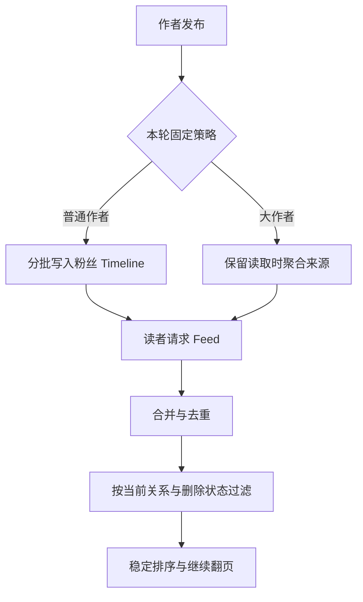

# Sprint 3：Feed 推拉策略和分发控制

> 主线：S1；建议窗口：2026-11-16。  
> 前置：S2 权威关系、SQL Feed 基线与 S4 可靠事件骨架。  
> 共同约定见 [Sprint 1](./1-基础闭环和权威数据查询.md)；本 Sprint 是主要难点之一，日期服从理解与正确性。

## 1. 核心问题

**作者发一次帖，应该在发布时为粉丝预先分发，还是在粉丝读取时现场聚合？工作量被移动到了哪里？**

目标是用相同业务语义和实测成本解释策略选择，不是仅仅实现 Redis 时间线。

## 2. 学习目标

- 拉、纯推、推拉混合各自承担的读成本、写放大、存储与异步延迟。
- Timeline 的帖子 ID 索引与帖子正文的区别；缓存容量与产品历史范围的区别。
- 多来源合并、去重、稳定排序与游标边界。
- Go 有界 worker、任务分批、背压与取消；为什么不能为每位粉丝无界启动 goroutine。
- 当前关系和删除状态如何约束派生数据；重新关注后迟到旧任务为什么危险。

学习时先手算一个普通作者与一个大作者的工作量，再看实际测量。手算用于形成假设，不能替代内存或延迟实测。

## 3. 实现顺序

1. 固定 SQL 拉取参考路径，验证当前关注作者加自己、排序、去重和历史分页。
2. 实现纯写扩散，先让静止且追平后的结果与参考路径一致。
3. 增加混合策略：普通作者预分发，大作者读取时聚合；同一运行内固定分类，不做在线迁移。
4. 实现分批与有界调度，关注大任务和普通任务共存时的推进情况。
5. 接入新关注最近 20 条历史补入，保留近期索引之外的合法历史读取路径。
6. 覆盖删除、取关、重新关注与迟到任务交错，以及过滤后不足一页但仍有后续候选的情况。
7. 在分发部分粉丝后退出，验证恢复后重做或续做不会漏段，补齐 S4 的真实 Feed 窗口。

图表示逻辑职责，实际查询和批量校验顺序在实现时决定，避免每个候选单独查询造成额外成本。

## 4. 验收与证据

| 项目 | 场景 | 需要留下的证据 |
|---|---|---|
| S1-A | C 集静止且追平，三策略全量对照 | 内容 ID、顺序与分页结果；独立参考结果 |
| S1-B | Q 集，关注 100／500／1000 位作者 | P95/P99、有效吞吐、DB 请求量、读时合并成本 |
| S1-C | F 集，1000／1 万／10 万独立粉丝 | 每帖逻辑写入、索引内存、总资源、可见延迟 |
| S1-D | 大作者与普通作者混合发布 | 普通作者可见性、积压、goroutine 与内存 |
| S1-E | 关系变更、删除与迟到任务交错 | 不复活删除内容，不破坏重新关注 |
| S4 补验 | 部分分发后退出与重复投递 | 实际目标集合完整，故障轮次与恢复结果 |

先过正确性，再冻结策略与负载进行正式对照。所有策略保持相同页大小、过滤规则和历史范围；不能靠少返回数据获得收益。

可见性在发压期间持续观察并记录轮询间隔、抽样范围和未完成样本。Timeline 索引内存与 Redis RSS 分开报告，写入条数不能直接当作内存节省。十万粉丝实验不能外推成百万规模成绩。

## 5. 技术 insight 与面试产物

产出三种策略的成本表与一张混合负载结果图，并用自己的话回答：

1. 为什么不是所有作者都纯推，或者全部 SQL 拉取？
2. 混合策略减少了什么，代价落在了哪个读请求上？
3. 分类阈值由哪些实验支持？为什么没有通用最优阈值？
4. 分批和限制并发为什么不天然等于公平调度？普通任务是否真的持续推进？
5. 索引裁剪后如何读取旧帖？迟到事件和持续写入下分页承诺是什么？

简历素材使用“测试条件 → 策略 → 成本变化 → 读取代价”的结构。没有显著优化时，记录适用范围和取舍，不伪造改善。

## 6. 完成门槛与超时处理

三策略结果一致只是正确性门槛；完整完成还需读写对照、混合负载和交错故障证据。

若超时，优先修复结果不一致与无界资源问题，停止额外策略、自动调参和 UI 扩展。不能把只有纯推的实现写成推拉混合。临近 11 月 19 日仍未完成时，收口到已经证明的能力，留存失败与未验证项，并转入固定的简历窗口。

## 7. 参考代码与阅读顺序

**参考程度：这是 WeBook 的主要阅读 Sprint。** 学习它的推拉业务拆分与实验组织，Paopao 提供统一业务语义的改造起点，不将两套服务整体合并。

| 顺序 | 代码入口 | 重点阅读与用途 |
|---|---|---|
| 1 | [Paopao jinzhu/tweets.go](paopao-ce/internal/dao/jinzhu/tweets.go) 的 `ListFollowingTweets` | 回顾 SQL 拉取基线及权威过滤，再讨论为何需要分发 |
| 2 | [WeBook feed/service/article_event.go](geektime-basic-go/webook/feed/service/article_event.go) 的 `CreateFeedEvent` | 核心入口：根据粉丝数分流为拉事件或粉丝推事件，理解 fanout 的成本来源 |
| 3 | 同文件的 `FindFeedEvents`；[service/feed.go](geektime-basic-go/webook/feed/service/feed.go) 的 `GetFeedEventList` | 阅读推／拉结果并发获取、等待、聚合、排序与截断；理解 `errgroup` 和互斥保护的职责 |
| 4 | [repository/feed_event.go](geektime-basic-go/webook/feed/repository/feed_event.go)、[dao/feed_push_event.go](geektime-basic-go/webook/feed/repository/dao/feed_push_event.go)、[dao/feed_pull_event.go](geektime-basic-go/webook/feed/repository/dao/feed_pull_event.go) | 追踪收件箱／发件箱记录、批量创建和时间条件查询；实际事件持久化是 GORM 表，不是现成 Redis Timeline 实现 |
| 5 | [events/base.go](geektime-basic-go/webook/feed/events/base.go) | 将外部事件与业务 handler 串起来；本项目改接自己的可靠事件链路 |
| 6 | [test/feed_test.go](geektime-basic-go/webook/feed/test/feed_test.go)、[stress_test/data_test.go](geektime-basic-go/webook/feed/test/stress_test/data_test.go)、[stress_test/readme.md](geektime-basic-go/webook/feed/test/stress_test/readme.md) | 阅读测试组织、造数和纯推／纯拉／混合实验入口；上游截图与成绩不作为本项目证据 |
| 7 | [stress_pushevent_test.js](geektime-basic-go/webook/feed/test/stress_test/stress_pushevent_test.js)、[stress_pullevent_test.js](geektime-basic-go/webook/feed/test/stress_test/stress_pullevent_test.js)、[stress_mixedevent_test.js](geektime-basic-go/webook/feed/test/stress_test/stress_mixedevent_test.js) | 借鉴对照场景的划分，再换成自己的负载、数据与完整接口路径 |

### 阅读时必须识别的差异

- `article_event.go` 的示例阈值为 4，创建时查询粉丝数分流；本项目需要在一轮实验内固定策略，并用数据解释阈值，不能照抄常数或默认支持动态切换。
- 拉取关注作者的示例请求只取前 200 条，不能满足本项目 500／1000 关注者读取场景。
- 示例以秒级 `ctime` 条件分页、按时间排序，缺少本 PRD 的发布时间＋帖子 ID 边界；创建 Feed 事件时使用当前时间，也不能直接当作不可变帖子发布时间。
- `feed.go` 中 `GetFeedEventListV1` 在 `eg.Wait()` 前排序共享结果，不能作为并发写法模板；应重点读等待后再聚合的主路径，并独立验证自己的实现。
- 示例混合压测为 10 秒固定 VU，并带固定用户与时间戳；只能参考脚本结构，不能替代本项目 arrival-rate、预热、正式采样、多轮重复和持续可见性观察。

**需要自行补齐：** Redis Timeline 设计、相同语义的三策略对照、分批有界分发与普通任务推进、帖子级去重、当前状态过滤、历史补入和旧页回退、重新关注保护，以及中途退出恢复。不要因为示例有 `follow_event.go` 就默认已实现我们要求的关注历史补入。
