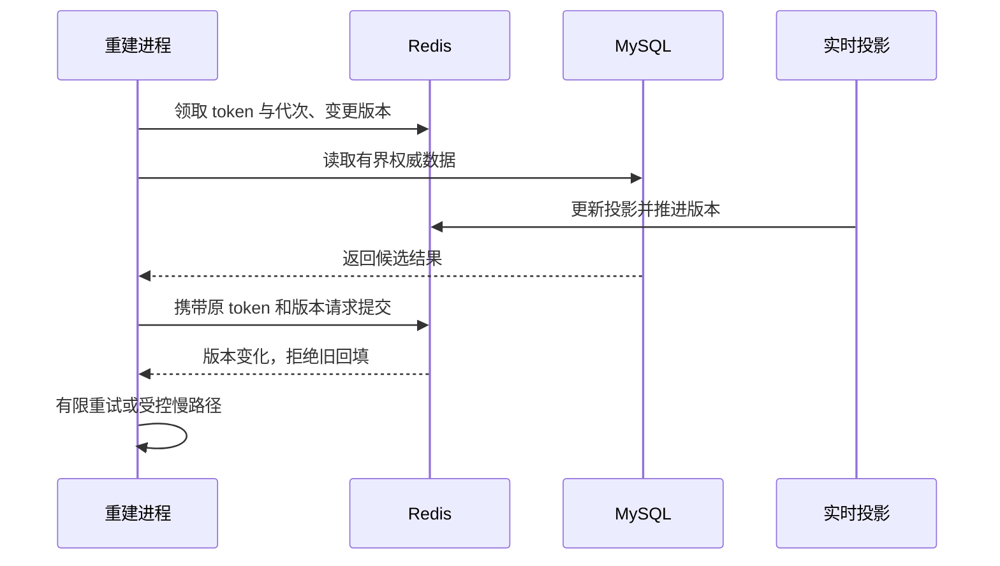

# Sprint 4：缓存一致性恢复与搜索投影

> 状态为待实施。对应 v2 的 P3、P4，前置为 Sprint 3 真实 Feed 与外部处理器。
> 共同约定见 [规划总览](./README.md)。按缓存、搜索两个子阶段推进，分别留下可验收交付。

## 1. 工程问题与学习目标

已确认的事件对应缓存被清空后如何恢复？旧数据库读结果晚到时，怎样避免覆盖已观察到的新投影？Meilisearch 接受任务后，如何确认其真实结果并处理执行状态不确定？

掌握 singleflight 的同进程同 Key 边界、跨实例重建资格、不同 Key 总容量、token 与代次、搜索 task UID 和最终对账。

## 2. 实施批次

### 4.1 缓存分层与读取状态

L1 缓存可安全复用的内容或候选，L2 保存正文和时间线索引，MySQL 裁决当前有效状态。设置容量、TTL 和淘汰边界。L1/L2 命中路径继续执行必要的权威过滤。

为真实空、缺失、未构建、构建中、依赖失败和容量拒绝建立可观测状态。统一普通读取、历史慢路径和重建的数据读取逻辑，控制每批候选和正文查询大小。

### 4.2 回源合并与本地保护

同进程同 Key 使用 singleflight 合并重叠回源，定义等待者取消与共享任务 deadline 的关系。跨实例使用有限期限的重建资格，限制资格竞争、等待与重试。

大量不同 Key 共享准入、执行并发、队列长度和总时间预算。Redis 停机时本地保护继续生效。提前冻结最大实例数 `Nmax`，每实例额度 `q` 满足 `Nmax*q <= B`，覆盖所有实际回源入口并汇总 SQL 连接与请求量。

本阶段通过两个进程验证跨实例协议，后续 Sprint 5 接入完整服务发现与部署治理。

### 4.3 条件提交的缓存重建

1. 原子领取 build token，读取缓存代次和变更版本。
2. 在 Redis 外批量读取权威数据，构建有界候选。
3. 回填 Lua 检查 token、代次和变更版本，匹配才提交。
4. 不匹配时丢弃旧结果，按有限次数重新构建，耗尽后走受控慢路径。
5. 实时投影更新同步推进目标缓存版本，元信息缺失时拒绝旧构建者。
6. 删除标记、事件重放窗口和缓存元信息保留期成套定义，避免过期后旧任务恢复错误状态。

每次 Lua 仅处理有界数据。涉及多 Key 时记录同槽约束和 Key 命名。该协议保护已观察到的缓存变化，尚未到达的业务变化由权威过滤与后续事件处理保障。

### 4.4 搜索作为第二种外部投影

Feed 与搜索分别消费必须处理的事件。按对象组织搜索处理顺序，先实现逐条基线，再引入同时有批量大小和等待时间上限的索引提交。

记录 task UID，等待实际成功状态并通过查询测量可见性。等待中的任务保存可恢复身份和后续检查意图，遵循 Sprint 3 的 ACK 责任。受理成功但本地尚未保存 UID 时，按不确定结果处理，回读权威状态、核对现有外部任务或重做当前目标状态。

Meilisearch 写入依据当前权威状态构造。删除后的新搜索请求执行权威过滤，迟到任务或失联旧消费者产生的残留通过最终对账或重建收敛。对每种不确定窗口记录恢复方式，验证版本字段实际具备的保护范围。

接通中英文关键词搜索、无匹配和错误响应，沿用前 100 条匹配范围。以接口脚本验证发布、搜索、删除全过程。

### 4.5 搜索恢复与重建

搜索停止 60 秒时继续发布、删除与 Feed 读取，记录核心服务表现和恢复后的指定事件追平时间。停写重建使用隔离的新索引或明确清空的测试索引，等待全部任务实际完成，再核对有效文档 ID 和字段。

重建需要固定边界、处理在途任务、核对新投影、切换读取和保留回退步骤。索引受理、任务完成和用户可见分别测量。

## 3. 验收矩阵

| 场景 | 必留证据 |
|---|---|
| 同热点受控重叠、两个进程同时回源 | 实际回源次数、资格竞争、共享等待及取消结果 |
| 大量不同 Key 缺失 | 全实例任务并发、队列、SQL 量及拒绝期限 |
| Redis 停止 60 秒并保持业务写入 | 成功读取、写入目标、拒绝、超时与 DB 压力并列曲线 |
| 旧读晚回、重建期间新帖、删除和关系变化 | 拒绝旧回填次数、权威过滤及最终完整结果 |
| 构建者退出、token 过期、元数据丢失 | 新构建者接管、旧构建者被拒绝、有限恢复时间 |
| 热、冷、故障、恢复后四状态 | 相同语义的延迟、成功率和全部 DB 请求量 |
| 搜索逐条与小批量 | 端到端可搜索 P95/P99、任务失败、吞吐与等待成本 |
| 搜索受理后退出、效果后未 ACK、迟到创建、删除 | 适用核心窗口至少 20 轮，实际文档身份与字段收敛 |
| 搜索停机和停写全量重建 | S3-A～E 全部证据、最终集合核对、可见性未完成样本 |

## 4. 完成门槛与技术叙事

缓存与搜索各自通过正确性、故障、恢复及正式对照。高写入导致重建反复失败的场景须验证重试预算和慢路径。恢复后的缓存与索引通过独立权威集合核对。

交付缓存竞争时序图、回源与有效服务曲线、搜索任务状态图和逐条／批量成本表。能够比较本地合并与跨实例资格，解释锁到期后的旧写风险、条件提交的保护边界，以及搜索顺序控制和最终对账各自的作用。

## 5. 代码阅读与回退

从 Sprint 3 的候选读取、批量权威校验、投影处理接口入手。Paopao 的 `internal/dao/search/meili.go` 可作为文档映射参照，实际任务跟踪和恢复依照本项目协议实现。

缓存可按配置回退到有界 SQL 读取，搜索保留上一代已核对索引及失败重放入口。回退同样遵守资源预算和当前状态过滤。下一 Sprint 将这些资源域部署为可独立扩缩容的进程。
