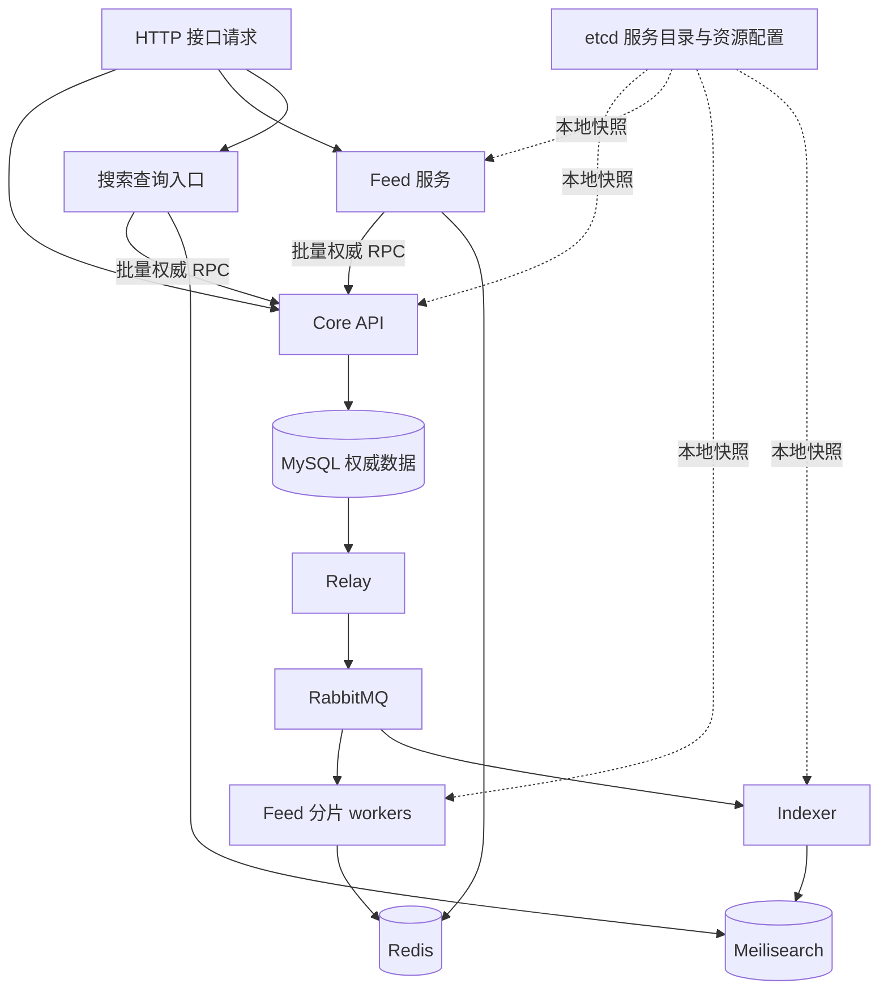

# Sprint 5：分布式执行与服务治理

> 状态为待实施。对应 v2 的 P5，前置为 Sprint 3、4 的真实投影、恢复协议和资源预算。
> 共同约定见 [规划总览](./README.md)。本 Sprint 形成第四条简历主线，并验证已有协议的多实例行为。

## 1. 工程问题与学习目标

增加进程后如何分配工作、保护共享数据库、接管退出的 worker？搜索依赖变慢和配置中心断开时，其他请求如何继续在预算内运行？

需要掌握 gRPC deadline 与取消、批量 RPC、固定逻辑分片、SAC、优雅 drain、lease、Watch revision 和配置快照。对每项机制明确其控制范围和失效后的行为。

## 2. 目标运行结构

Core 保留账号、帖子、关系和数据库事务边界，提供批量权威读取。Feed 读取、Fanout、重建和 Indexer 按资源域独立部署。Relay 负责事件传输。具体 HTTP 路由入口在实施批次中明确，已有外部接口契约继续适用。

## 3. 实施批次

### 5.1 gRPC 边界与生命周期

先定义批量帖子／关系有效性、粉丝页和必要权威数据读取 RPC，设置单请求批量上限。Feed 与 Indexer 通过 Core 获取所需权威数据，Core 管理数据库连接预算。

传播 deadline、取消和 trace ID，数据库和下游调用响应取消。定义业务错误、容量拒绝和依赖不可用的映射。仅对适合安全重试的操作启用有限重试，所有尝试共享总时间预算。

先单实例经过真实 RPC 运行并核对结果，测量拆分前后额外延迟。连接复用、连接池、启动就绪、停止接收、drain 和退出期限一起实现。

### 5.2 固定逻辑分片与工作池

冻结逻辑分片数量 P，按目标对象键路由。Fanout 展开后按接收用户归组，让大作者的接收任务分散到多个分片。搜索按帖子对象组织处理顺序，明确哪些任务可并行、哪些必须串行。

使用固定版本及队列类型验证多队列与 Single Active Consumer。每个分片串行执行所需顺序任务，跨分片并行。消费归属由 RabbitMQ 管理，etcd 只承担低频控制面。

调整 worker 数量时观察各分片负载，通过有界 drain 和重新订阅改善分配。记录未确认任务、退出期限和接管时延。断联旧消费者可能继续完成外部调用，沿用目标版本、幂等与搜索对账协议。

### 5.3 服务发现与配置恢复

实例通过 lease 注册地址、角色和版本，客户端从快照建立本地目录并 Watch 更新。服务 readiness 与目录租约分别定义，实例退出先停止接收再撤销注册。

资源配置带 revision，完整校验后原子替换。实例暴露当前生效 revision。断线从 revision 恢复，历史压缩时重新获取快照。已有实例在 etcd 暂不可用期间使用已验证配置和目录，并依靠连接失败处理失效地址；全新实例缺少可信快照时保持未就绪。

配置降低并发时停止新准入并等待在途退出，设置有界过渡期。涉及集群预算和副本数的变更按保守顺序生效，等待相关实例确认 revision 后再放开容量，避免新旧配置混用突破总预算。

### 5.4 资源隔离与多实例回归

为读取、普通分发、重任务、历史补入、重建和搜索分别冻结并发、连接、队列和超时预算。接入 Sprint 4 的 `Nmax*q <= B` 约束，启动和扩容检查最大副本数。共享数据库连接及 SQL 请求量按全部实例汇总。

分别运行固定总资源的 1／2／多 worker 对照，以及增加总资源的容量对照。实例数量上限服从本机预先约定预算。保持相同数据和负载，报告分片倾斜、闲置资源、并行效率和饱和点。

## 4. 验收矩阵

| 场景 | 通过依据与证据 |
|---|---|
| 经过真实 RPC 的全部业务回归 | 身份、删除／关系过滤、分页与单进程参考一致 |
| RPC deadline、取消、依赖慢响应 | 在途工作有界退出，重试次数与总时限符合预算 |
| 1／2／多 worker 两组资源条件 | 有效吞吐、普通作者 P99、可见延迟、CPU／内存及分片负载 |
| SIGKILL 活跃 worker | 未完成任务接管、恢复时延、重复效果与普通业务尾延迟 |
| 旧消费者失联后晚完成外部调用 | Redis 条件保护有效，搜索经核对收敛 |
| 搜索进程或依赖受限 | 发布与 Feed 满足冻结成功率、时延和资源目标 |
| etcd 断开、重连、revision 压缩与无效配置 | 旧快照行为、重取快照、生效 revision 和错误证据 |
| 扩缩容与降低预算并发发生 | 全实例预算、连接数、准入和 drain 符合过渡约定 |
| 多实例下 Redis 停机和同时重建 | 保留最低有效服务，DB 负载受控，最终集合正确 |

新增分布式关键故障采用可控注入及逐轮身份核对，正式报告至少 20 轮；性能对照沿用至少 3 轮。可选 RabbitMQ 三节点 quorum 实验单独约定资源与多数派场景，报告本机进程／容器故障范围。

## 5. 完成门槛与技术叙事

交付服务启动配置、批量 RPC 契约、分片路由说明、控制面恢复步骤、资源配置表以及上述实验报告。故障接管、配置恢复和多实例预算均通过后收口。

形成固定总资源／扩资源两张对照图、worker 接管时序图和 etcd 断线恢复图。能够比较单进程与按资源域拆分、固定分片与按 worker 数取模、SAC 与目标存储幂等，说明 MySQL 权威入口和单机实验的边界。

回退到已验证的实例数、配置 revision 与订阅分配，保留固定分片身份和未完成任务。首轮保持 P 固定，后续在线重分片需要独立设计和验收。
