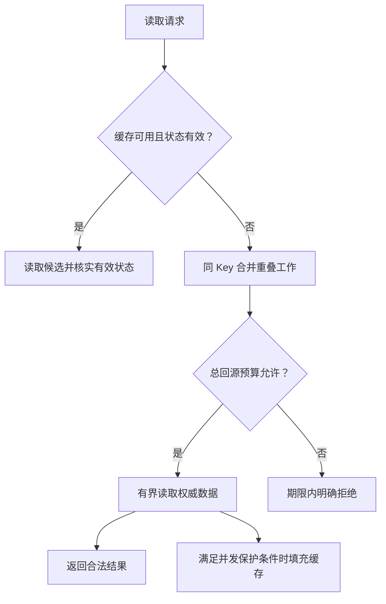

# Sprint 5：缓存回源控制和并发重建

> 主线：S5；建议窗口：2026-11-18。  
> 前置：正确的 Feed、权威查询慢路径与可靠业务事件。  
> 共同约定见 [Sprint 1](./1-基础闭环和权威数据查询.md)。

## 1. 核心问题

**单个热点缓存缺失、大量不同缓存缺失、整个 Redis 停机分别会发生什么？怎样保护数据库，同时保留有效服务？**

S4 解决必要工作不能丢，S5 解决已经生成的派生数据以后丢了怎么办。过去已经确认的事件，不会因为今天缓存丢失就自动重新执行。

## 2. 学习目标

- 区分 Timeline ID 索引、正文缓存、权威关系与删除状态检查。
- 理解 `singleflight` 只合并同一 Group 中同 Key 的重叠执行，不是全局限流。
- 区分准入速率、执行并发、排队长度和超时；知道请求受控拒绝与服务有效性需要一起考察。
- 理解空缓存、未构建、构建中、依赖故障等状态不能统一返回空列表。
- 推演“读取旧快照 → 新帖写入 → 旧快照覆盖缓存”的竞争，理解重建发布需要保护哪些边界。

具体重建协调方案在实现前对比，优先选择满足当前单环境和实例范围的简单方案；不用尚未验证的锁或版本设计先承诺正确性。

## 3. 实现顺序

1. 明确缓存状态与正常读取、缓存缺失、依赖异常时的返回语义。
2. 对相同热点合并重叠回源，先用可控制的同步屏障验证合并边界。
3. 限制不同 Key 的总工作量：准入、并发、最大队列和超时；把所有实例的额度算清楚。
4. 接通 Redis 故障慢路径，保留必要鉴权、关系判断、删除过滤与正文读取。
5. 实现受控缓存重建，并保护重建期间的新发布、删除、取关和重新关注。
6. 将恢复后的结果与权威参考查询核对，再测恢复服务能力。

图中回源预算的实例范围必须明确。每实例上限不能直接当作所有实例合计上限。

## 4. 验收与证据

| 项目 | 实验 | 判断依据 |
|---|---|---|
| S5-A | 同一热点在受控重叠窗口缺失 | 同 Group 同 Key 的实际回源次数、共享等待与错误 |
| S5-B | 大量不同用户缓存同时缺失 | 全实例并发、准入、队列与 SQL 压力不越预算 |
| S5-C | Redis 停止 60 秒，保留业务写入 | 最低有效读取、写入目标、拒绝、超时和资源同时达标 |
| S5-D | 清理隔离 Timeline，恢复期间继续变更 | 不覆盖新内容、不复活删除或失效关系；恢复结果与耗时 |
| S5-E | 热、冷、故障回退、恢复后四种状态 | P95/P99、完整成功率、全链路 DB 请求量及相同语义 |

回源任务数与 SQL 数分别记录，一个任务可能执行多条 SQL。保留状态检查的成本，不能把所有 SQL 归零作为不合理目标。

只删除隔离测试数据或指定命名空间。恢复正确性看内容集合与业务状态，不看 Redis Key 总数是否回来。故障期间全部拒绝，或将错误返回为空列表，均不算成功降级。

## 5. 技术 insight 与面试产物

产出一组并列曲线：成功读取、拒绝、超时、DB 负载；再附一份并发重建结果核对。回答：

1. 为什么 singleflight 解决不了大量不同 Key 同时缺失？
2. 为什么只限制并发还可能出现大量等待和内存占用？
3. 怎样确定回源预算，如何证明数据库受保护且用户仍得到有效服务？
4. 为什么不能简单查一次数据库，然后覆盖整个 Timeline？
5. 为什么缓存重建不能替代 Outbox，Outbox 也不能替代重建？

简历可写实际热点回源压缩、故障服务能力或重建时间；必须同时给出预算、成功率与适用范围，不能隐藏拒绝率。

## 6. 完成门槛与超时处理

热点合并完成不等于 S5 完成。完整完成还需大量不同 Key、Redis 停机、并发重建和四种状态对照。

若到 11 月 18 日仍在处理前置主题，不强行开一个只有概念没有证据的缓存亮点。可以把 S5 留到后续迭代，简历如实使用已经完成的深项；首版 S5 验收要求保持不变。11 月 19 日转入简历收口，不为了凑齐五条延误投递准备。

## 7. 参考代码与阅读顺序

**参考程度：有缓存读写、缺失回源和失效事件参考，没有在本次检查的相关路径中找到满足 S5 的完整热点合并、全实例回源预算和并发重建方案。** 这一 Sprint 的核心保证需要自己设计并证明。

| 顺序 | 代码入口 | 重点阅读与用途 |
|---|---|---|
| 1 | [Paopao dao/cache/cache.go](paopao-ce/internal/dao/cache/cache.go)、[core/cache.go](paopao-ce/internal/core/cache.go) | 找到缓存接口及实现选择；先确认实际启用路径，不因为目录内有实现就假定正在使用 |
| 2 | [dao/cache/base.go](paopao-ce/internal/dao/cache/base.go) 的 `IndexPosts`、`cachePosts`、`SendAction` | 阅读命中／回源／异步填充与失效流程，分析资源限制和并发覆盖风险 |
| 3 | [dao/cache/web.go](paopao-ce/internal/dao/cache/web.go)、[common.go](paopao-ce/internal/dao/cache/common.go)、[events.go](paopao-ce/internal/dao/cache/events.go) | 理解 Redis Get/Set/Delete、用户与关系缓存、失效事件；识别哪些状态不能只依赖滞后缓存 |
| 4 | [servants/web/loose.go](paopao-ce/internal/servants/web/loose.go) 的 `getIndexTweets`、`indexTweetsFromCache`、`userTweetsFromCache`；[servants/base/events.go](paopao-ce/internal/servants/base/events.go) | 追踪实际业务响应缓存与异步填充，不只阅读底层 Redis 封装 |
| 5 | [WeBook feed/repository/cache/feed_event.go](geektime-basic-go/webook/feed/repository/cache/feed_event.go) | 可选对照：`GetFollowees`／`SetFollowees` 缓存关注作者 ID，TTL 为 10 分钟；只参考序列化和缓存缺失表达 |

**不能直接照搬：** WeBook 上述缓存存的是关注作者集合，不是帖子 Timeline，也没有本项目要求的 Timeline 重建流程。Paopao `cachePosts` 在 channel 满时会另起 goroutine 等待发送，不能因此宣称总工作量有界；`IndexPosts` 缓存读取失败后直接回源，也不能单独构成缓存故障期间的受控服务能力。

**需要自行实现：** 同 Key 重叠请求合并、不同 Key 的总准入／并发／排队预算、空与未构建状态、完整鉴权和过滤的故障慢路径、并发更新下安全重建，以及 S5-A～E 的观测和核对。`singleflight` 使用标准库生态中的现有实现即可，不为学习目的自制替代库；具体用法在实施时再核对依赖版本。
