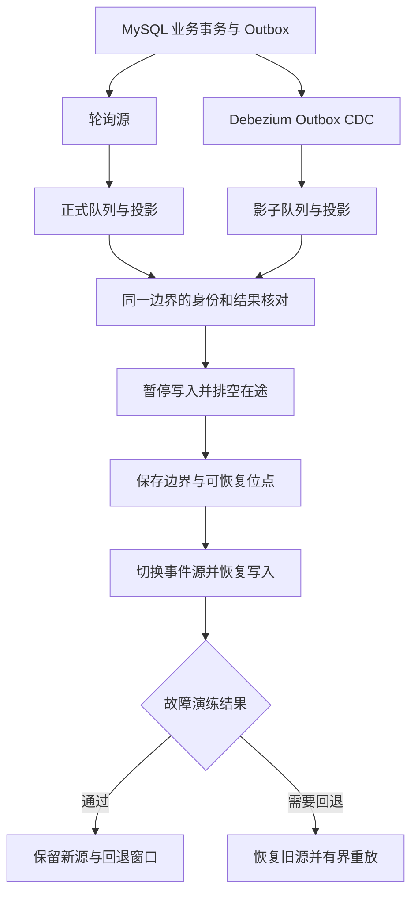

---
当前考虑废弃sprint 6
---

# Sprint 6：CDC 对照、受控切换与联合验收

> 对应 v2 的 P6～P8，前置为完整真实投影、多实例治理和可核对指标。
> 共同约定见 [规划总览](./README.md)。用户已取消旧日历截止，本 Sprint 包含 CDC 工程交付及四条主线的证据收口。

## 1. 工程问题与学习目标

将应用轮询换成日志捕获，减少了哪些 SQL，又增加了哪些资源和恢复成本？如何在统一事件契约下比较、切换和回退事件来源？

掌握 binlog、snapshot、offset、schema history、源位置与业务版本的区别，理解多表行变更到领域事件的归一化，以及投影重建的完整集合边界。

## 2. 实施批次

### 6.1 固定兼容组合与恢复存储

实测并记录 MySQL、Debezium Server、RabbitMQ 的固定版本、配置与镜像摘要，补齐 MySQL 8.0 兼容性待办。记录 binlog 配置、权限、日志保留预算、offset 和 schema history 的可靠存储方式。

使用 connector 支持的快照和日志模式。验证 RabbitMQ sink 的目标绑定、持久化、发布确认、不可路由和位点提交语义。无法证明交付安全的组合记录具体失败条件，调整兼容组合或适配后继续验收。

为日志增长与 CDC 落后设置阈值、告警和停止条件。位点对应日志已清理时进入显式重建流程，保留诊断证据。

### 6.2 Outbox CDC 影子对照

定义可替换事件来源接口，轮询和 CDC 归一化输出相同事件契约。首轮只捕获 Outbox 新增行，保留稳定事件身份，明确排除轮询状态更新带来的重复语义触发。

轮询写正式投影，CDC 写隔离的影子队列和投影，按相同业务边界核对事件身份、目标对象、顺序约束与最终结果。两条源同时运行期间的额外成本单独记录，正式性能比较分开运行相同负载。

比较正常投递是否可省逐行状态回写，重新设计清理与回退保留条件。Outbox、binlog、offset、失败任务和重放窗口必须匹配，事件 ID 的大小不作为提交水位依据。

### 6.3 受控切换与回退演练

1. 暂停相关写入，确认在途业务事务已结束，记录一致边界。
2. 排空或明确登记边界内的未完成工作，等待外部任务实际完成并核对投影。
3. 固定新源可恢复位点和目标投影代次，确认影子结果一致。
4. 切换正式事件源配置，保证同一正式投影只有选定源负责该阶段输入。
5. 恢复写入，持续核对身份、可见性和资源。
6. 注入失败，按记录边界恢复旧源，以有界重放补齐并再次核对。

### 6.4 选择性业务表 CDC 与请求记录评估

完成 Outbox CDC 后，逐类列出发布、删除、关注、取关的行变化、稳定对象身份、业务版本和必要 payload。重点检查物理删除关系、重新关注、多表事务以及快照事件的映射。能完整恢复领域变化的事件类才进入业务表 CDC 小规模原型。

对候选类运行同语义影子实验、故障及切换验证，比较减少 Outbox INSERT 后的全链路成本。正式切换前保留必要 Outbox 意图，并为停止写 Outbox 后的回退设计暂停写入、回补意图或从可靠来源重放的闭合流程。未满足条件的事件类继续使用已验证来源，记录测量和判断依据。

`post_requests` 首轮保留。比较独立窄表与业务表内幂等字段的适用性，覆盖至少 24 小时识别、同键异内容、删除后身份、跨重启和首次响应重放。候选压缩方案只有在收益与全部语义验证成立后采用。本批必交付评估结论与适用条件，实际切换取决于实验结果。

### 6.5 联合验收与证据冻结

执行两条接口脚本流程。第一条覆盖注册、登录、查找、关注、发帖、Feed、详情、取关；第二条覆盖发布、搜索、删除及发布请求重试。

覆盖三种事件来源中实际实现的路径、缓存冷热与恢复、多实例故障接管、配置中断、搜索故障和源切换。按共同总览逐项核对旧 S1～S5 与 v2 新验收要求，关联可复用证据，受修改影响的路径重新执行。

## 3. CDC 验收矩阵

| 场景 | 需要核对的结果 |
|---|---|
| 轮询与 Outbox CDC 同负载对照 | SQL、提交、CPU、内存、磁盘、redo／binlog、事务与事件延迟、总资源 |
| 快照期间写入、connector 退出和位点恢复 | 必要事件身份完整、重复效果正确、位点可解释 |
| RabbitMQ 暂停、不可路由、确认丢失 | 后继恢复可找回意图，offset 与实际交付边界符合固定配置 |
| 相关日志被清理 | 明确失败并启动新代次重建，完整集合核对包含幽灵记录清理 |
| schema 变化和多表事务归一化 | 兼容失败可诊断，必要领域事件不漏、不错误放大 |
| 停写切换、恢复写入、故障回退 | 边界前后身份与最终效果正确，暂停和恢复时间可测 |
| 业务表 CDC 候选与请求记录压缩 | 全部既有业务语义及成本对照，结论允许保留现方案 |

CDC 交付／确认／位点和切换关键故障窗口各至少 20 轮，正式性能至少 3 轮。监测新增组件的资源，实验预算需在运行前约定。

## 4. 四条主线的最终材料

| 主线 | 架构或时序图 | 核心证据 | 面试取舍 |
|---|---|---|---|
| 时间线生成与分发优化 | 推拉与分块交接 | 三策略、写放大、索引内存、普通任务可见性 | 分类策略、读写成本、分页与任务公平性 |
| 可靠的派生数据维护 | 外部效果与 ACK、CDC 切换 | Redis／搜索故障、影子核对、源成本与回退 | 外部执行不确定、幂等、日志与恢复代价 |
| 热点缓存与一致性恢复 | 条件回填竞争 | 回源次数、有效服务、旧回填拒绝、集合恢复 | 合并范围、预算、token 与版本边界 |
| 分布式执行与服务治理 | RPC、分片、控制面 | 扩容效率、接管、隔离、revision 恢复 | 共享主库、分片倾斜、静态配额利用率 |

每条材料写清问题、本人实现、实测条件、结果、代价与已验证边界。准备约 90 秒项目介绍、每条约 5 分钟展开和沿代码的深入追问。数字链接到原始样本和固定源码，功能正确但缺少性能证据的内容使用实际机制与正确性表述。

## 5. 完成定义

必做交付包括 Outbox CDC 影子与性能对照、恢复与受控切换演练、业务表 CDC／请求记录评估、全部联合验收、四条项目简历素材、证据索引和面试提纲。选择性方案未被采用时交付实际原因和实验边界。

完整个人简历需要目标岗位、真实经历及用户材料，项目开发阶段持续整理项目段落，最终根据已提供资料形成可编辑版本与投递格式。技术实现和验收完成状态独立记录，所有失败或未验证项明确留痕并继续处理。
