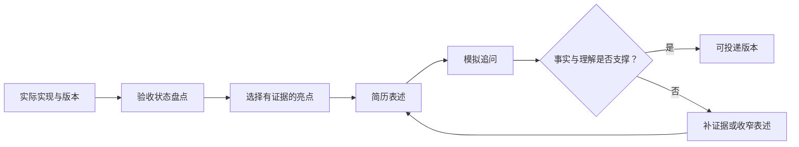

# Sprint 6：联合验收和简历面试收口

> 固定窗口：2026-11-19 至 11-20。  
> 硬截止：**11 月 20 日结束前形成可投递简历。** 不以五个 Slot 全部完成为前提。  
> 前置：前五个 Sprint 实际取得的实现、学习记录与证据；共同规则见 [Sprint 1](./1-基础闭环和权威数据查询.md)。

## 1. 目标与优先级

P0 是把真实做过、理解到位、能拿出证据的部分写成优质简历，并能经受追问。P1 是完成首版全部联合验收。两者冲突时保留简历窗口，同时明确首版还缺什么，不能改口声称全部完成。

这两天不开发第六个 Slot，不集中补学前五天所有知识。只修影响演示、证据可信度或已声明能力的关键问题。

## 2. 11 月 19 日：冻结素材范围并形成完整初稿

1. **盘点而非补齐所有功能。** 对每个 Slot 记录实现状态、理解程度、正确性结果、服务目标结果、优化结论和剩余风险。
2. **选择简历重点。** 从证据最强、本人贡献最明确、最能解释取舍的主题中选择少量亮点。可以只有两三个深项，不要求五个 Slot 各占一条。
3. **固定可演示版本。** 记录代码版本、启动方式、数据种子、依赖与资源配置；受后续修改影响的证据要重跑或明确失效。
4. **完成简历整体初稿。** 不只写项目段落；结合目标岗位、真实教育／经历、已有技能和篇幅安排完整简历。缺失的个人事实需要向用户收集，不能编造。
5. **第一轮模拟面试。** 每个重点追问方案选择、失败窗口、实验可信度与限制，发现讲不清的地方后补理解或收窄表述。

目标岗位和现有简历材料应在前五个 Sprint 推进期间尽早确认；不要等到 20 日才发现基础信息不齐。

## 3. 11 月 20 日：完成可投递版本

1. 修复影响演示与核心结论的关键问题；执行被修改路径所需回归。
2. 校准简历中的每个动词和数字，删除没有证据的性能、规模或可靠性承诺。
3. 完成简历内容、排版和投递格式，至少保留可编辑源稿与可投递版本。
4. 完成一次项目演示和第二轮追问，形成简洁口述与技术细节两种讲法。
5. 将未完成验收列入后续迭代，不让它阻塞已可投递简历的交付。

实际投递由用户决定；本计划不授权自动发送简历或联系企业。若提前形成合格版本，可以提前用于投递，不必为了等完整首版而等到 20 日。

## 4. 联合验收与证据整理

联合验收优先检查：

- 两条实际页面流程：注册／登录—查找—关注—发帖—Feed—详情—取关；发布—搜索—删除。
- 删除和取关后的新请求遵循权威状态，不能因缓存或索引滞后而越界展示。
- 请求重试、事件重投、部分执行退出、依赖恢复后的业务效果可核对。
- 空结果、未就绪、依赖故障、超出容量能区分，异常不伪装为空列表。
- 失败任务能检查和重放，恢复不依赖临时手工修改数据库。

完整首版仍按原方针覆盖 S1～S5 全部矩阵。此处的优先清单不是缩减验收。未完成联合流程时，在演示说明和完成状态中明确，简历不得声称完整产品闭环已交付。

每项证据至少关联：源码版本、本人改动、数据和种子、运行命令、资源与负载、原始记录、结论与边界。已有验证只有在代码和相关条件仍适用时才复用；不要无理由重复所有实验，也不要用旧结果支持已变化的实现。

## 5. 简历表述规则

| 实际状态 | 可以如何写 | 不应如何写 |
|---|---|---|
| 正确性通过，未做性能对照 | 实现机制、业务保证、覆盖的测试场景 | 提升吞吐或降低 P99 |
| 正式对照完成且效果明确 | 条件、基线、改善、代价 | 脱离负载的通用提升百分比 |
| 故障实验完成 | 指定事件量与窗口下的恢复结果 | 绝不丢消息、端到端 exactly-once |
| 复用上游能力 | 基于底座改造，明确自己的贡献 | 从零研发上游已提供的能力 |
| 只学习或设计，未实现 | 在学习笔记或后续规划中说明 | 写成已落地的项目成果 |

每条亮点先按这个结构起草，再压缩为简历语言：

> 在【明确场景】下遇到【具体问题】，选择【实现方案】并完成【本人工作】；通过【可复现实验】验证【结果】，同时承担【代价或边界】。

所有占位内容必须替换为真实事实，缺少证据的数字直接删除。简历篇幅有限，可以将详细代价放入面试材料，但口述必须能够主动解释。

## 6. 面试材料与技术 insight

准备三种粒度：

- **约 90 秒项目介绍：** 项目用途、个人贡献、最强的两三个技术问题与证据。
- **约 5 分钟主题展开：** 一张结构或时序图，说明方案、替代方案、实验与取舍。
- **深入追问：** 能沿代码与故障窗口继续解释，而不是只背术语。

每个选入简历的主题至少回答：

1. 你遇到的具体问题是什么，为什么值得解决？
2. 为什么选择这个方案？另一个更简单的方案何时反而更合适？
3. 哪些工作来自上游，哪些是你亲自设计和修改的？
4. 你的实验是否公平，测量了哪些指标，遗漏了哪些范围？
5. 方案付出了哪些写入、读取、内存或运维成本？
6. 如果数据分布、实例数或故障条件变化，哪些结论可能不再成立？
7. 最后一次实验推翻了你原先的什么判断？你据此改了什么？

第 7 个问题是 insight 的重要来源。没有发生过的失败或调整不能编故事；可以如实讲某个假设被证实、尚未证实，或一个方案没有显著收益。

## 7. 最终交付与完成定义

P0 交付包括：

- 可投递简历及可编辑源稿，内容与真实经历、岗位方向匹配。
- 项目架构／流程图、演示步骤和已知限制。
- 选入简历亮点的证据索引与本人贡献说明。
- 面试口述提纲和追问记录。
- 未完成实现／验收清单，明确哪些不能对外宣称。

**11 月 20 日是否完成 P0，看简历能否投递、亮点是否真实、本人是否能够解释；首版是否完成，看原有功能与验收要求是否全部满足。两种状态分别记录。**

若最后仍有主题做得浅，删减简历篇幅或移出重点，不用新功能填空。招聘窗口优先，后续继续深化项目并用新证据更新简历。

## 8. 参考代码与材料边界

**本 Sprint 没有可直接复用的“简历与面试收口代码”。主要输入是自己的最终实现、实验原始记录、贡献说明和个人经历。** 两个参考目录只帮助整理启动说明、演示路径和测试组织，不能提供本项目成绩。

| 参考材料 | 阅读目的 | 使用限制 |
|---|---|---|
| [Paopao README_ZH.md](paopao-ce/README_ZH.md)、[docker-compose.yaml](paopao-ce/docker-compose.yaml)、[web/README.md](paopao-ce/web/README.md) | 整理自己版本的启动、依赖和前端运行说明 | 必须改成实际采用的服务与配置，不能把上游“可运行”当作自己版本已通过 |
| [Paopao web/src/views](paopao-ce/web/src/views) 与 [web/src/components](paopao-ce/web/src/components) | 对照两条主流程梳理演示入口，标明复用与本人修改 | 不把上游界面和业务数量算作个人新增成果 |
| [WeBook feed/test/stress_test/readme.md](geektime-basic-go/webook/feed/test/stress_test/readme.md) 与 [data_test.go](geektime-basic-go/webook/feed/test/stress_test/data_test.go) | 借鉴“准备数据—运行服务—发压—查看结果”的说明顺序 | 不能使用上游截图、吞吐、延迟或模拟粉丝规模作为自己的证据 |

**没有现成参考、必须自行产出的部分：** PRD 全链路联合验收、五个 Slot 的最终状态台账、数字到原始证据的映射、本人技术取舍、面试问答、简历与真实经历匹配。阅读范围到此收束，不在最后两天继续漫游参考仓库、增加新的技术主题。
