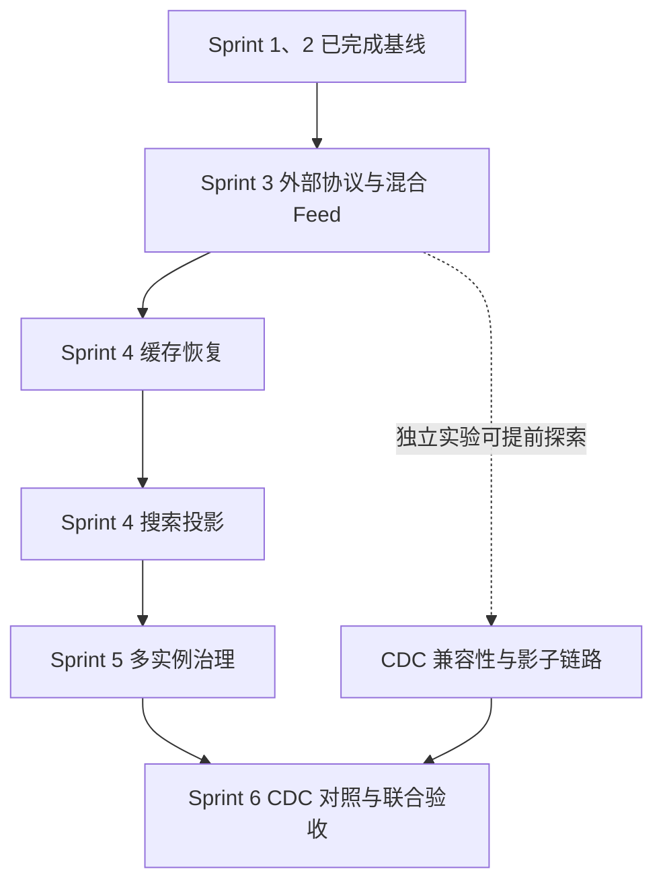

# Sprint 开发规划总览

> 规划更新于 2026-11-16，依据 [实现方针 v2](../实现方针-v2.md)。
> Sprint 1、2 按用户确认已完成，Sprint 3 按实施中确认的范围收口，证据见 [Feed 验收报告](../../notes/fanout/07-acceptance.md)；Sprint 4～6 为待实施规划。用户已确认取消原 11 月 20 日截止，按 v2 推进。

## 1. 四个 Sprint 的依赖与交付

Sprint 按完成门槛推进，每个 Sprint 再拆成可单独审查 diff、回归与回退的小批次。每批代码交付附公开函数及复杂私有函数的控制流或数据流 Mermaid 图、实现取舍和测试证据。

| Sprint | 主题 | v2 切片 | 完成后的能力 |
|---|---|---|---|
| [3](./3-Feed推拉策略和分发控制.md) | 外部投影协议与混合 Feed | P0、P1、P2 | 可恢复的真实分发，SQL 拉取／纯推／混合三策略对照 |
| [4](./4-缓存一致性恢复和搜索投影.md) | 缓存一致性恢复与搜索投影 | P3、P4 | 热点合并、条件重建、Redis 故障服务及第二种外部投影 |
| [5](./5-分布式执行和服务治理.md) | 分布式执行与服务治理 | P5 | gRPC 边界、分片工作池、多实例扩缩容与 etcd 控制面 |
| [6](./6-CDC对照和联合验收.md) | CDC 对照、受控切换与联合验收 | P6、P7、P8 | 事件源成本对照、切换恢复证据、四条简历材料 |

CDC 提前探索使用独立数据与投影，主交付顺序仍按图中实线推进。

## 2. 四条简历主线如何形成证据

| v2 主线 | 主体交付 | 跨 Sprint 补强 | 最终需要回答的问题 |
|---|---|---|---|
| 时间线生成与分发优化 | Sprint 3 | Sprint 5 的并行分发 | 写放大、读取尾延迟和普通任务推进如何取舍 |
| 可靠的派生数据维护 | Sprint 3 外部协议、Sprint 4 搜索 | Sprint 6 CDC | 重复、迟到、外部执行不确定与源切换如何恢复 |
| 热点缓存与一致性恢复 | Sprint 4 | Sprint 5 集群预算 | 如何合并回源、拒绝旧回填、恢复丢失缓存 |
| 分布式执行与服务治理 | Sprint 5 | Sprint 6 联合故障 | 扩容、接管、配置恢复与依赖隔离的边界是什么 |

关系索引和 SQL 查询优化作为权威读取与性能基线的证据。搜索作为第二种投影验证恢复协议。每条简历材料关联其独有的工程问题、本人改动、原始实验和代价。

## 3. 业务与迁移约定

- 发布成功时，权威帖子和必要异步意图均已可靠保存。请求幂等保留至少 24 小时、跨重启有效，删除后重试仍恢复原结果，同键异内容拒绝。
- 删除或取关成功后开始的新读取，按最新权威状态过滤。L1、Redis 和搜索命中后仍执行必要的批量权威检查。
- Feed 保留统一的 `(created_on, post_id)` 排序、分页、自己发布内容、新关注最近 20 条补入及缓存范围以外的历史读取。
- 明确区分真实空结果、未构建、构建中、依赖错误和容量拒绝。
- SQL Dummy 保留其事务内效果测试用途。外部投影有独立恢复协议，历史消息、失败记录和重放入口纳入兼容设计。
- 事件 schema 版本、业务对象版本、关系生命周期、缓存代次、CDC 位点分别定义。全局事件 ID 只承担消息身份，业务顺序须有独立依据。
- 采用 Go、MySQL、Redis、RabbitMQ、Meilisearch、gRPC、etcd，CDC 实验使用 Debezium Server。全部通过接口与脚本交付。

## 4. 原验收要求的承接

下表中的 S1～S5 为 [v1](../实现方针-v1.md) 的历史验收编号，用于追踪测试要求。v2 的四条工程主线使用全称。

| 旧要求 | 新执行位置 |
|---|---|
| S1-A～E，三策略、混合负载、关系交错 | Sprint 3，Sprint 5 补多实例回归 |
| S2-A～D，关系、执行计划、深分页、索引成本 | Sprint 3 基线批次承接 Sprint 1 后续待办 |
| S3-A～E，搜索时效、故障、重建 | Sprint 4 搜索批次 |
| S4-A～H，提交、确认、消费、故障、重放 | Sprint 2 现有证据按适用范围复用；Sprint 3、4 补真实效果；Sprint 6 联合核对 |
| S5-A～E，热点、回源、Redis 故障与重建 | Sprint 4，Sprint 5 补全实例预算与故障 |
| MySQL 8.0 实际兼容性待办 | Sprint 6 兼容矩阵，记录与当前本机版本的差异 |

| 数据集 | 保留规模和用途 |
|---|---|
| C | 200 用户、5000 有效关注、1 万帖，全量正确性核对 |
| Q | 12 万用户、100 万关注、20 万帖，100／500／1000 关注作者读取及关系深分页 |
| F | 单作者 1000／1 万／10 万独立粉丝，叠加普通作者及读者 |
| E | 1 万条可追踪有效事件，另有可识别无效消息 |

正式性能场景至少 3 轮，沿用预热 60 秒、稳定采样 300 秒的建议，报告实际时长与样本数。原 S4-B／C／D 核心故障窗口各至少 20 轮，真实 Feed 和搜索各自覆盖适用的外部效果窗口。关系深分页比较页大小 50、约 0／1000／1 万／10 万位置，保留合理索引和相同语义。MQ、搜索、Redis 的既有停机测试均保留 60 秒。

正确性、服务目标、优化收益分别判定。正式对照前冻结负载、成功率、P95/P99、可见性、普通任务推进、恢复期限与资源预算。请求到达率、实际发出数、拒绝、超时、未完成事件同时记录，可见性观察贯穿发压全过程。

## 5. 本机资源与证据约定

测试运行于 M4 Pro／24G 本机。每次测试前约定 CPU、内存、并发、连接、队列、磁盘与运行时长，记录所有进程和容器合计值。源码、镜像、卷和证据总磁盘上限为 100G。当前规划不预先分配全部主机内存。

Sprint 3、4、5、6 分别准备基础分发、缓存与搜索、多实例、CDC 实验配置。通过分时运行对照组控制峰值，各对照组保持约定的公平条件。新实验预算由摸底后与用户约定，超预算即停止该轮并报告。资源不足时提出具体瓶颈和规格调整方案，由用户确认后执行。

每份报告记录源码提交、未提交 diff、组件版本、数据种子、命令、实例数、持久化设置、冻结目标、原始样本、结果核对、成本和限制。测试脚本复用现有 `scripts/verify_api.py` 与 outbox 集成测试的隔离方法，按真实入口补齐场景。

## 6. 完成和回退

每个 Sprint 的必做批次和验收全部通过后收口。存在失败或未验证项时持续记录并处理，完成状态与可用于简历的材料分别记录。每批交付积累架构图、故障时序图、取舍表和一次口述，Sprint 6 再整合成四条可审查的简历表述。

可选项包括活跃读者选择性物化、RabbitMQ 三节点 quorum 故障实验。业务表 CDC 和请求记录压缩在 Sprint 6 完成适用性与成本评估，正式采用取决于同语义验证。回退采用保留 SQL 读取、轮询事件源、已验证部署配置和必要的有界重放，具体步骤在所属批次落地。
