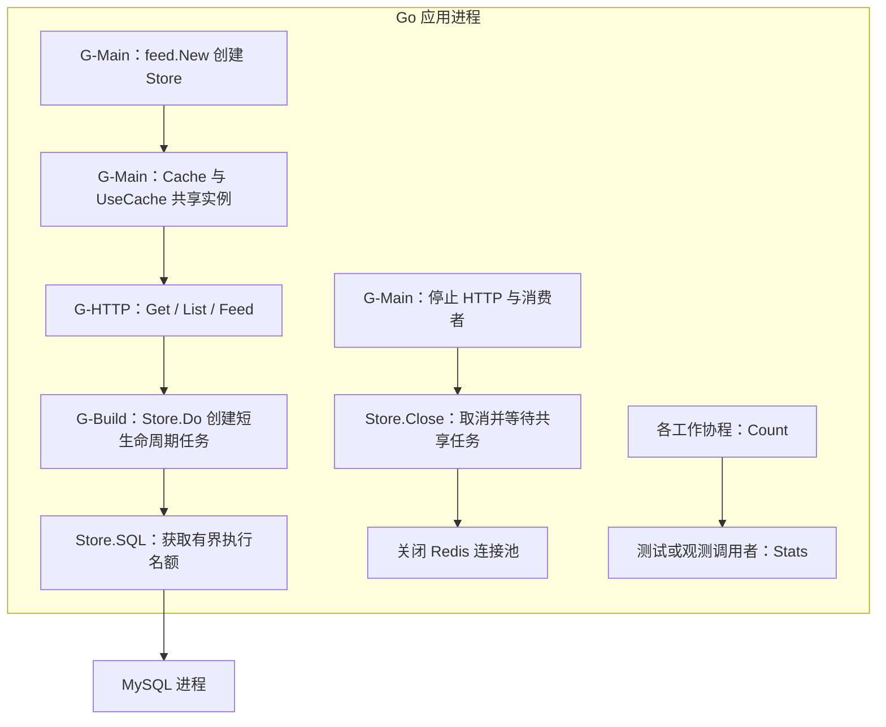
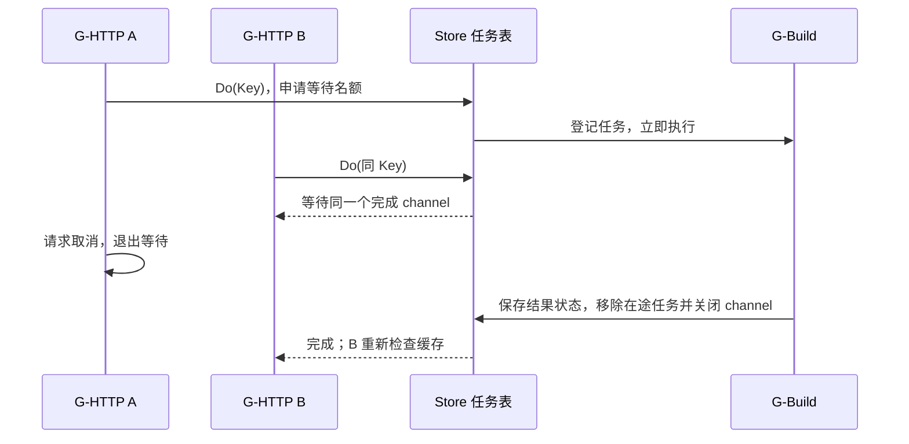
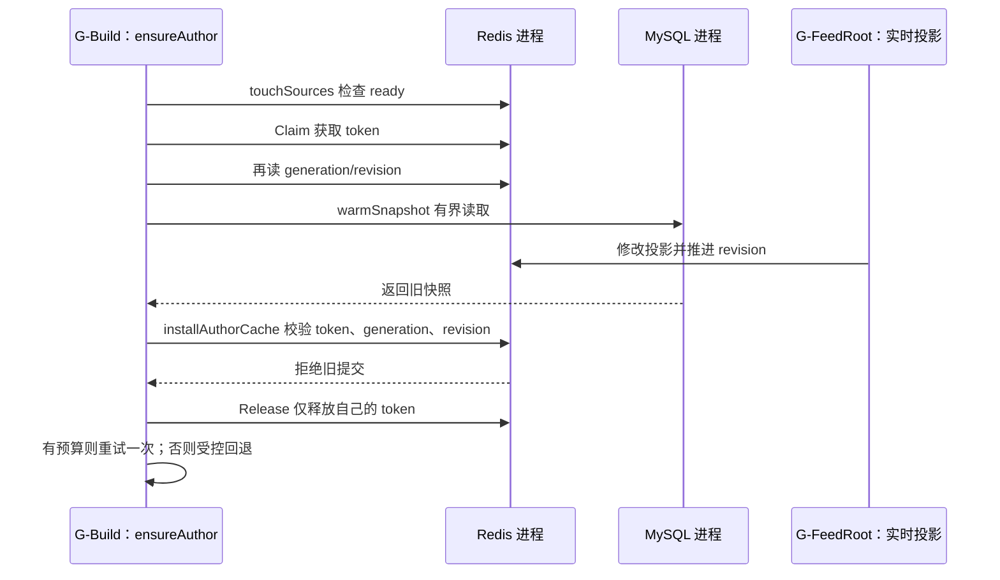
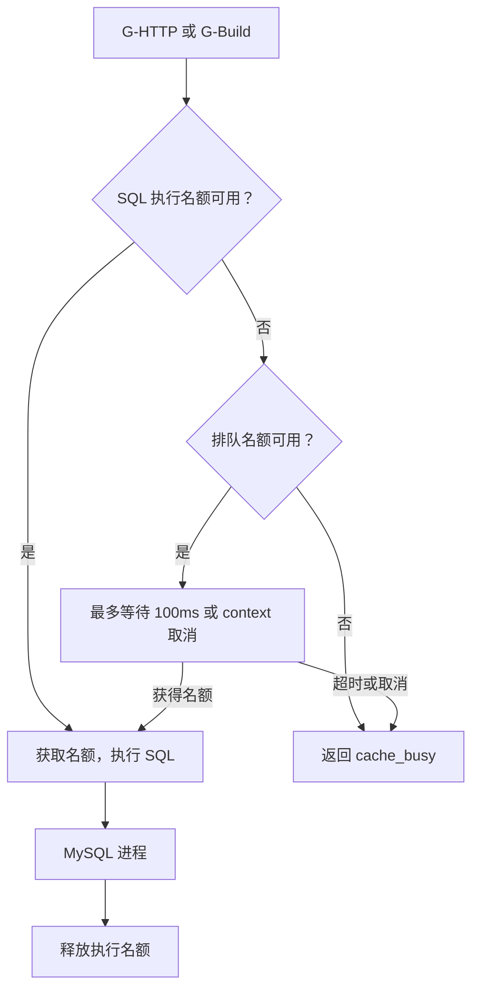
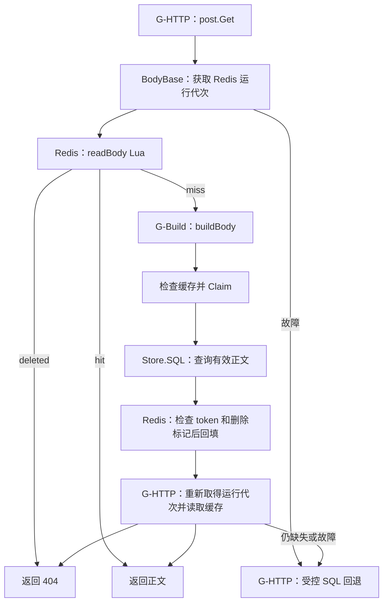
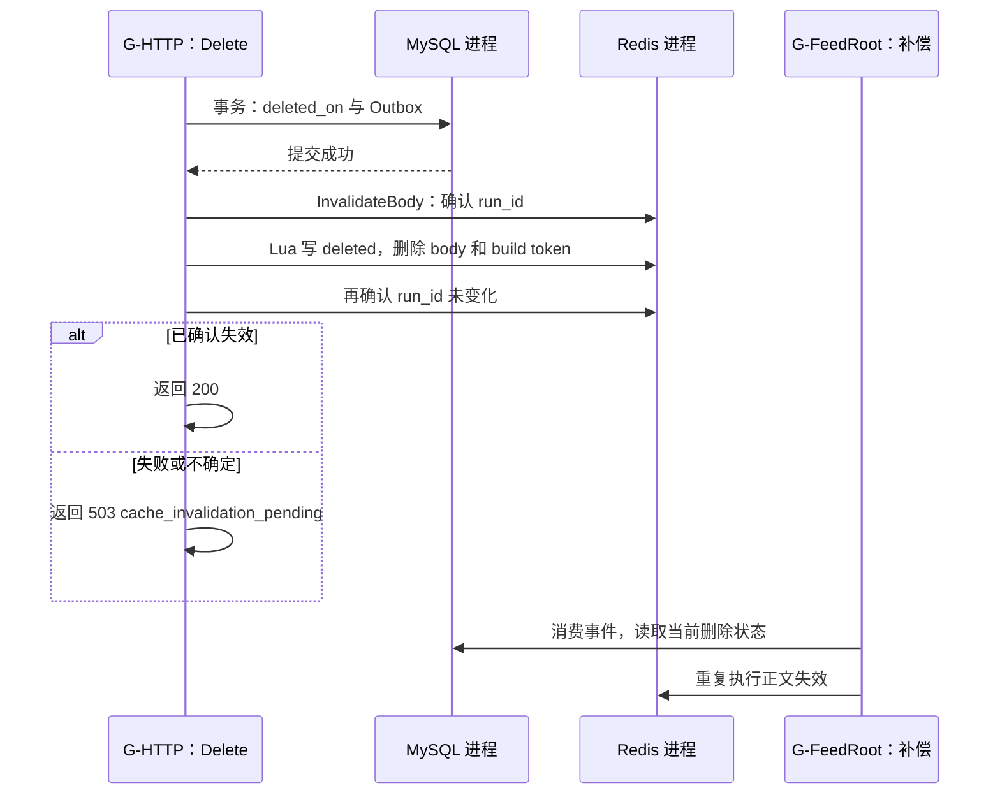

# 作者索引与正文缓存：实现与验证

本轮范围：作者索引与文章详情的懒惰重建、三层并发保护、正文同步删除标记。搜索与正式性能对照未在本轮完成。

## 入口与运行方式

沿用 `FEED_MODE=push|hybrid`、`REDIS_URL`、`RABBITMQ_URL`、`RABBITMQ_QUEUE_PREFIX`。应用启动时 Feed 和文章详情服务共享一个 cache.Store。
`FEED_MODE=sql` 保持 SQL 基线；正文缓存仅在上述缓存模式启用。混合部署不得让旧版本或 SQL 基线实例绕过同步失效后仍向同一业务库写入。

- `GET /posts/:id`：按文章 ID 缓存正文。热度来自实际访问，不新增热度排名。鉴权仍查数据库。
- `GET /users/:id/posts`：作者近期 500 条候选缓存，超过覆盖范围改走 SQL 历史页。
- `GET /feed`：混合策略中的作者来源按需重建，重建结果可用于当前请求。读者缓存沿用既有行为。
- `DELETE /posts/:id`：SQL 事务提交后同步设置正文删除标记，确认后才成功。失败返回 `503 cache_invalidation_pending`；重试不会重复产生删除事件，但会再次失效缓存。
- 正文未接入 Feed/作者列表的正文批量查询，以免把现有批量 SQL 拆成逐帖查询。

## 公共函数与生命周期

| 函数 | 职责与调用关系 |
|---|---|
| `cache.New` | 初始化应用级 Store、生命周期 context、共享任务表及容量通道，不创建后台扫描服务 |
| `cache.Store.Close` | 关闭新任务准入，取消共享任务，等待其退出，再由 Feed 关闭 Redis |
| `cache.Store.Do` | 原子登记/加入同 Key 在途任务，限制调用者与任务表大小，等待完成或请求取消 |
| `cache.Store.SQL` | 限制重建、读取校验和回退的 SQL 操作并发与排队 |
| `cache.Token` | 生成随机构建身份 |
| `cache.Store.Claim` | SET NX PX 领取有限期构建资格 |
| `cache.Store.Release` | Lua 比较身份，仅释放自己的资格 |
| `cache.Store.BodyBase` | 获取 Redis run_id，生成正文缓存代次命名空间 |
| `cache.Store.Count/Stats` | 原子累加并读取进程内指标；sql_operations 计受保护操作，不等于完整系统 SQL 语句总数 |
| `feed.Service.Cache` | 向详情服务提供同一个 Store，不创建第二份额度 |
| `feed.Service.List` | 校验作者/游标，读取或重建作者索引，再批量权威校验，超范围回退历史 SQL |
| `feed.Service.Feed` | 复用作者按需重建，保留读者来源、关系指纹、排序与历史分页 |
| `feed.Service.Handle` | 删除事件回读当前状态后补偿正文失效，再更新索引 |
| `post.Service.UseCache` | 在启动阶段注入 Store；不支持运行中并发切换 |
| `post.Service.Get` | 参数校验后选择缓存详情或 SQL 基线 |
| `post.Service.Delete` | 提交删除及 Outbox；重复调用同样执行正文失效 |
| `post.Service.InvalidateBody` | 同步删除 Lua，前后确认 Redis 运行代次，防止重启时写错命名空间 |

`ReadAuthor` 仍是已有的底层投影检查入口，保留其原始 Redis 读取语义，供分发验证核对真实效果；业务接口通过 `List/Feed` 使用按需重建。



## 第一层：有界的同 Key 共享

采用标准库 mutex、map 与完成 channel 实现 singleflight 语义，没有增加第三方依赖。与无界地先创建任务再排队相比，任务登记前已经限额。首个请求立即启动，后来请求加入当前轮，不引入凑批等待。

- 最多 64 个等待调用者、64 个未完成 Key。调用者全部取消也不能让仍在运行的任务表无限增长。
- 任务从应用生命周期派生，总 deadline 为 2 秒。单个 HTTP 请求取消只结束自身等待。
- 共享的是构建完成状态；正文结果从 Redis 再读，避免删除后新加入的等待者拿到旧 SQL 快照。



## 第二层：短租期与条件提交

构建资格为随机 token，租期 3 秒，不自动续期。未获得资格最多等待 200ms，每 20ms 重新检查缓存，超时走受控 SQL 回退。回退没有资格，不写缓存。

作者构建最多读取 501 条，保存 500 条及历史覆盖 floor。`ensureAuthor` 最多两次尝试，且受同一个 2 秒任务期限约束；仅提交冲突重试，SQL/Redis 错误直接交给回退。元信息有效且 count=0 是真实空，不反复重建。



作者元信息丢失时重建新代次，旧提交被拒绝。同槽规则沿用作者 hash tag。Redis 尚未观察到的业务变化仍由 SQL 权威过滤和后续投影处理保障。

## 第三层：SQL 总量保护

Store.SQL 使用执行通道和排队通道：每实例 4 个执行名额、16 个排队名额、最多等待 100ms。超过名额或等待期限返回 `cache_busy`。两个实例对应此资源域最多 8 个执行操作。



覆盖作者快照、正文加载、Feed 来源查询、候选权威校验、历史/故障回退。鉴权、业务写入、后台投影不计入这 4 个额度，仍受原连接池约束；不能把此数字宣称为完整系统 SQL 总并发。
Redis 不可达时不执行重建，回退请求使用本地 SQL 限额。此路径不跨请求共享正文 SQL 快照，以免删除交错时绕过权威状态；同 Key 合并覆盖可执行的缓存重建路径。

## 正文缓存与删除

正常命中执行 INFO server 获取运行代次，再用 Lua 原子复核 run_id 并读取 deleted/body；不读取正文 SQL。TTL 为 10 分钟加文章 ID 的 0～30 秒偏移。正文不可编辑，故不额外引入内容版本。删除标记保留 11 分钟。



正文未在本地保存可复用的副本。不能把共享构建者读到的正文直接返回给后来加入的请求。未安装成功的结果只用于丢弃，当前请求可重新查询 SQL。



标记过期后，旧构建者的 token 已撤销/过期，不能回填；新构建者必须重新查询 MySQL。Redis 重启后 run_id 改变，旧持久化正文不可直接命中。读取 Lua 内再次检查运行代次，覆盖客户端 INFO 与正文读取之间的重启窗口。此策略面向当前单机 Redis；原地恢复旧数据、复制回滚和 Cluster 路由需要单独的运行代次治理，不能宣称已经覆盖。

## 验证与证据

运行于本机 MySQL、Redis 7.4、RabbitMQ 既有依赖。新增故障验证用独立容器 `notex-cache-test-sprint4`：1 CPU、256MiB、Redis maxmemory=128MiB/noeviction、AOF everysec；Go GOMAXPROCS=4/GOMEMLIMIT=512MiB。测试创建并删除独立数据库、队列及 Key 前缀。GOMEMLIMIT 是运行时软目标，不是 RSS 硬限制。

已执行：

- `go test ./src/...`，`go vet ./src/...`。
- `go test -race`：缓存并发单元测试及新增真实协议测试。
- 单 Key 重叠任务仅执行一次；一个等待者取消不影响另一等待者；64 个任务准入上限、4 个 SQL 执行上限、100ms 排队期限与关闭取消。
- 两个真实子进程竞争作者构建：一个 `author_built=1, sql_operations=1`，另一个 `lease_contended=1`，实际构建合计一次。
- 作者列表 620 篇文章，按 37 条分页，跨越 500 条覆盖边界，身份、正文、排序与 SQL 基线一致；空作者只构建一次。
- 关闭详情服务 SQL 连接后，正文命中仍成功；删除后无需 SQL 即返回 404。
- 20 轮正文删除后旧回填拒绝、token 撤销、新构建者接管、旧释放不删除新 token；作者 revision 和失效 token 拒绝。
- Sprint 3 Feed/分发/读取真实回归通过，包括既有各 20 轮故障交错与真实 HTTP 测试。
- 独立 Redis 停止至少 60 秒：120 次详情/Feed 读取、60 次发布成功；60 次删除已提交 SQL 并返回缓存失效未确认。重启后正文与作者列表首次恢复读取约 12.37ms。原始输出：[停机日志](./2026-11-17-outage.log)。这是低负载功能恢复样本，不是 P95/P99 或吞吐结论。

复现新增测试：

```sh
GOMAXPROCS=4 NOTEX_CACHE_INTEGRATION=1 go test -race ./src/internal/post ./src/internal/feed -run '^(TestBodyCacheProtocol|TestCacheRecoveryIntegration)$' -count=1 -v -timeout=120s
GOMAXPROCS=4 go test -race ./src/internal/cache
```

60 秒故障用独立容器启动后，设置 `TEST_REDIS_URL=redis://127.0.0.1:6381/0` 与 `NOTEX_CACHE_OUTAGE_CONTAINER=notex-cache-test-sprint4`，测试超时至少 150 秒。测试拒绝不以 `notex-cache-test-` 开头的容器名。

仓库根目录 `go test ./...` 会扫描 notes 下的历史源码证据副本并触发 Go internal 导入限制；本轮使用 `./src/...` 验证真实源码，不修改历史证据。

## 已知边界

- 本轮证明正确性、重建合并、容量限制与故障恢复；未完成热/冷/故障/恢复四状态正式性能对照，也没有全链路 SQL 语句量和资源峰值的连续采样报告。
- 新增正文删除协议依赖所有写入实例使用一致配置。切换到 SQL-only 前应停止正文缓存读取或清空该命名空间，不能只让部分写入实例绕开失效。
- 正文每次命中多一次 INFO 以检查 Redis 运行代次，必须在性能实验中计入成本；只证明省去正文 SQL，不承诺短正文一定更快。
- 缓存 noeviction 到达内存上限时回填可能失败，读取走受控 SQL，删除标记写入失败不能报告删除成功。
- 不缓存不存在的正文；不存在文章请求可能在共享构建后再次查询 SQL，仍受本地额度约束。
- 无 L1 正文副本、租期续约、自动热度排名、会话缓存或搜索投影。
