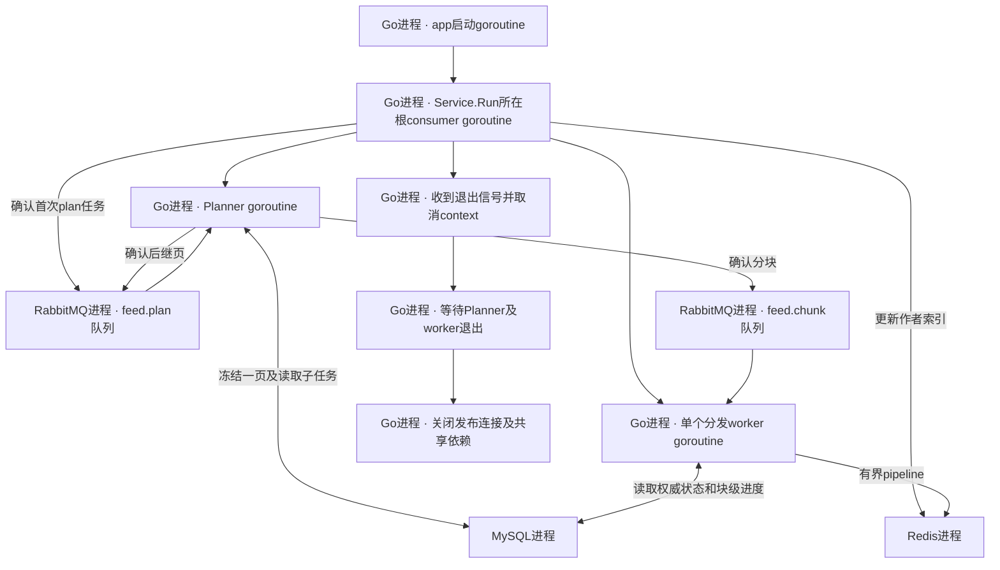
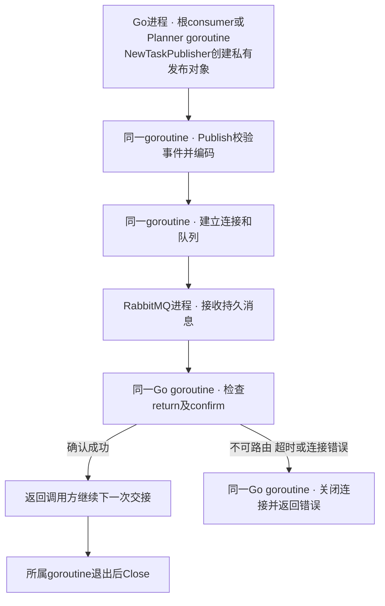
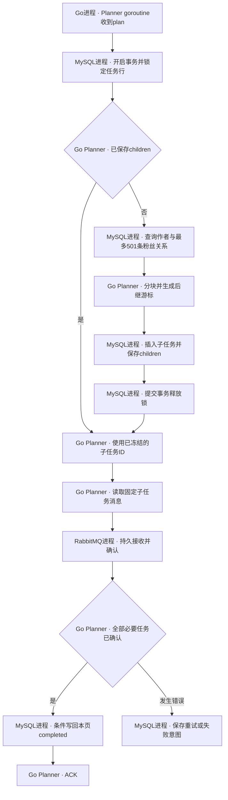
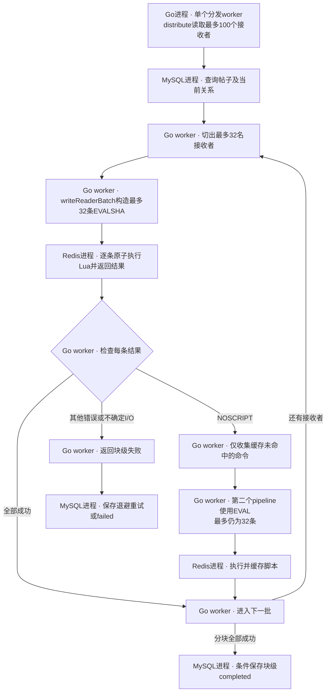

# 阶段四 · Planner 与读者索引分发写入

## 本轮范围与决策

本轮实现读者索引写入、粉丝分页、冻结分块、发布确认、后继游标和故障恢复。纯推读取与混合读取在阶段五统一实现。整体性能基线采用完全MySQL帖子写入和完全MySQL排序拉取。

Go应用运行一个根事件consumer、一个Planner和一个分发worker。Redis Client继续由Feed Service共享，连接池大小为4。后续按goroutine隔离客户端或请求逻辑的实验记录在 [多Redis客户端优化点](../opts/multi-redis-client.md)。

| 边界 | 固定上限 |
|---|---:|
| 一页粉丝 | 500，SQL最多读取501条判断后继页 |
| 一个分块的接收者 | 100 |
| 一次Redis pipeline的命令 | 32 |
| 一个规划页交接的子任务 | 7 |
| Planner数量 | 1 |
| 分发worker数量 | 1 |
| 每个消费者prefetch | 1 |
| 外部领取期限 | 30秒 |
| 单次handler context | 5秒 |
| 一轮失败尝试 | 5次 |

## 运行组织与公开入口

### App.Run 与 Service.Run

`app.Run`在配置Redis时调用`Service.Run`。Service.Run在当前goroutine运行根消费者，启动一个Planner goroutine和一个分发worker goroutine。各消费者复用现有SQL任务领取、失败、重放与恢复扫描逻辑。退出时取消共同context，等待两个子goroutine退出，再关闭各发布连接，应用随后释放Redis及MySQL。



### NewTaskPublisher、Publish 与 Close

根consumer与Planner分别拥有一个TaskPublisher，串行使用各自的AMQP连接。`NewTaskPublisher`只创建对象。`Publish`验证任务身份，建立连接并声明队列，发送持久消息，检查mandatory路由返回和发布确认。任意不确定错误会关闭连接，下次尝试重新建立连接。`Close`在所属goroutine结束后释放连接。



通用SQL消费者继续使用原有入口。外部消费者增加`feed.plan`和`feed.chunk`两个合法队列角色，消息解码和CLI重放使用同一套身份校验。

## 任务身份与SQL记账

新增迁移`0006_feed_tasks.sql`保存任务输入和冻结结果。`consumption_jobs`保存执行状态、尝试次数与领取身份，`event_replays`继续保存重放审计。

| 字段 | 用途 |
|---|---|
| id | Feed任务身份，也用作该任务的MQ event_id与MessageId |
| root_event_id | 来源业务Outbox事件ID |
| parent_id | 来源Planner任务ID，首次Planner使用0 |
| ordinal | 本页生成子任务的固定位置 |
| kind | feed.plan或feed.chunk |
| body | 帖子ID、规划游标或有界接收者列表 |
| children | 规划前为SQL NULL，规划后保存固定子任务ID列表，包括空列表 |
| created_on | 固定的任务消息创建时间 |

唯一约束`(root_event_id,parent_id,ordinal)`保护同一父任务下的子任务身份。根事件重试复用首次规划任务。MQ任务payload只携带`task_id`，worker从SQL读取任务输入，并核对消息类型、ID和创建时间。根事件与Feed任务各自的ID通过consumer命名空间区分。

分块接收者记录`user_id`与`relation_id`。作者本人使用relation_id=0。SQL记账按根事件、规划页、分块进行，接收者级效果写入Redis。

## handleRoot、plan、preparePage 与 publishTasks

handleRoot先复用Handle更新作者索引，随后创建或取得首次规划任务，确认发布后返回成功。关系根事件继续进入waiting，原始消息保存在SQL中。

preparePage开启短事务并锁定当前任务行。如果children已保存，重试直接读取原有子任务。如果首次规划，按帖子查作者，再沿`(follow_id,created_on DESC,id DESC)`索引查询最多501条粉丝关系。前500条进入分块，第501条用于判断是否需要后继任务，后继游标取实际处理的第500条。

第一页额外加入作者本人。分块输入、后继任务和父任务children列表在同一事务提交。事务提交后，publishTasks读取并确认发布最多7个子任务。



部分子任务确认后失败时，父任务保留原有children。恢复可以重复发布已确认子任务，消息身份和接收者列表固定。当前页completed表示交接完成，完整分发还需要检查子任务执行结果。

成功路径在全部必要发布确认后保存completed并ACK。失败路径沿用阶段三协议，可靠保存pending重试或failed审计后允许ACK，恢复责任由SQL任务承担。持久化失败时关闭消费连接，未ACK交付由RabbitMQ重新投递。累计attempts继续防止过期执行者覆盖新领取者进度。

## distribute 与有界pipeline

分发worker读取固定分块，限制接收者数量为1～100。它按post_id回读当前帖子状态。添加操作批量核对当前关系ID与读者ID，删除操作可清理分块内已经取关的接收者。随后按32人一批串行调用writeReaderBatch。

每名读者使用同一hash tag的三个键。

```text
<prefix>:reader:{user_id}:posts       ZSET，41字节固定排序成员
<prefix>:reader:{user_id}:deleted     SET，帖子删除标记
<prefix>:reader:{user_id}:relations   HASH，post_id映射relation_id
```

每条Lua只更新一个读者与一篇帖子。添加检查删除标记后写ZSET与关系身份。删除先保存标记，再移除ZSET成员与关系身份。字符串ID保留int64精度。



有界性由以下约束共同提供。

- 一个分块最多100名接收者，一次pipeline最多32条命令。
- 每条命令只携带一篇帖子的固定宽度成员、int64身份和固定脚本，键名前缀由应用配置限制。
- pipeline批次串行执行，前一批收取结果后再提交下一批。
- NOSCRIPT补发仅包含当前批次失败的命令，数量最多32。
- 外部处理context为5秒，go-redis网络超时为2秒，客户端自动重试关闭。
- pipeline部分成功后重做整个分块，已成功的成员写入可重复执行。

pipeline的32条命令不承诺对应单个网络包。原子性由各条Lua提供。Redis命令执行、socket I/O与客户端组织的实际成本由后续独立实验衡量。

## 边界与后续阶段

本阶段按当前关系分页并冻结每一页。新关注、晚提交关系、取关后历史清理、旧生命周期与新生命周期竞争由阶段六继续闭合。删除分发覆盖本次规划捕获的接收者，先前已取关且未进入这次计划的历史成员依赖后续清理和读取时权威过滤。

作者索引及读者索引暂按当前实验规模保留。缓存裁剪与历史读取在后续阶段完成。当前生产HTTP Feed采用SQL读取，阶段五接入纯推与混合读取。SQL-only性能基线脚本将Redis消费者配置置空。

## 实测与证据

最终运行位于 [stage4-01报告](runs/2026-11-16-stage4-01/report.json)，整轮107.94秒。报告保存源码commit、diff、SHA256、未跟踪源码快照、版本与命令。运行后源码SHA256核对全部一致。

| 验证项 | 结果 |
|---|---|
| Go常规测试 | 通过 |
| Outbox消费者race集成 | 14个子测试通过 |
| 作者索引回归 | 6个子测试通过，本轮Redis停机项关闭 |
| 阶段四分发race集成 | 7个子测试通过 |
| 两个子任务确认后注入失败 | 20轮，冻结接收者、子任务ID和后继任务保持一致 |
| Redis pipeline部分成功 | 20轮，通过错误键类型注入部分失败，恢复后成员完整且唯一 |
| 读者效果成功后取消worker，尚未写completed及ACK | 20轮，提前设置领取到期时间后重做成功 |
| 删除后迟到添加 | 20轮，无索引成员复活 |
| 1203粉丝加作者本人 | 3个plan、14个chunk，1204名接收者与SQL参考集合完全一致，随后删除追平 |
| 分块目标队列不可路由 | 发布失败可见，重新建立连接后重用冻结计划完成交接 |
| RabbitMQ停机至少60秒 | 发帖事务及Outbox意图保留，恢复后1204名接收者完整，从停机开始到追平80.54秒 |
| 正常HTTP启动入口 | 发帖经根consumer、Planner、worker进入本人读者索引 |
| 既有HTTP功能回归 | 27组通过，并发4 |
| pipeline实际观测 | 551个批次，最大32条命令，冷脚本EVAL补发32条 |

1203个粉丝同一时间戳的分页覆盖关系ID边界。第一页500粉丝加本人生成6块，第二页500粉丝生成5块，第三页203粉丝生成3块，共14块。功能耗时包含故障注入与检查，性能基线仍采用既定MySQL路径。

| 资源采样 | 峰值或增量 |
|---|---:|
| 测试及子进程合计RSS | 179.88 MiB |
| MySQL RSS，取总监控与HTTP脚本的较大值 | 182.83 MiB |
| RabbitMQ容器内存 | 153.10 MiB |
| Redis容器内存 | 13.96 MiB |
| MySQL目录运行期间增量 | 10864 KiB |
| MySQL目录结束增量 | 0 KiB |
| 本轮证据，清理记录生成前 | 110761字节 |

RSS约每2秒采样，容器内存约每10秒采样。约定的Go、MySQL、容器、磁盘和单轮时间预算均满足。测试隔离数据库、队列、Redis键和进程已清理。RabbitMQ和Redis运行中。目录与Docker磁盘账面合计约12 GB，原始数值保存在清理记录。

证据见 [Feed测试日志](runs/2026-11-16-stage4-01/feed.log)、[消费者测试日志](runs/2026-11-16-stage4-01/consumer.log)、[HTTP报告](runs/2026-11-16-stage4-01/api-report.json)、[资源采样](runs/2026-11-16-stage4-01/resources.jsonl)、[清理核对](runs/2026-11-16-stage4-01/cleanup.json)。

## 运行方式

新建实验库按序执行迁移0001～0006。已有本轮数据库增加0006迁移后，沿用现有MYSQL_DSN、RABBITMQ_URL、RABBITMQ_QUEUE_PREFIX和REDIS_URL启动应用，Service.Run自动启动三类消费者。

```bash
GOMAXPROCS=2 GOMEMLIMIT=512MiB go run ./src
NOTEX_FEED_INTEGRATION=1 NOTEX_FANOUT_INTEGRATION=1 \
  NOTEX_FANOUT_MQ_OUTAGE=1 GOMAXPROCS=2 GOMEMLIMIT=512MiB \
  go test -race -p 1 -count=1 -timeout=6m -run TestAuthorIndexIntegration -v ./src/internal/feed
```

CLI处置沿用阶段三接口。

```bash
go run ./src/cmd/events list --scope consumer --status failed
go run ./src/cmd/events replay --scope consumer --id "$RECORD_ID" --reason '依赖恢复后继续原有分发任务'
```

重放使用consumption_jobs记录ID。返回消息中的task_id对应feed_tasks行，可查询root_event_id、parent_id、body与children追踪交接关系。
