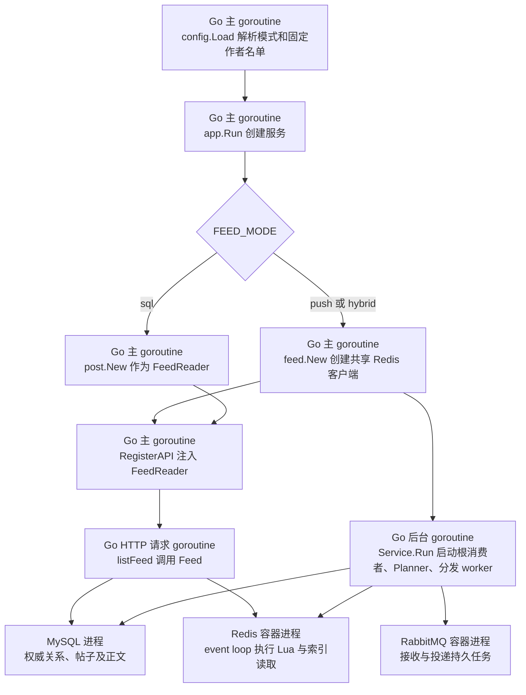
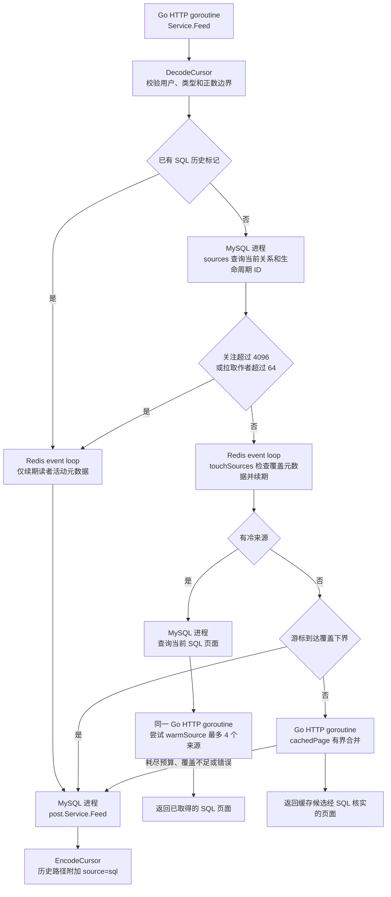
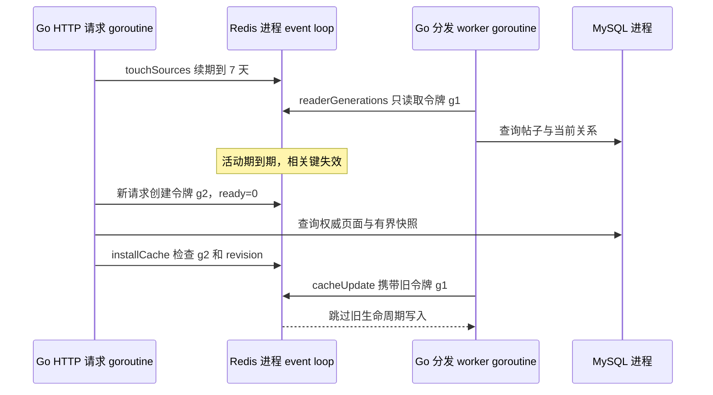
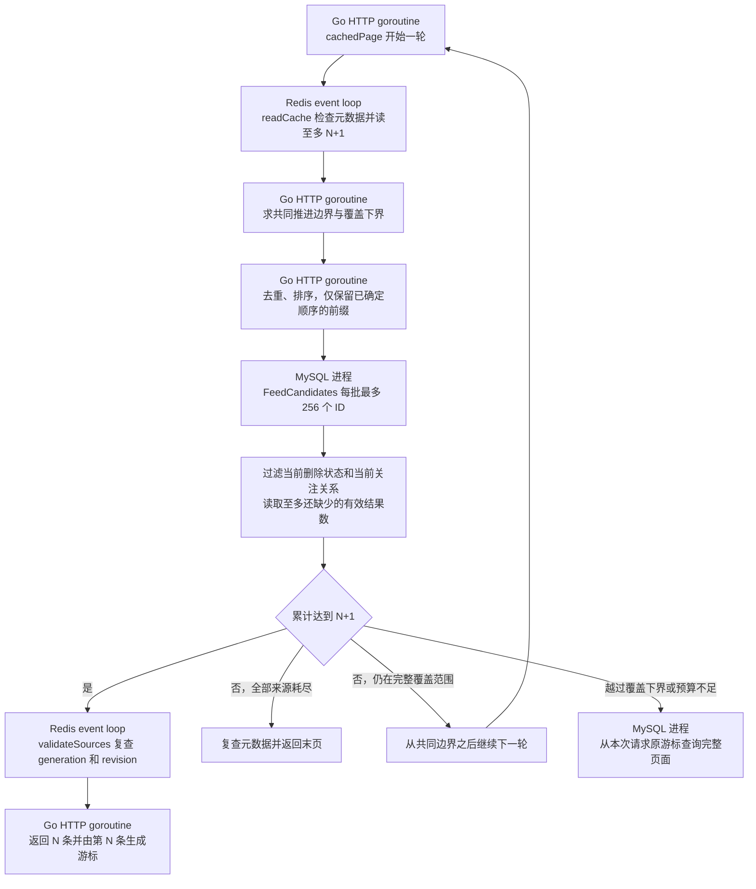
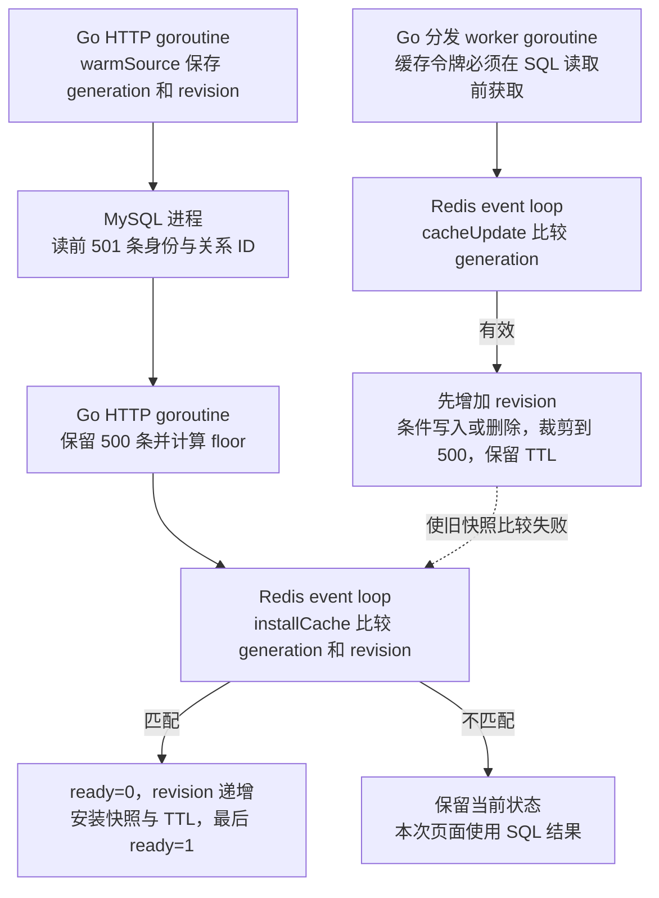
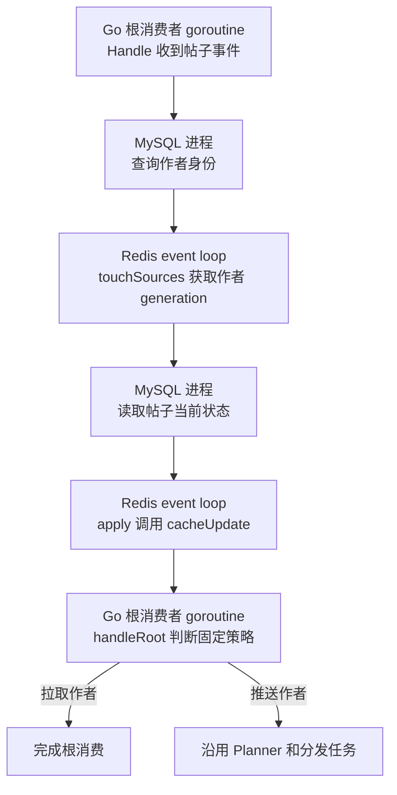

# 阶段五 · 纯推与混合读取

2026-11-17 完成。最终验证批次为 `runs/2026-11-17-stage5-02`，阶段五包含 13 个读取子测试，消费者、阶段三／四回归和 27 组 SQL HTTP 回归均通过。

## 本轮约定

- 客户端自行缓存已加载帖子，重复请求继续采用稳定游标。服务端保留已返回的索引成员。
- 活跃度以 Feed 请求为依据，读者缓存活动期为 7 天。后台分发沿用原到期时间。
- 纯推与混合读取统一实现。混合模式最多聚合 64 位拉取作者，加一个读者索引。
- 每个读者／作者索引保留最近 500 条。冷缓存、历史范围、来源过多和缓存故障由 SQL 提供结果。
- 固定拉取作者名单在启动时冻结。SQL 模式保持完全 MySQL 排序读取的基线入口。

本轮自行选定的保护参数为缓存阶段 2 秒、每次请求最多重建 4 个来源、最多读取 8192 个候选和 8 轮、每批正文回查最多 256 个 ID、覆盖签名最多计算 4096 条关注关系。它们限制单请求工作量，正式性能对照可根据测量调整。

## 入口与进程



`FeedReader` 只有 `Feed(ctx, actor, cursor, limit)` 一个方法，`post.Service` 与 `feed.Service` 都实现它。HTTP 认证、页大小校验与响应结构复用已有逻辑。Redis 客户端被这些 goroutine 共享，连接池上限为 4，pipeline 上限为 32。Lua 在 Redis 进程执行，Go 请求 goroutine 等待结果。

`feed.New` 验证 `push/hybrid`，去重固定作者名单，计算策略签名，创建带连接和读写超时的客户端。纯推模式的拉取作者集合为空。`Close` 在后台消费者退出后关闭客户端。

### 启动

执行现有 `0001`～`0006` 迁移，设置 MySQL、RabbitMQ 连接后启动。

```bash
export FEED_MODE=hybrid
export FEED_PULL_AUTHORS='42,108'
export REDIS_URL='redis://127.0.0.1:6380/0'
go run ./src
```

`FEED_MODE` 默认 `sql`。`push` 统一读取读者索引。`hybrid` 根据当前关注关系选择固定名单中的作者索引，本人属于拉取作者时也计入 64 位上限。运行中的名单由进程启动配置决定，后续实验按已约定的清空数据／重启服务流程切换策略。

## 路径选择



| 判定 | 具体标准 |
|---|---|
| 冷缓存 | `cache` 元数据不存在、`ready=0`、策略／关注身份签名变化，或成员数量与元数据不一致 |
| 历史页 | 游标携带 `source=sql`，或游标小于等于任一来源的完整覆盖下界。候选不足且继续向下会越过覆盖下界时也进入历史路径 |
| 来源过多 | 当前所需拉取作者超过 64 位。读者索引另外占一个来源 |
| 关系过多 | 当前关注超过 4096 条，限制每次关系签名计算的工作量 |
| 缓存中途失效 | generation、revision、ready 变化，Redis 错误、超时或存储成员无法解析 |

SQL 历史标记仅记录分页路径。旧游标缺省该字段继续有效，SQL 本身也接受新的 Feed 游标。`DecodeCursor` 限制长度、base64/JSON 格式、归属、类型和排序边界，`EncodeCursor` 复用原编码方式。客户端原样传递游标即可。

冷请求取得 SQL 页面后，在同一个 HTTP 请求 goroutine 内做有界重建，再返回页面。同步重建可能增加冷请求延迟，2 秒缓存 context 从 Feed 入口开始计时。HTTP 原有 5 秒 context 继续约束整体请求。重建失败会保留冷状态，下次请求再次尝试。

## 缓存数据与活动期

读者使用四个键，作者使用其中 `posts`、`deleted`、`cache` 三个键。作者逻辑中的关系键占位不会创建实际 Hash。

| 键后缀 | 类型 | 内容与作用 |
|---|---|---|
| `posts` | ZSET | score 为 0，member 为 20 位时间戳、分隔符、20 位帖子 ID。字典序保持 int64 精度和同秒排序 |
| `deleted` | SET | 字符串帖子 ID，拒绝同一缓存生命周期内的迟到新增 |
| `relations` | HASH | 帖子 ID → 写入时的关系 ID，本人的帖子记录 0 |
| `cache` | HASH | generation、signature、ready、floor、count、revision |

元数据的职责各自明确。

- `generation` 是随机生命周期令牌，过期或覆盖身份变化后重新生成。旧 worker 携带的令牌无法写入新生命周期。
- `signature` 由模式、固定作者名单及读者当前关系 ID 计算。取关重关会产生新关系 ID，使旧覆盖失效。
- `ready` 表示已安装有边界的完整 SQL 快照。仅收到几个事件积累出来的索引继续保持冷状态。
- `floor` 是完整覆盖的最旧排序成员。空值表示快照当时的全部有效历史均在范围内。
- `count` 保存预期成员数量，用来识别局部键丢失。读者同时比较 ZCARD 与 HLEN。
- `revision` 在写效果前递增，用来拒绝被并发事件更新超越的 SQL 快照，并发现分页读取期间的索引变化。

这些字段位于 Redis 缓存元数据中。MySQL outbox 沿用已确认的事件字段。



读者后台写入仅获取元数据剩余 TTL，并将更新过的键保持在同一到期时间。元数据不存在时，分发跳过该读者。Feed 请求会续期活动窗口，历史页与来源过多的 SQL 路径也记录活动。作者索引在请求读取及作者事件处理时续期。

500 条上限约束 ZSET 与读者关系 Hash。删除保护集合在该活动生命周期内保留，持续活跃且删除密集的账户可能积累超过 500 个删除标记。删除标记的进一步回收需要结合重放窗口与水位论证。

## 有界候选合并

`cachedPage` 每轮从每个来源取至多 `limit+1` 个成员。Go goroutine 按帖子 ID 去重，按 `(created_on,id)` 降序合并。

存在截断来源时，不能直接把其他来源的较旧候选填满页面。比如来源 A 返回 `100、99`，来源 B 返回 `90、89`，A 后面仍可能有 `98`。当前轮可以安全处理到 99，下一轮从排除 99 的边界继续。代码取所有截断来源末尾成员中最新的一个，作为共同推进边界，并结合覆盖下界限制这一范围。



`FeedCandidates` 在一条 SQL 内过滤当前关系和删除状态，然后读取正文。每批最多 256 个 ID，返回数量限制为当前还缺少的有效结果数。本次请求的缓存路径累计只取得至多 `limit+1` 条有效帖子正文。SQL 回退会重新从原始游标获取页面，避免把不完整缓存结果暴露给客户端。

请求 50 条时，最终仍使用第 51 条有效结果判断 `has_more`。Redis 可以读取多个来源的轻量身份成员，正文经过合并后批量读取。删除过滤需要补读时受轮数和候选预算约束。

### 各层工作量

| 位置 | 上限 |
|---|---|
| 拉取作者 | 64 位，加一个读者来源 |
| Redis pipeline | 32 条命令，EVALSHA 冷脚本回退同样受限 |
| 单来源每轮候选 | `limit+1`，最大 101 |
| 单请求候选 | 8192，发出下一批前预留其最大返回量 |
| 读取轮次 | 8 |
| 单次正文 SQL 的 ID | 256 |
| 冷快照查询 | 501 行，用额外一行判断是否截断 |
| 冷快照安装 | 最多 500 条 |
| 单请求重建来源 | 4 |
| 缓存阶段 context | 2 秒 |

`scriptBatch` 统一处理 EVALSHA pipeline 和逐条 NOSCRIPT 回退，拒绝空批次或超过 32 条的批次。`readerGenerations`、`validateSources` 同样按 32 条拆分。每批在同一 goroutine 中执行完再处理下一批。

## 重建与写入交错



`installCache` 使用单个有界 Lua 安装快照，先将 ready 置为 0，最后完成全部成员和元数据后置为 1。Redis 脚本运行错误可能留下已执行的写入，因此在创建数据键时立即设置 TTL，局部失败保持可识别的冷状态。

`cacheUpdate` 对一个来源的一条帖子执行更新，删除先记录保护标记，再移除 ZSET 和关系 Hash 成员。新增检查保护标记，超出 500 条时裁剪最旧成员并推进 floor。generation 在权威 SQL 读取之前获取，使过期前读到的旧状态无法写入过期后的新缓存。

### 作者策略与根消费者



`Handle` 的关注／取关事件继续进入持久 waiting 状态。`ReadAuthor` 保留有界原始作者候选查询和严格 member 解码功能，面向用户的 Feed 通过 `Feed` 完成覆盖判断与 SQL 核实。

`Stats()` 返回并发安全的进程内计数快照，读取路径可见 `cache`、`sql_cold`、`sql_history`、`sql_sources`、`sql_relationships`、`sql_budget`、`sql_redis`、`sql_redis_or_validation`。重建及续期计数用于本轮测试证据。

## 验证与证据

最终代码快照、SHA-256、执行命令及资源采样保存在 `runs/2026-11-17-stage5-02/`。前一批 `stage5-01` 同样通过，随后增加小页截断边界测试并将候选预算前移到 pipeline 发出之前。

```bash
GOMAXPROCS=2 GOMEMLIMIT=512MiB go test -p 2 -parallel 1 ./src/...
NOTEX_FEED_INTEGRATION=1 NOTEX_FANOUT_INTEGRATION=1 NOTEX_READING_INTEGRATION=1 \
  GOMAXPROCS=2 GOMEMLIMIT=512MiB \
  go test -race -p 1 -count=1 -timeout=6m -run TestAuthorIndexIntegration -v ./src/internal/feed
```

完整批次还执行 `TestConsumerIntegration` 的 race 测试、构建 API 和 `scripts/verify_api.py --concurrency 4`。可从仓库根目录使用归档的 `run.py` 加一个新的运行目录复跑同一批次。

| 检查 | 最终结果 |
|---|---|
| 普通 Go 测试与 API 构建 | 全部通过 |
| 消费者 race 回归 | 14 个子测试通过 |
| 作者投影与阶段四回归 | 原有 20 轮窗口、1203 粉丝加本人核对通过 |
| 阶段五读取 | 13 个子测试通过 |
| SQL HTTP 回归 | 27 组通过 |
| 全量分页 | 800 条帖子夹具中 788 条可见结果，纯推和混合均与 SQL 一致 |
| 64／65 边界 | 64 位作者加读者进入缓存路径，65 位直接 SQL |
| 小页共同边界 | 连续 80 页、每页 1 条，与 SQL 逐页相同，均使用缓存路径 |
| 过滤和去重 | 已删除候选补读、来源重复、重新关注覆盖重建通过 |
| 历史与预算 | 500 条裁剪后的 SQL 历史页、8 轮耗尽回退通过 |
| 生命周期与快照 | 20 轮旧快照拒绝及旧 generation 写入拒绝通过 |
| 7 天活动期 | 缩短／推进到期时间模拟，后台写保持截止时间，读取续期通过 |
| 结构缺失、空集合、Redis 不可用 | SQL 回退及正确空页通过 |
| 真实 HTTP 混合入口 | 普通作者与拉取作者发布后查询一致，拉取作者根事件的 feed_tasks 数量为 0 |
| pipeline | 读写实测最大 32 条命令 |

本批保持 MQ 和 Redis 容器在线。Redis 不可用读取使用不可连接地址验证 SQL 回退，阶段三／四已有的停机恢复证据分别保存在对应报告。

### 资源采样

用户批准的预算为 Go `GOMAXPROCS=2`、测试进程合计 RSS 2 GiB、MySQL RSS 4 GiB、RabbitMQ 2 CPU／768 MiB、Redis 1 CPU／256 MiB 与 maxmemory 128 MiB／noeviction、HTTP 并发最多 4、新增数据与证据 2 GiB、总磁盘 100 GiB、单轮 30 分钟。

最终批次耗时 32.17 秒。资源脚本约每 2 秒采样本机进程，容器约每 10 秒采样。

| 对象 | 观测值 |
|---|---|
| 测试进程树 RSS 峰值 | 160.97 MiB |
| MySQL RSS 峰值 | 214.13 MiB |
| RabbitMQ 容器采样峰值 | 125.9 MiB |
| Redis 容器采样峰值 | 23.04 MiB |
| 两批证据文件 | 约 212 KiB |
| 最终批次 MySQL 目录净增长 | 0 KiB |

采样峰值仅代表观测时刻。Docker 镜像、容器与卷的快照合计约 11.3 GB，仓库约 87 MiB，MySQL 目录约 522 MiB，均落在本轮预算范围内。测试完成后核对隔离测试库、测试 Redis 前缀及 RabbitMQ 队列均已清理，中间件容器继续运行。

## 当前边界与后续阶段

- 新发帖先提交 MySQL，缓存模式的最新可见结果受异步消费进度影响。快照完整覆盖与事件追平共同决定可见范围。
- 读取会查当前关系并回查 SQL 正文。其成本包含关系签名查询、Redis 往返和正文校验，性能收益需要阶段七正式对照测量。
- 读者索引按活动创建。Planner 仍遍历粉丝并生成持久分块，分发 worker 通过活动令牌跳过冷读者。当前内存收益与任务展开成本应分别测量。
- 每个请求最多重建 4 个来源，65 个全部冷来源在持续成功的请求下需最多 17 次请求才能完成逐步重建，期间 SQL 保证页面完整。
- 关系事件的历史补入、旧关系清理、晚提交与公平推进继续由阶段六实现。当前签名失效和 SQL 回查提供保守读取路径。
- 本批验证功能、竞态和资源界限。Q／F 正式容量、P95/P99 与三策略成本表由阶段七完成。

每个 goroutine 独立 Redis 客户端／连接请求逻辑的后续优化讨论继续记录在 `notes/opts/multi-redis-client.md`。
