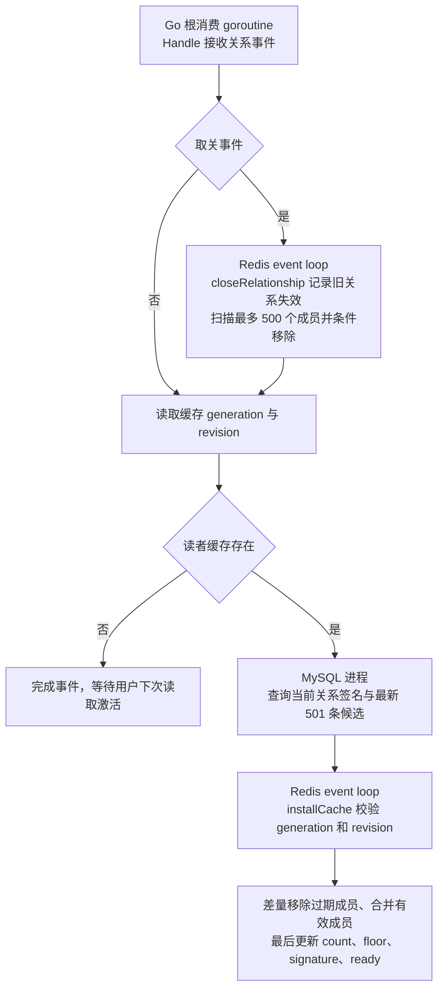
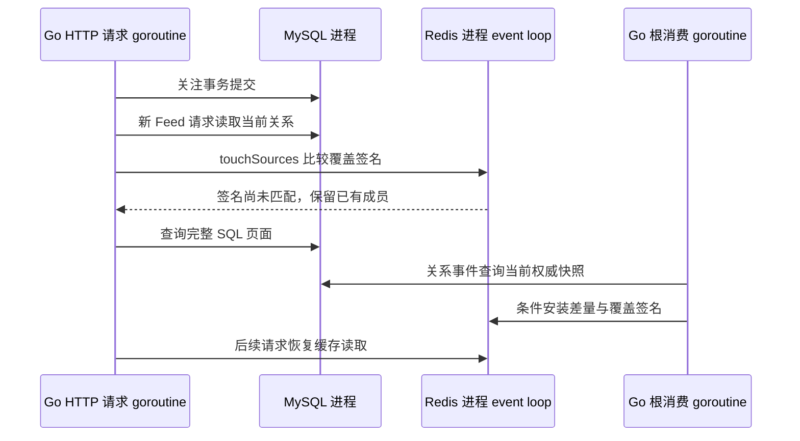

# 阶段六 · 关系变化的最小收口

关系事件消费更新活跃读者的 ZSET、帖子关系 Hash，以及已有缓存元数据。一次取关最多检查 500 个帖子成员，使用旧 relation_id 条件清理。其他仍在最近 500 条范围内的有效成员保留。

## 实现方式

`Service.Handle` 把关注和取关交给 `reconcileRelationship`。`handleRoot` 在关系处理完成后结束该事件。现有消费协议承担超时、重试和失败重放。

`reconcileRelationship` 复用 `sources` 和 `warmSource`，查询当前已提交关系下的最近 501 条候选，保留 500 条。混合模式的读者快照排除固定拉取作者，其帖子仍由读取时的作者索引提供。Lua 对已有成员与目标成员做差量维护，保留仍在目标集合中的成员。这个选择使连续关注多个作者的覆盖签名可以在同一完整快照安装后发布，也补齐取关后空出的容量。

`closeRelationship` 将 `blocked:<relation_id>` 放在已有 cache Hash，阻止持有旧关系身份的迟到分发。帖子关系 Hash 继续只保存帖子映射，因此现有 HLEN 与 ZCARD 检查可以继续使用。失效标记跟随缓存生命周期到期，持续活跃且频繁改变关系时标记数量会增长。

`cacheUpdate` 对新增同时检查帖子删除保护和关系失效标记。重新关注会产生新的 relation_id，旧清理任务按当前 SQL 状态修复缓存，并保留新关系成员。

## 立即读取

`Feed` 对关系签名不匹配记录 `sql_relationship_change`，直接查询 SQL。`touchSources` 保留已有读者成员并续期活动窗口。缓存缺失或结构损坏仍使用原有冷缓存恢复路径。

## 工作量与代价

每次关系事件的 Redis 遍历最多 500 条，SQL 快照最多返回 501 行，安装最多 500 条。后台任务保持原活动截止时间，generation 保持原值，revision 保护并发快照。关系数量超过 4096 的读者继续使用已定义的 SQL 路径。

SQL 查询采用当前读者整体快照，会有读取与排序成本。采用它是为了复用完整覆盖模型并处理多个并发关系变化。正式测量可用于判断是否需要作者级增量查询。任务调度沿用现有单 Planner 和单分发 worker。

## 验证

`read_integration_test.go` 增加 20 轮关注交错。每轮验证取关后立即读取与 SQL 相同、待处理索引保留、旧写入被阻止、重新关注后旧删除事件保留新关系帖子，以及 generation 保持原值。

首轮证据位于 `runs/2026-11-17-stage6-01`，普通 Go 测试、14 个消费者 race 子测试、作者与分发回归、读取回归和 27 组 SQL HTTP 回归通过。最终故障回归与正式读性能、容量证据统一记录到阶段七报告。

最终 `runs/2026-11-17-stage7-faults-01` 使用完整实现复测通过，并新增 20 轮关注事务晚于 Planner 快照提交的窗口：先确认冻结接收名单中没有该读者，再提交关注事务，立即读取由 SQL 返回新帖子，关系消费随后补齐读者索引。当前关系语义与 SQL 提交结果一致；普通新帖仍受异步分发延迟影响。
