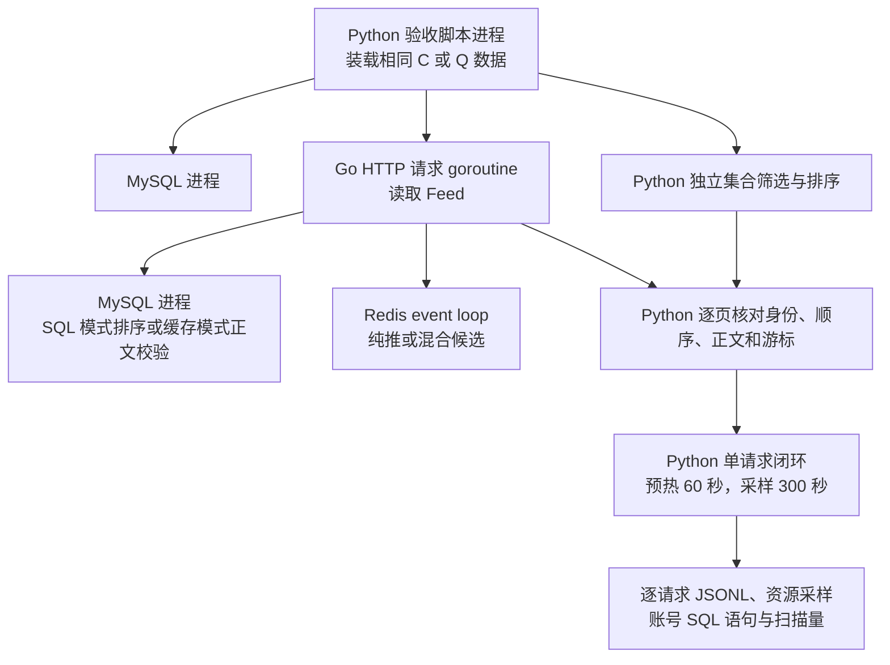

# 阶段七 · Sprint 3 验收与成本对照

## 冻结实验条件

C 集为 200 用户、5000 关注、1 万帖子，三种策略均对全部 200 位读者执行完整分页，与独立 Python 集合筛选和排序结果比较。各模式累计返回 244712 条可见帖子。

Q 集为 12 万用户、100 万关注、20 万帖子，选取关注 100／500／1000 位作者的三位读者。每轮完整分页核对 2516 条结果。每种策略三轮，预热 60 秒、稳定采样 300 秒，HTTP 单请求闭环，三位读者轮转，页大小 50。混合策略固定拉取作者 ID 为 10～73，共 64 位。各轮重新装载相同种子数据，串行运行。

F 集为 1000／1 万／10 万名独立且活跃的粉丝，加作者本人。每个规模进行三次发布，逐个检查全部读者成员，同时插入普通作者任务观察推进。F 使用帖子 Service 事务入口，测试将已提交根事件交给真实 handleRoot，再通过真实 MQ、Planner 和分发 worker 执行。这里测量业务事务开始到全部成员分发完成的耗时，HTTP 入口由另一个集成场景覆盖。

验收要求为参考结果逐条一致、请求无错误、任务最终完成、资源保持预算内。吞吐与延迟用于比较各策略的成本，吞吐口径为单请求闭环的实际完成速率。

## 调用与数据流



`scripts/fanout_acceptance.py` 复用基线脚本的数据生成、隔离数据库、独立参考、HTTP 调用与资源检查。新增 `Acceptance.verify` 核对 Feed，`Acceptance.run` 执行预热及稳定采样，`statements` 采集应用账号的 SQL 统计，`cleanup` 清理专属数据库、账号、队列和 Redis 前缀。

原双向关系深分页与执行计划证据继续见阶段一。Q 的首个 SQL 轮次也执行了双向关系完整分页。后续模式与轮次聚焦本轮变更的 Feed 入口。

## F 容量结果

| 活跃粉丝 | 第一次全部完成 ms | 第二次 ms | 第三次 ms | 普通任务可见范围 ms |
|---|---:|---:|---:|---:|
| 1000 | 220.310 | 217.236 | 326.599 | 114.127～223.280 |
| 10000 | 1330.894 | 1722.403 | 1819.284 | 114.359～227.070 |
| 100000 | 10988.859 | 11771.264 | 11920.153 | 110.683～115.360 |

这三次发布分别核对了粉丝数加本人数量的实际 Redis 成员。F 集每名粉丝接收三条测量帖子，内存结果对应这一数据密度，填满每人 500 条的容量需要另行测量。10 万粉丝的普通任务在本轮负载下持续推进。表内为三次离散发布观察，普通任务采用 100 毫秒轮询，计时从该轮大作者发布开始，因此包含普通任务创建前的时间和轮询误差。稳定读取吞吐实验单独使用上述 Q 集 300 秒窗口。

| 活跃粉丝 | 三次发布后 INFO used_memory 最大值 MiB | INFO used_memory_rss 最大值 MiB |
|---|---:|---:|
| 1000 | 2.57 | 27.82 |
| 10000 | 9.41 | 28.28 |
| 100000 | 81.46 | 107.73 |

内存值来自同一 Redis 进程，包含基础结构与分配器开销，不能简单除以帖子数当作长期每帖成本。F 集受监控测试进程树 RSS 最大采样值为 274.70 MiB，MySQL 为 279.41 MiB。

## 复现

```bash
GOMAXPROCS=2 go build -p 2 -o /tmp/notex-stage7-api ./src
GOMAXPROCS=2 go build -p 2 -o /tmp/notex-stage7-events ./src/cmd/events
python3 scripts/fanout_acceptance.py \
  --dataset Q --mode hybrid --round 1 \
  --binary /tmp/notex-stage7-api --events-binary /tmp/notex-stage7-events \
  --output notes/fanout/runs/new-Q-hybrid-1
```

F 集使用 `NOTEX_FEED_INTEGRATION=1 NOTEX_SCALE_FOLLOWERS=100000 GOMAXPROCS=2 GOMEMLIMIT=512MiB go test -race -p 1 -count=1 -timeout=25m -run TestAuthorIndexIntegration -v ./src/internal/feed`。规模只接受 1000、10000、100000，测试自动清理独立数据库与缓存前缀。

## 资源与解释边界

沿用已批准预算，Go 使用 GOMAXPROCS=2，测试进程树 RSS 上限 2 GiB，MySQL 4 GiB，RabbitMQ 2 CPU／768 MiB，Redis 1 CPU／256 MiB、maxmemory 128 MiB、noeviction。每批上限 30 分钟，新增数据与证据上限 2 GiB，总磁盘上限 100 GiB。HTTP 实验采用单请求闭环，低于批准的并发上限 4。

基线脚本记录进程树、MySQL RSS 和 RabbitMQ 容器采样，Redis 内存记录在容量日志和每轮最终 INFO 输出中。采样值反映观测时刻，Go GOMEMLIMIT 为运行时软限制。数据与证据由各批的资源检查约束。

新发帖的缓存可见时间仍取决于异步消费。关系事件使用当前读者 SQL 快照的差量安装，包含查询与排序成本。当前实验将静态读取吞吐、有限发布容量与故障恢复分别给出可核查结果。

原始证据位于 `runs/2026-11-17-stage7-*`。

## Q 正式读取结果

九个正式轮次全部通过，共记录 176761 次稳定采样请求。下表为各模式三个正式轮次的中位数，吞吐对应三位读者轮转的整体速率。

| 模式 | 请求／秒 | 100 作者 P95 ms | 500 作者 P95 ms | 1000 作者 P95 ms | 100 作者 P99 ms | 500 作者 P99 ms | 1000 作者 P99 ms |
|---|---:|---:|---:|---:|---:|---:|---:|
| sql | 30.183 | 69.999 | 19.270 | 13.022 | 74.216 | 20.438 | 13.947 |
| push | 100.165 | 11.955 | 12.563 | 13.282 | 14.114 | 14.787 | 15.422 |
| hybrid | 63.929 | 18.913 | 18.390 | 18.912 | 20.754 | 20.472 | 20.821 |

SQL 模式在本数据集的 100 作者组需要扫描更多全局时间索引条目才能取得一页，因此比 1000 作者组慢。纯推减少了候选扫描，在 100 作者组有明显收益。1000 作者组的 SQL 已能较快找到有效帖子，纯推还承担当前关系查询和 Redis 往返，因此两者接近。

混合模式在本轮每次聚合 64 位作者及一个读者来源，读取耗时高于纯推。其写侧代价取决于普通作者和拉取作者的比例。

| 作者策略 | 每帖逻辑 Redis 帖子索引成员写入 |
|---|---|
| SQL 模式 | 0 |
| 纯推或混合中的普通作者 | 作者索引 1 个，加活跃粉丝及本人读者索引 |
| 混合中的拉取作者 | 作者索引 1 个 |

这里统计逻辑帖子成员。Lua 内还包含关系 Hash、元数据、TTL 和裁剪操作。SQL 发布事务成本沿用阶段一的测量口径，分发任务按阶段四的 500 人 Planner 页和 100 人 chunk 记账。

### SQL 统计异常与处理

纯推第二轮的 Prepare 增量为 88911，Execute 增量为 74625，后者低于该轮请求所需的执行次数，扫描行计数也偏低。该轮全部 HTTP 请求和正确性核对通过，延迟样本继续纳入正式三轮结果；SQL 执行与扫描成本标记为异常并排除。当前查询到的 Performance Schema lost 计数为 0，异常原因尚未确定。

验收脚本加入计数一致性检查，并在后续核对轮次中先优雅停止 API，再读取最终统计。额外纯推轮次用于获得第三组有效的 SQL 成本样本。

补测 `Q-push-4` 已通过：预热 60 秒、采样 300.01 秒，共 30740 次采样请求，计数一致性检查通过，隔离资源清理成功。读取延迟主表仍使用预先约定的前三轮；SQL 成本采用 SQL／混合各自 1、2、3 轮，纯推 1、3、4 轮的中位数。

| 模式 | 平均 SQL Execute／请求 | 平均扫描行／请求 |
|---|---:|---:|
| SQL | 3.000 | 26114.489 |
| 纯推 | 3.008 | 1271.636 |
| 混合 | 3.013 | 1334.000 |

统计取应用账号 Performance Schema 的 `statement/com/Execute` 增量，包含同账号后台轮询，因此缓存模式略高于 3 条。表内是每轮三位读者合并后的请求均值，再取三轮中位数。该结果表明主要收益是减少候选扫描；关系读取、正文及当前权威状态校验仍保留。补测 MySQL RSS 峰值 411.92 MiB，仍在预算内。

### 代码修复与测量边界

检查期间修复 Lua 的多返回值问题。`string.gsub` 的替换次数曾被作为额外的 HDEL 字段参数，可能误删其他帖子的关系映射。现在先将帖子 ID 保存到局部变量再删除，并增加 501 个小 ID 成员的裁剪回归。

该修复发生在部分定时读取轮次之后。静态 Q 读取期间没有发帖和索引裁剪，原先冷快照安装的旧成员集合为空，相关删除分支未被执行。各轮保留独立二进制 SHA-256 和源码差异，最终故障与功能回归使用修复后的代码。

九个正式轮次的受监控测试进程树 RSS 采样峰值为 537.33 MiB，MySQL 为 398.27 MiB，均低于批准上限。

## E 与最终故障回归

`runs/2026-11-17-stage7-faults-01/report.json` 记录最终代码的完整回归，所有步骤通过，总耗时 298.05 秒。

| 场景 | 结果与边界 |
|---|---|
| E：MQ 停止至少 60 秒 | 保留 10000 次 Service 业务事务，恢复后两条队列及已确认消息按身份核对通过 |
| Redis 停止至少 60 秒 | 真实 HTTP 发帖仍提交成功；停机期间 Feed 走 SQL 并包含已提交帖子，恢复后索引追平 |
| 分发中 MQ 停机 | 根意图保留，恢复后完整分发；另测不可路由任务保持已冻结交接 |
| 消费者协议 | 14 个 race 子测试通过，覆盖重复、租约、重试转交、永久失败与重放 |
| 作者与分发竞争 | Redis 效果后退出、完成记账失败、部分交接、部分 pipeline、旧删除保护等核心窗口各 20 轮通过 |
| 关系变化 | 20 轮取关／重新关注／迟到旧写入，立即读取与 SQL 相同，旧清理保留新关系 |
| 关系事务晚提交 | 20 轮先冻结遗漏该读者的 Planner 快照，再提交关注事务，关系消费补齐帖子 |
| 读取边界 | 64／65 来源、历史页、删除过滤、冷缓存、7 天活动 TTL、快照竞争、真实 HTTP 混合读写通过 |
| 小 ID 裁剪 | 501 条成员裁剪至 500，其他帖子的关系 Hash 字段保持完整 |
| 全库与接口 | `go test -p 2 -parallel 1 ./src/...`、API 构建、27 组 HTTP 功能回归通过 |

最终故障批次使用 `-race` 执行消费者和 Feed 集成测试。监控到的测试进程树 RSS 峰值为 197.59 MiB，MySQL 为 396.56 MiB；测试期间数据库目录最大增量约 63.81 MiB。两容器在故障测试结束时恢复运行。

复现故障批次的测试入口如下，需本机 MySQL 和 compose 中的 Redis、RabbitMQ，可先按阶段一配置 TEST_MYSQL 等连接环境：

```bash
GOMAXPROCS=2 NOTEX_INTEGRATION=1 go test -p 1 -count=1 -timeout=20m \
  -run TestPublisherIntegration -v ./src/internal/outbox
GOMAXPROCS=2 NOTEX_CONSUMER_INTEGRATION=1 go test -race -p 1 -count=1 \
  -run TestConsumerIntegration -v ./src/internal/outbox
GOMAXPROCS=2 NOTEX_FEED_INTEGRATION=1 NOTEX_FANOUT_INTEGRATION=1 \
  NOTEX_READING_INTEGRATION=1 NOTEX_REDIS_OUTAGE=1 NOTEX_FANOUT_MQ_OUTAGE=1 \
  go test -race -p 1 -count=1 -timeout=6m -run TestAuthorIndexIntegration -v ./src/internal/feed
```

这些故障测试会按场景停止并恢复本项目容器，不应与性能采样同时运行。各批使用独立数据库、账号、队列和缓存前缀，运行器清理自己的测试资源。原始证据按仓库现有规则留在本机 `runs/`，汇总报告、实现和测试入口纳入版本控制。

全部批次结束后的只读核对见 `runs/2026-11-17-stage7-suite/cleanup.json`：测试数据库与账号为空，RabbitMQ 队列为空，Feed／基准缓存前缀为空，Redis 和 RabbitMQ 均运行。Docker 镜像、容器与卷合计约 11.31 GB，实验原始证据约 83 MiB；没有本轮新增镜像。Go 源码与最终通过回归时的 SHA-256 一致，格式及差异空白检查通过，Go 源码中未发现家目录路径。
