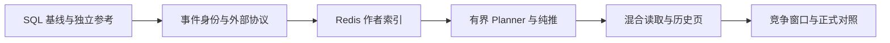

# Feed 分发实验记录

Sprint 3 的基线、后续实现更新与压测报告统一维护在本目录。

## 当前批次

[第一步基线记录](01-baseline.md) 已完成，记录范围、运行方式、SQL 成本、资源预算与实测结果。最终运行采用 C3 和 Q2，全部通过并清理隔离资源。

[阶段三作者索引](03-author-index.md) 已完成，包含外部消费者、Redis条件更新、事件身份与逐函数流程图。最终stage3-04通过14个消费者子测试、6个Feed子测试及27组HTTP功能回归，记录20轮故障窗口、Redis停机恢复与资源采样。

[阶段四Planner与分发写入](04-planner-distribution.md) 已完成，采用单Planner、单分发worker和最多32条命令的有界pipeline。stage4-01通过1203粉丝加本人的集合核对、四组各20轮故障窗口、MQ停机恢复及27组HTTP回归。纯推读取随阶段五混合读取一并实现，整体性能基线采用完全MySQL写入和排序拉取。

[阶段五纯推与混合读取](05-reading.md) 已完成。stage5-02 通过 64／65 作者边界、788 条全量分页、80 页单条分页、20 轮生命周期与快照窗口、真实 HTTP 混合发布读取、既有消费者与分发回归及 27 组 SQL HTTP 回归。活动期为 7 天，索引保留 500 条，历史页采用 SQL。正式三策略性能对照继续在阶段七完成。

`runs/` 保存每次运行的原始报告、HTTP 样本、资源采样、执行计划和参考结果。失败运行也保留，重试使用新目录。

## 推进顺序

每批更新记录代码版本、改动、函数流程、正确性证据、成本和未验证范围。性能摸底与正式验收分别记录实际负载和轮次。

[阶段六关系收口](06-relationships.md) 已完成，记录有界清理、差量快照与立即读取兜底。[阶段七正式验收](07-acceptance.md) 汇总 C/Q/F/E、三策略三轮性能、故障恢复和成本边界。原始证据保存在 `runs/2026-11-17-stage7-*`。
