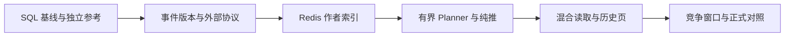

# Feed 分发实验记录

Sprint 3 的基线、后续实现更新与压测报告统一维护在本目录。

## 当前批次

[第一步基线记录](01-baseline.md) 已完成，记录范围、运行方式、SQL 成本、资源预算与实测结果。最终运行采用 C3 和 Q2，全部通过并清理隔离资源。

`runs/` 保存每次运行的原始报告、HTTP 样本、资源采样、执行计划和参考结果。失败运行也保留，重试使用新目录。

## 推进顺序

每批更新记录代码版本、改动、函数流程、正确性证据、成本和未验证范围。性能摸底与正式验收分别记录实际负载和轮次。
