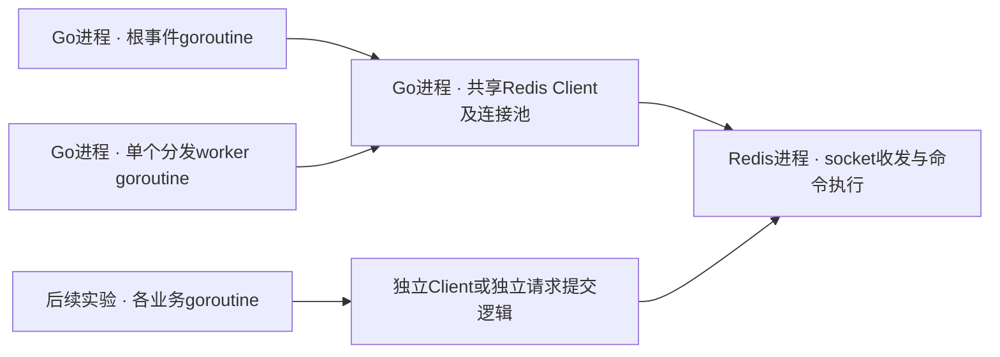

# 后续优化 · 按 goroutine 隔离 Redis 客户端或请求逻辑

## 当前实现

阶段四使用一个 Planner goroutine 和一个分发 worker goroutine。根事件处理器与分发 worker 共享 `feed.Service` 中的 go-redis Client，连接池大小为4。Planner 负责 SQL 分页和 MQ 交接。分发 worker 每次 pipeline 最多发送32条条件更新脚本，分块最多100名接收者。

## 优化动机

对高频、小命令的 Redis 工作负载，socket I/O、网络往返、协议编码、系统调用与连接争用经常限制端到端吞吐。后续应优先测量这些成本，以及 Redis 命令执行线程的实际利用率。用户提出按 goroutine 配置独立 Redis 请求客户端或请求逻辑，将这一方向保留为后续优化点。

共享 Client 本身可以通过连接池使用多条 socket 连接。独立 Client 会分别持有连接池，因此需要一起限制总连接数和总内存。独立客户端的收益取决于连接争用和请求调度成本，具体结果以本项目测量为依据。

## 对照实验

固定数据集、pipeline上限、活跃worker数量和总连接预算，对照共享Client、按业务goroutine独立Client、共享连接池配合独立请求批次三种组织方式。记录连接池等待时间、socket收发吞吐、客户端CPU、Redis命令执行耗时、端到端P95/P99、错误率与RSS。

以现有完全MySQL写入和排序拉取作为整体性能基线。本优化实验单独解释 Redis 请求组织方式对分发写入的影响。独立客户端数量增加时同步约束连接池，避免把连接数增加的收益混入客户端隔离的结论。

Redis pipeline可摊薄往返和系统调用开销，需要有界批次控制响应缓冲。Lua在Redis服务端原子执行，脚本工作量也应保持有界。[Redis pipeline文档](https://redis.io/docs/latest/develop/using-commands/pipelining/)、[Lua文档](https://redis.io/docs/latest/develop/programmability/eval-intro/)
