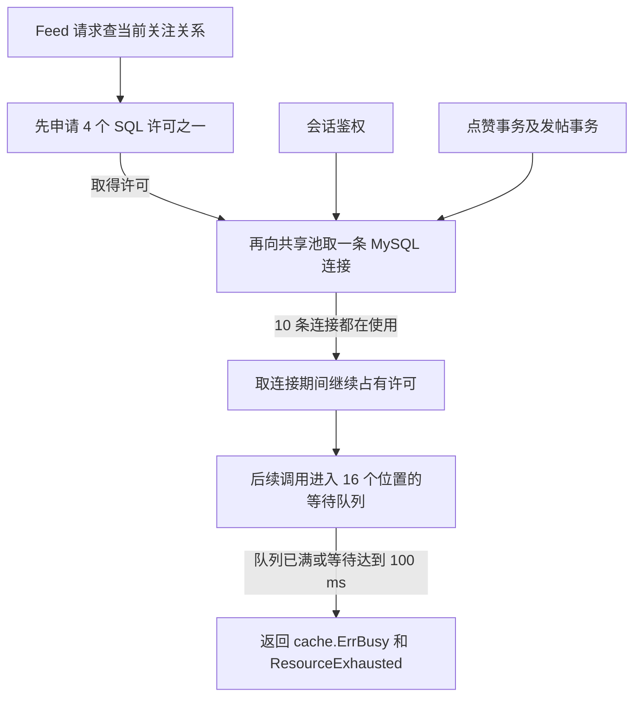

# Batch04 · Core SQL 许可与数据库连接竞争诊断

**原配置的高档瓶颈在 Core 进程的共享 MySQL 连接池。** Feed 读请求先取得 SQL 执行许可，再和鉴权、点赞事务、发帖及关注写入竞争数据库连接。在 4,096 目标档，四个许可几乎一直处于占用状态，许可持有时间的 99.44% 落在取数据库连接的调用里。查关注关系的 RPC 大量返回 ResourceExhausted，许多首页请求在检查读者收件箱之前即告失败。

## 两种等待分别发生在哪里

共享 10 连接组，4,096 目标档取中间 25 秒。六个角色持续存活，Redis 规格和种子与 batch03 相同。下述“连接秒”是一条连接从交给调用者到还回池的墙钟时间；事务中的网络往返、Redis 操作和提交都包括在内。

| 实测项 | 数值 | 含义 |
|---|---:|---|
| DBStats.InUse | 每次采样 10/10 | Core 池在窗口内的每个采样点均满 |
| Core 受保护读操作 | 累计约 100 许可秒 | 25 秒内平均用满 4 个许可 |
| GetFeedRelations | 持许可 81.60 秒，其中取连接 81.14 秒 | 427 次获许可，平均每次取连接约 190 ms |
| SQL 许可队列拒绝 | 队满 29,669 次，等满 100 ms 3,302 次 | 以这两种拒绝合计，约 90.0% 是队满 |
| 连接池累计等待 | 124,540 次，24,259.9 等待秒 | 所有共用池的调用者并发累计，平均每个计入等待的调用约 195 ms |

100 ms 限制的是尚未拿到许可的排队时间。拿到许可后，等待底层数据库连接可以超过 100 ms。这个顺序解释了为什么队列很快填满，同时 MySQL 端实际执行的关系 SQL 很少。[准入实现](../../../src/internal/cache/cache.go) · [基线窗口计数](core10/diagnosis.json)

## 谁占了共享连接

同一 25 秒窗口，已归还连接的持有时间共 247.04 连接秒，接近 10 条连接的 250 秒容量。

| 借出连接的调用路径 | 连接秒 | 占比 |
|---|---:|---:|
| 帖子事务，开始于 lockPost | 112.32 | 45.5% |
| 会话鉴权 Authenticate | 57.14 | 23.1% |
| 发帖事务 Create | 49.97 | 20.2% |
| likeAccess 的直接查询 | 13.49 | 5.5% |
| 关注关系写事务 | 13.43 | 5.4% |

lockPost 的占比覆盖从 BeginTx 到还连接的整个事务。冷赞／取消冷赞会锁帖子行，在事务内询问 Redis 当前是否已晋级为热帖，再写 post_likes 并提交。基线该窗口的 InnoDB 行锁抽样没有捕获持续等待；采样间隔约 1.5 秒，短暂锁等待仍可能存在。[事务入口](../../../src/internal/post/like_heat.go) · [冷赞事务](../../../src/internal/post/likes.go) · [MySQL 抽样](core10/mysql-samples.jsonl)

## 中档和高档的区别

2,048 目标档，基线窗内整页回退占据 43.68 个许可秒，取连接占全部许可持有时间约 45%。Feed Query 因关系签名变化尝试回退 7,165 次，因冷读回退 0 次。4,096 档，取连接比例升至 99.44%，同窗缓存成功返回只剩 1 次。提前准备收件箱能缓解冷读，关系变更仍会触发重新读取；进入高档后，读缓存前的连接竞争已足以使正常路径失效。[Feed 路径计数](core10/feed-paths.jsonl)

## 用连接池对照验证

三次各跑完整一趟五档阶梯。以下取 4,096 目标档的 30 秒 HTTP 结果，以及该档中间约 25 秒的内部计时。

| Core 连接分配 | 实发 QPS | 综合成功 QPS | Feed 成功 QPS | Feed 成功率 | 取连接占读许可持有时间 |
|---|---:|---:|---:|---:|---:|
| 普通与 RPC 共用 10 | 3,171.6 | 1,903.1 | 1.5 | 0.12% | 99.44% |
| 普通与 RPC 共用 20 | 3,482.9 | 2,091.4 | 1.8 | 0.13% | 98.96% |
| 普通业务 6 ＋ RPC 读取 4 | 2,056.4 | 1,687.2 | 471.7 | 57.28% | 0.08% |

扩大共享池提高了综合吞吐，在高档几乎未恢复 Feed。留出读连接后，读池平均占用 3.62/4，窗口内 DBStats 新增连接等待为 0。普通池平均占用 6/6，同一档有 571 个请求超时。与共享 10 相比，成功发帖从 255.0 降至 162.0 QPS，成功点赞从 475.5 降至 303.8 QPS。这组结果验证了争用发生的位置。各组客户端都触到了在途限制，实际到达量不同；固定 6＋4 的测量展示了资源分配的代价，不能当作同一实发负载下的容量提升。[五档并排](comparison.md) · [共享 10](core10/README.md) · [共享 20](core20/README.md) · [固定分池](reserved4/README.md)

## 隔离后看见的第二个瓶颈

- **Feed 侧。** 隔离组的 4,096 档诊断窗口内，整页 ReadFeedPage 占用 67.45 许可秒，约占全部 87.40 许可秒的 77%。Feed Query 记录了关系签名变化回退 11,394 次、冷读回退 0 次。这些是尝试，不代表全部执行成功。关注／取关改变当前关系，收件箱签名会在异步事件处理时更新；两者尚未一致时，读路径回退整页查询。本轮没有给单个关系事件打端到端时间戳，无法量化每次签名差异持续了多久。[读取判断](../../../src/internal/feed/read.go) · [签名更新](../../../src/internal/feed/relationship.go)
- **写侧。** 隔离组窗口内，从 lockPost 借出的 58.35 连接秒中，冷赞事务提交占 25.65 秒（44%），持事务检查 Redis 热状态占 14.02 秒（24%），写点赞边占 8.89 秒，锁定帖子行的 SELECT 占 6.55 秒。该分解仅在隔离组采集，不能直接移植为共享组比例。耗时含驱动、网络、调度及服务端处理，提交耗时不能进一步归因到具体磁盘操作。[分段原始计数](reserved4/diagnosis.json)
- **优化优先级。** 如果目标是兼顾 Feed 和写吞吐，优先减少共享连接需求和持有时长，先从点赞事务与高频会话鉴权入手。并行验证能否缩短关系变化后连续整页回退的时段，保留取关后即时不可见的语义。若需要 Feed 过载保护，读连接隔离已有实验证据，具体额度须按 Feed 和其他接口各自的成功 QPS、超时及延迟选定。

## 采样与比较口径

- 三组均运行本机 M 综合场景，每档计划 30 秒。初态为同一名单的 750 位就绪、250 位冷读者。Core、Feed Query、Rebuilder、Feed Worker、Relay、Like Worker 各一实例。Redis 上限 1 GiB，测试进程 RSS 加容器 working set 守卫 4 GiB，单轮新增磁盘守卫 2 GiB。
- 每秒记录 Core 池统计、许可及队列状态、各调用点累计持有时间与拒绝原因，同时读取 Feed Query 的实际缓存和回退路径计数。诊断表对每档去掉两端各约 2 秒后计算差值，HTTP 结果按整个发压档统计。各计时点随调用完成计入，窗口边缘可出现跨秒完成。
- Core 指标通过 Go 1.26.1 临时编译 overlay 加入，业务源码和默认部署配置保持原状。20 连接实验只改变 Core 最大连接数。隔离池实验将同一总预算 10 划为 RPC 权威读取 4 条及其他调用 6 条；鉴权继续走普通池，读许可仍为 4 个，另采集了点赞事务分段计时。RPC 读池还承接后台投影读取。每个配置独立运行一趟，插桩本身有成本，绝对吞吐应与原版 batch03 分开看。[基础观测差异](diagnostic-overlay.diff) · [隔离组差异](reserved-read-pool.diff)
- MySQL performance_schema 的 digest 槽已占满 10,000 个，Performance_schema_digest_lost 持续增长。新测试库首档的 digest 结果为空，定位使用客户端实测计时及连接统计。未重置共享实例的统计。[MySQL 状态](mysql-digest-status.tsv)

三轮均通过同一份收件箱名单核验，结束时六个角色均存活，本轮命名空间已清理。单轮发压期间最高内存采样为 1,104.0 MiB，最大新增磁盘采样为 453.0 MiB。三轮均未触发连续三桶严重不可用条件；含读专池时，2,048 档即触及客户端到达率限制。业务仓库中未应用本轮两个诊断差异。
