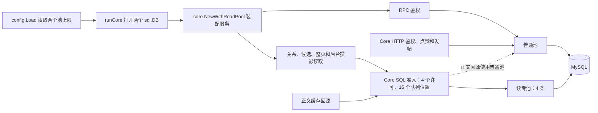
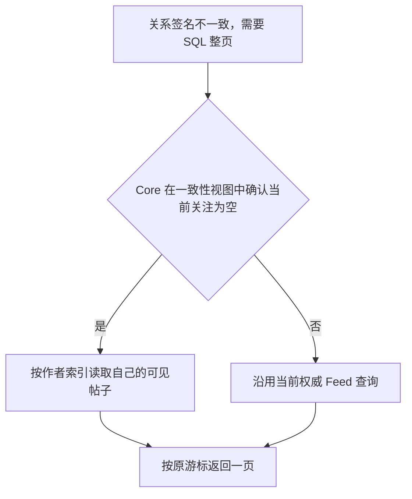

# Batch05 · Core 连接池预算与 Feed 回退

**在相同实发 2,048 QPS 下，68 条组取得最高综合成功吞吐 1,814.5 QPS 和最低综合成功 P99 162.8 ms。Feed 仍有 28.5% 的请求失败。** 三组读专池在各档内部窗口的新增取连接等待均为零。阻塞集中在 Core 的 SQL 准入，以及高档时的普通池和事务提交。下一项优先验证零关注读者的 Feed 整页回退。

## 测了什么

运行本机 M 综合流量，每组使用同一份夹具、随机种子 5、同一名单的 750 个就绪收件箱和 250 个冷收件箱。每组独立跑完五档各 30 秒。六个角色各一实例，Redis 1 GiB，MySQL 9.6.0 的连接上限 151。三组均未触发连续三个低成功率秒桶或资源守卫。最高内存采样 1,093.3 MiB，单组最大新增磁盘 422.7 MiB。结束时六角色均存活，各组测试库、账号、vhost、Redis 和 etcd 命名空间均已清理。

| 应用总上限 | Core 普通＋专读 | 2,048 档实发 / 成功 QPS | Feed 成功率 / 成功 P99 | 综合成功 P99 | 4,096 档实发 / 成功 QPS | 同档 Feed 成功率 |
|---:|---|---:|---:|---:|---:|---:|
| 40 | 20＋4 | 2,048 / 1,692.8 | 56.63% / 227.7 ms | 259.3 ms | 2,897.3 / 1,943.2 | 18.11% |
| 52 | 32＋4 | 2,048 / 1,681.7 | 55.28% / 204.8 ms | 239.7 ms | 3,416.7 / 2,187.2 | 10.18% |
| 68 | 48＋4 | 2,048 / 1,814.5 | 71.50% / 131.3 ms | 162.8 ms | 3,629.8 / 2,337.8 | 10.97% |

另外 16 条分给 Feed Worker 4、Relay 2、Like Worker 10。拆分部署默认采用已约定的 32＋4，下一轮优化实验优先以 68 条组作对照。每配置仅跑一次，且 68 条组在 1,024 档 P99 高于另外两组。4,096 与 8,192 目标档三组均碰到客户端 1,024 在途上限，最后一档实发约 2,850～3,787 QPS。高档数据反映各组过载表现；同负载比较取前三档。[每档 HTTP、数据库与资源明细](comparison.md)

## 分池后的请求如何取连接

Core 和 Feed Query 的本机诊断端口分别提供池统计、SQL 拒绝计数及 Feed 路径统计。拆分服务在正式源码中启用本次路由。合并部署继续使用 core.New，将同一个池传给构造函数。路由回归测试分别从鉴权、关注关系查询和整页读取进入，验证实际选中的连接池。[服务装配](../../../src/internal/app/roles.go) · [路由构造](../../../src/internal/core/service.go) · [路由测试](../../../src/internal/core/service_test.go)

## 瓶颈怎样形成

1. **Feed 已经拿得到专用连接，SQL 许可持续排队。** 2,048 档的三组均没有漏发。52 条组在约 26.1 秒内，4 个许可平均占用 4.0，队列平均 15.5/16，新增 11,315 次准入拒绝。整档 30 秒内，10,989 个 HTTP 503 全来自 Feed。准入计数包含各类受保护调用，窗口和计数单位与 HTTP 不同。68 条组平均排队降到 14.2/16，读专池新增取连接等待仍为零。[52 条原始采样](total52/resources.jsonl) · [68 条原始采样](total68/resources.jsonl)
2. **关系变动触发整页回退。** 52 条组同一窗口计到 8,806 次关系签名不一致的整页回退尝试、0 次冷读回退、3,669 次缓存成功返回。关注或取关改变了 MySQL 的关系，Redis 收件箱保留旧签名时，Feed 会走整页 SQL。终点该组 Feed 主队列还有 7,470 条 ready 消息。队列里包含多种事件，单个关注事件的传播时延和零关注查询占全部许可秒的比例本轮均未直接测量。[读取判断](../../../src/internal/feed/read.go) · [异步对齐](../../../src/internal/feed/relationship.go) · [终点队列](total52/queues.tsv)
3. **普通池在高档也用满了，写侧要分开看。** 4,096 目标档三组普通池各采样点均满。52 条组 14 次状态快照合计看到 317 个处于 waiting for handler commit 的线程样本，测试账号出现行锁等待的快照为 1 次，MySQL 平均消耗约 2.24 个 CPU 核。该窗口测试账号同时打开的连接峰值为 41，实例连接打满错误增量为 0。提交阶段占用连接值得继续分解；现有 InnoDB 文件平均写耗时不足以定位 binlog 或具体磁盘同步操作。

## 首选优化及实测边界

**优化前（当前实现）**。收件箱需要整页 SQL 回退时，零关注读者也执行通用 Feed 查询。下图为 68 条组一位自己也没有发帖的读者的首页执行计划。

**优化后（建议方案，已单独验证查询）**。Core 在同一一致性视图内确认用户存在、当前关注为空，然后按读者自身 author_id、软删除条件和原来的时间游标走已有的 idx_author_active_created 索引，取 limit＋1 条。用户自己可能发过帖子，需要正常返回。读者有关注时先沿用当前路径。这样能保留取关立即不可见、分页顺序和下一页判定。

停压后在 68 条组的同一只读快照中执行 EXPLAIN ANALYZE。29,238 篇帖子中有 29,233 篇可见，1,000 位读者中 65 位当时为零关注。每一类选一位读者，比较首页时返回的帖子 ID 及顺序一致。

| 关注数 | 当前 SQL 完成时间 | 逐作者 LATERAL（优化器自行选索引） | 逐作者 LATERAL（指定作者索引并统一 ID 类型） | 只查自己 |
|---:|---:|---:|---:|---:|
| 0 | 171 ms | 33.2 ms | 0.118 ms | 0.00208 ms |
| 1 | 0.419 ms | 38.2 ms | 10.7 ms | — |
| 3 | 0.459 ms | 37.9 ms | 39.8 ms | — |

零关注样本的当前 SQL 沿全局时间索引扫描 29,233 行并逐行判断可见性，最后返回空页；只查自己直接定位作者索引，匹配 0 行。52 条组的另一个零关注样本也扫描 27,538 行才返回空页。对于关注热门作者的样本，当前查询分别只需检查 62、21 行就凑齐一页。逐作者改写即使指定索引，执行计划仍对作者范围内的结果排序。这支持先优化零关注分支。上述计时为查询根节点的一次执行，不含分支核验、应用排队和网络开销。整体 QPS 收益需下一轮端到端复测。[52 条组执行计划](total52/feed-plans.txt) · [68 条组执行计划](total68/feed-plans.txt) · [复现脚本](feed-plans.py)

复测固定 48＋4、相同初态和同一到达率，单独改变零关注回退。记录零关注调用次数及许可持有时长、所有 Feed 回退的许可持有时长、准入拒绝、Feed 成功 QPS 和 P99，并检查自己发帖、取关并发与跨页游标。若剩余回退仍主要由关系签名差异触发，再为关系提交和收件箱签名更新加入关联时间戳，测出持续时间后选择修复位置。

三个首档 digest 窗口均为空，本报告的 SQL 归因依赖运行时计数、测试账号状态采样和停压后的只读执行计划。压测使用工作区修改后的源码，run.json 的 commit 为基线 HEAD。Go 测试命令为 `go test ./src/... ./scripts/ladder`。
