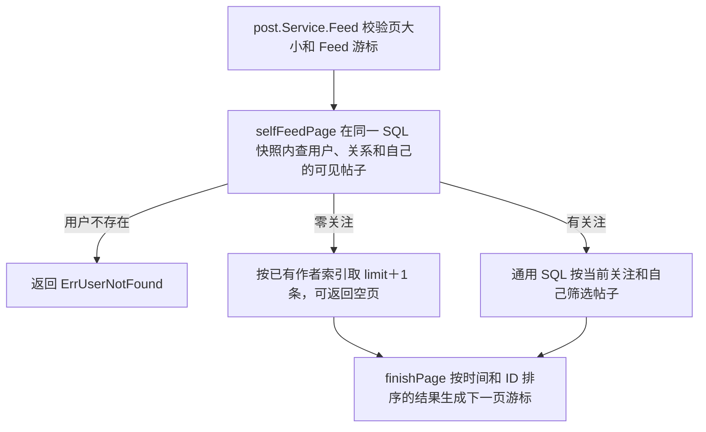

# Batch06 · 零关注读者的 Feed 回退

**零关注空首页的扫描已消除。** 在本轮同一个数据库快照里，旧查询检查了 27,144 篇可见帖子才返回空页，新查询使用作者索引，匹配 0 篇。2,048 QPS 档的 Feed 成功率由 71.50% 升至 74.95%，成功请求的 P99 由 131.3 ms 升至 169.6 ms。整体表现仍受关系变化后的整页回退与 SQL 准入排队影响。

## 负载与结果

与 Batch05 的 68 条组对照。两组各跑一次 M 场景，共六个角色；Core 普通池 48 条、读专池 4 条、其他角色合计 16 条。两组使用同一数据库夹具、种子 5 及同一名单的 750 个就绪收件箱和 250 个冷收件箱。Redis 为 1 GiB。此轮发压 150.00 秒，结束条件为五档到时。下表每格为基线 → 本轮，P99 仅统计成功响应。

| 目标 QPS | 实发 QPS | 综合成功 QPS | Feed 成功 QPS | Feed 成功率 % | Feed P99 ms |
|---|---|---|---|---|---|
| 512 | 512.0 → 512.0 | 511.0 → 512.0 | 204.1 → 204.9 | 99.61 → 100.00 | 69.6 → 29.7 |
| 1024 | 1,024.0 → 1,024.0 | 1,010.2 → 1,023.8 | 396.0 → 409.4 | 96.67 → 99.95 | 89.9 → 39.8 |
| 2048 | 2,048.0 → 2,048.0 | 1,814.5 → 1,842.8 | 585.7 → 614.0 | 71.50 → 74.95 | 131.3 → 169.6 |
| 4096 | 3,629.8 → 3,551.2 | 2,337.8 → 2,440.0 | 159.3 → 308.5 | 10.97 → 21.73 | 806.1 → 680.1 |
| 8192 | 3,787.0 → 3,059.8 | 2,324.6 → 2,058.0 | 85.0 → 249.9 | 5.59 → 20.43 | 1,062.7 → 967.1 |

## 改动与回归

自己的帖子查询在子查询内部应用软删除、游标、排序及上限。外连接保留没有匹配帖子的读者。Core 的 /debug/pools 新增 feed_pages，记录整页调用和完成零关注分支的次数及墙钟耗时。真实 MySQL 回归覆盖读者不存在、空页、本人发帖、同秒分页、软删除、错用游标、未提交的关注、关注提交后与取关后的可见性。

## 本轮的 SQL 准入与回退

| 目标 QPS | 整页调用 / 零关注完成 | 整页累计秒 / 零关注累计秒 | 零关注平均 ms | 读池新增等待 | 4 个许可平均在用 | 平均排队 / 16 | SQL 准入拒绝（前 → 后） | 关系变化 / 冷读回退尝试 |
|---|---|---|---|---|---|---|---|---|
| 512 | 703 / 0 | 7.28 / 0.00 | — | 0 | 1.4 | 0.1 | 37 → 0 | 242 / 211 |
| 1024 | 2,778 / 35 | 16.00 / 0.03 | 0.98 | 0 | 2.9 | 1.9 | 452 → 10 | 2,300 / 0 |
| 2048 | 10,018 / 298 | 46.43 / 0.70 | 2.34 | 0 | 4.0 | 13.6 | 7,117 → 6,402 | 10,220 / 0 |
| 4096 | 7,348 / 316 | 60.93 / 1.65 | 5.22 | 0 | 4.0 | 15.7 | 34,980 → 30,306 | 10,510 / 0 |
| 8192 | 6,660 / 415 | 61.86 / 1.67 | 4.01 | 0 | 3.5 | 12.8 | 38,881 → 26,929 | 9,632 / 0 |

使用与基线相同的档内采样窗口，排除两端各 1 秒，计数取其余样本首末差，准入占用和排队为快照平均。整页计时从取得许可后进入 post.Service.Feed 开始，包含查库及组页；零关注计时从分支查询前到组页完成。两者均按调用结束累计。关系变化记录回退尝试，Core 调用计数仅包括获准进入整页读取的请求。

## 执行计划与剩余瓶颈

- 停压后在同一只读快照中，读者 35 无关注且没有自己的可见帖子。旧通用查询沿全局索引读 27,144 行，查询根节点完成时间为 184 ms。实际接入的分支 SQL 使用 idx_author_active_created，自己的帖子匹配 0 行，外连接返回一条表示空页的用户记录，总计 0.10 ms。该数字含数据库内的分支判断；网络、排队和 HTTP 处理另计。对有 1 个关注的读者 4，分支 SQL 直接返回关系标记，后续仍执行通用查询。
- 两组在 2,048 档均实发 61,440 个请求，其中 Feed 均为 24,574 个。Feed 503 由 7,004 次降至 6,155 次，成功请求 P95 由 66.9 ms 降至 55.3 ms，P99 同时变差。相同档内约 26 秒，普通池累计等待从 235.9 增至 1,080.2 连接等待秒，HTTP 峰值在途从 355 升至 853。多个调用的等待可以重叠。两组各一次，这些观测无法把每个慢请求归因到普通池。
- 同档 10,018 次已进入 Core 的整页调用中，298 次完成零关注分支，占 2.97%。关系签名不一致触发 10,220 次回退尝试。4 个 SQL 许可平均用满，等待队列平均占 13.6/16，读专池新增等待为 0。下一步优先关联同一读者的关系事务提交、投影消费、Redis 收件箱签名更新和回退请求，测量一次关系变化会触发多少次整页查询，以及这段时间主要耗在哪个阶段。
- 4,096 和 8,192 目标档均触及客户端 1,024 在途上限，基线与本轮实发不同。8,192 档实发约 3,060 QPS，综合成功吞吐低于上轮。高档仅表述过载表现。首档的 statement digest 样本为空，SQL 路径结论来自应用计数和停压后的实际执行计划。

功能验证使用 `NOTEX_FEED_INTEGRATION=1 go test -count=1 -run 'TestAuthorIndexIntegration/zero_follows_authoritative_feed' -v ./src/internal/feed`，常规回归使用 `go test ./src/... ./scripts/ladder`，均通过。压测命令为 `python3 scripts/ladder/run.py --core-conns 48 --core-read-conns 4 --output notes/performance-tests/batch06`，再次执行需使用新的输出目录。

## 发压与资源边界

| 目标 | 实发数 / 成功数 | 503 / 超时 / 末端取消 | 未发 / 峰值在途 | 综合成功 P95 / P99 ms | 发帖 / 点赞成功 QPS | 普通池平均在用 / 48 | 内存 / 新增磁盘 MiB |
|---|---|---|---|---|---|---|---|
| 512 | 15,360 / 15,360 | 0 / 0 / 0 | 0 / 25 | 13.6 / 30.3 | 40.9 / 76.8 | 2.3 | 933.1 / 176.4 |
| 1024 | 30,720 / 30,714 | 6 / 0 / 0 | 0 / 49 | 15.0 / 39.0 | 82.0 / 153.5 | 3.9 | 1,000.8 / 296.7 |
| 2048 | 61,440 / 55,285 | 6155 / 0 / 0 | 0 / 853 | 139.3 / 462.9 | 163.8 / 307.3 | 21.6 | 1,094.5 / 374.7 |
| 4096 | 106,536 / 73,200 | 33336 / 0 / 0 | 16,344 / 1,024 | 743.8 / 1,022.3 | 283.8 / 533.9 | 48.0 | 1,152.4 / 403.2 |
| 8192 | 91,793 / 61,741 | 28914 / 117 / 1021 | 153,967 / 1,024 | 937.5 / 1,366.7 | 238.4 / 452.1 | 48.0 | 1,160.2 / 414.7 |

全程最大采样内存 1,160.2 MiB，单批最大新增磁盘 416.7 MiB。六个角色在停压时均存活，三项采样正常退出，隔离数据库、账号、Redis、RabbitMQ vhost、etcd 命名空间均已清理。首例错误发生在发压后 37.5 秒，为 Feed HTTP 503。各过程文件仅在本地保存。[Batch05 同预算数据](../batch05/comparison.md)
