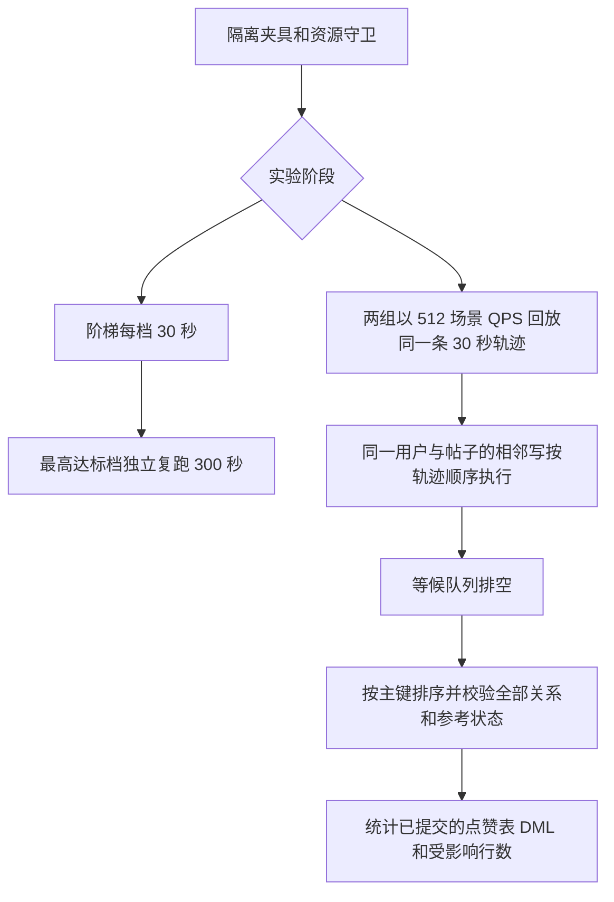

# L 场景热帖点赞对照实验

本机使用 1,000 个读者、2,875 篇有效帖子，均来自同一个 Sprint 5 夹具。每组从独立的新数据库、空点赞表、独立 Redis 前缀和 RabbitMQ vhost 开始。相同 Core 普通池 32、专读池 4，Go 服务 GOMAXPROCS=2。SQL 使用同步写入，自适应模式额外启动 Like Worker（连接池 10）。两种模式均启用混合 Feed 和相同的正文缓存。初始读者收件箱 750 个就绪、250 个冷态。部署的其余服务与历史综合阶梯相同。每批限制内存 4 GiB、新增磁盘 2 GiB，项目总磁盘预算 100 GB。

## 请求和计量

每 100 个请求随机打乱 60 次 PUT 点赞、20 次 DELETE 取消和 20 次 GET 详情。48 次 PUT 和 16 次 DELETE 发往同一热帖，其余写请求在其他帖子上均匀抽样；详情在全部帖子上均匀抽样。用户从 1,000 位读者均匀抽取，随机种子 5，每个窗口独立回放相同种子，从冷到热由服务自行晋级。阶梯的相邻档位保留服务状态，稳态和写库回放另起新组。

发压器开环调度，最多 1,024 个在途请求，HTTP 超时 2 秒。写吞吐为成功的 PUT 和 DELETE 数除以发压窗口秒数，统计 HTTP 200 和 202。写 P95 从计划发送时刻计到成功响应体读完，包含客户端调度延迟。准入条件是成功写 P95 < 100 ms，失败加未发占计划写请求的比例 < 0.1%。异步端每约 5 秒采集 Redis Stream 消息条数和 RabbitMQ ready/unacked 消息数；MQ 一条消息可包含多次状态变化，两者单位不同。停发后连续三次确认均为空，管理接口统计和轮询存在时间粒度。



## 30 秒阶梯定位

| 模式 | 场景 QPS | 成功点赞写 req/s | 写 P95 ms | 失败 / 未发写请求 |
|---|---:|---:|---:|---:|
| sql | 512 | 409.6 | 4.2 | 0 / 0 |
| sql | 1,024 | 819.3 | 3.0 | 0 / 0 |
| sql | 2,048 | 1,638.3 | 61.7 | 0 / 0 |
| sql | 4,096 | 2,798.0 | 671.6 | 2 / 14,361 |
| adaptive | 512 | 409.6 | 3.8 | 0 / 0 |
| adaptive | 1,024 | 819.3 | 8.6 | 0 / 0 |
| adaptive | 2,048 | 1,638.3 | 136.6 | 0 / 0 |

## 5 分钟稳态结果

| 模式 | 场景 QPS | 成功写 / 计划写 | 成功写 req/s | 写 P95 ms | 失败 / 未发写请求 | 达标 |
|---|---:|---:|---:|---:|---:|---|
| SQL | 2,048 | 490,998 / 491,520 | 1,636.66 | 70.784 | 82 / 440 | 否，缺口 0.1062% |
| SQL | 1,024 | 245,760 / 245,760 | 819.2 | 3.354 | 0 / 0 | 是 |
| 自适应 | 1,024 | 245,760 / 245,760 | 819.2 | 4.043 | 0 / 0 | 是 |

自适应 2,048 档在 30 秒定位时写 P95 已达 136.639 ms。按倍增档位测得两种模式相同的 5 分钟达标吞吐；中间速率未经细分。自适应稳态累计 59 个积压采样点，Redis Stream 最大 10 条，RabbitMQ ready 最大 0 条、unacked 最大 4 条，停发后 10.67 秒完成连续三次空队列确认（含轮询和等待）。各批合计观察到内存采样峰值 912.8 MiB，单批新增磁盘峰值 219.1 MiB。所有批次均完成隔离资源清理。

## 相同轨迹的写库结果

| 指标 | 纯 MySQL | 自适应 |
|---|---:|---:|
| 全部 HTTP 请求 / 成功 | 15,360 / 15,360 | 15,360 / 15,360 |
| 成功点赞或取消 | 12,289 | 12,289 |
| 点赞表已提交的 DML 执行次数 | 12,289 | 4,462 |
| 其中 Core / Like Worker | 12,289 / 0 | 2,712 / 1,750 |
| 点赞表实际变更行数 | 5,936 | 5,912 |
| 最终点赞关系数 | 2,596 | 2,596 |

DML 执行次数减少 **63.69%**，实际变更行数减少 **0.40%**。同态请求、冷热分流、消费端按关系折叠和多行批处理都会影响计数。两组最终关系集合与从输入操作独立推导出的 SHA-256 摘要一致。以上统计只覆盖 post_likes，未计 SQL 锁定读取、消费位置更新及 Redis 或 MQ 操作。

本机 Performance Schema 摘要槽已出现丢弃，本轮写库对照使用 Go build overlay，仅在回放二进制收集已成功提交事务中 post_likes 的执行次数及 RowsAffected。吞吐阶梯和 5 分钟稳态均使用原版服务。

## 复现

在仓库根目录运行下列命令。每次使用一个新的输出路径，各组顺序执行以独占预算。执行阶梯后，从每档 JSON 的 write_p95_ms、write_failed、write_unsent、write_planned 确定通过档位。若稳态未通过，降低档位并独立复跑。

```sh
python3 scripts/ladder/likes/run.py sql ladder 0 /tmp/notex-sql-ladder
python3 scripts/ladder/likes/run.py adaptive ladder 0 /tmp/notex-adaptive-ladder
python3 scripts/ladder/likes/run.py sql replay 512 /tmp/notex-sql-replay
python3 scripts/ladder/likes/run.py adaptive replay 512 /tmp/notex-adaptive-replay
python3 scripts/ladder/likes/run.py sql steady 2048 /tmp/notex-sql-steady
python3 scripts/ladder/likes/run.py adaptive steady 1024 /tmp/notex-adaptive-steady
```
